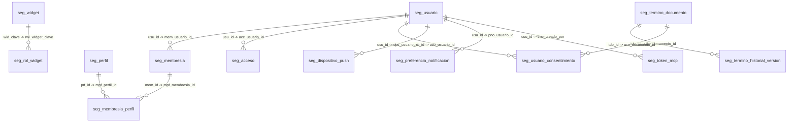
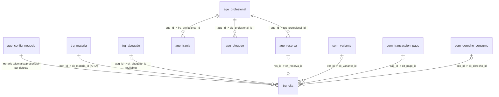
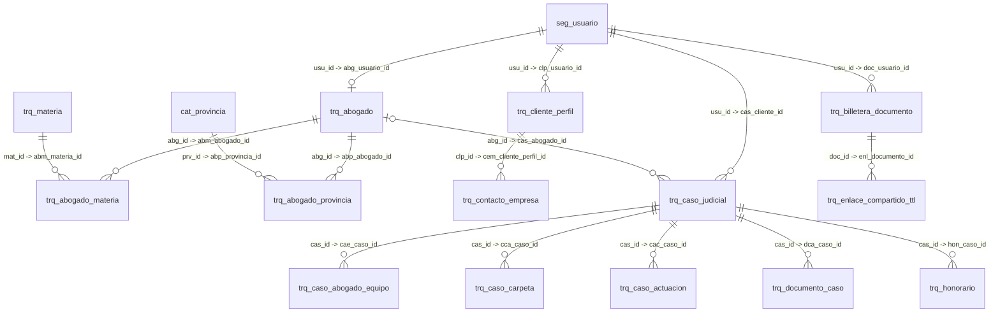

# Modelo de Datos Integral del Ecosistema (Esquemas, Tablas, Columnas, PK y FK)

Este documento describe la arquitectura completa de base de datos del **Ecosistema Multi-Negocio** (**Tranqi**, **FastFix Home**, **Tinkay** y **Margaritas Floristería**) sobre una única instancia **PostgreSQL 15+ en Supabase** multi-esquema. Incluye la explicación arquitectónica, las reglas de gobierno, los diagramas Entidad-Relación (ER) y el diccionario exhaustivo de los **10 esquemas y 93 tablas** con todas sus columnas, llaves primarias (`PK`), llaves foráneas (`FK`), nulabilidad, valores por defecto y restricciones.

---

## 1. Cómo Está Estructurado el Modelo de Datos

### 1.1 Arquitectura de Dos Capas (Plataforma Transversal vs. Dominio de Negocio)
El modelo de datos evita duplicar tablas entre negocios dividiendo la base de datos en dos niveles claramente delimitados (ver [`marco-de-trabajo.md`](marco-de-trabajo.md)):

1. **Esquemas Transversales de Plataforma (`comun_*`)**:
   - **Una sola identidad universal (`comun_seguridad`)**: Un usuario (`seg_usuario`, 1:1 con `auth.users`) se registra una única vez en el ecosistema y puede tener membresías (`seg_membresia`) y múltiples perfiles jerárquicos (`seg_membresia_perfil` -> `seg_perfil`) en cualquiera de los 4 negocios (`tranqi`, `fastfix`, `tinkay`, `margaritas`).
   - **Catálogo comercial y pagos unificados (`comun_comercio`, [ADR-0003](adr/0003-catalogo-comercial-unificado.md))**: Todo lo que se vende (servicios jurídicos, suscripciones, arreglos florales, mantenimientos técnicos) vive en `com_producto` y `com_variante`. Los cobros con tarjeta (Payphone / PagoPlux) se liquidan en `com_transaccion_pago` y las suscripciones/cupos en `com_suscripcion` y `com_derecho_consumo`.
   - **Motor de agenda transversal (`comun_agenda`, `PLT-020`)**: Separa los horarios de atención por defecto del negocio (`age_config_negocio` para consultas telemáticas y presenciales) y la disponibilidad individual de cada profesional (`age_profesional`, `age_franja`, `age_bloqueo`, `age_reserva` con restricción `EXCLUDE USING gist` anti-solape) de los detalles clínicos o jurídicos de la cita.
   - **Auditoría, Notificaciones, Configuración, Catálogo y Reclutamiento (`comun_auditoria`, `comun_notificacion`, `comun_configuracion`, `comun_catalogo`, `comun_reclutamiento`, `comun_tareas`)**: Servicios compartidos con aislamiento multi-tenant mediante la columna discriminadora `*_negocio`.

2. **Esquemas de Dominio por Negocio (`tranqui_legal`, `fastfix_mantenimiento`, `tinkay_floristeria`, `margaritas_floristeria`)**:
   - Contienen exclusivamente las entidades propias del giro de cada negocio.
   - En **Tranqi (`tranqui_legal`)**, las entidades jurídicas se enlazan con los esquemas comunes mediante llaves foráneas inter-esquema:
     - `trq_cita` se vincula a `tranqui_legal.trq_materia` (`cit_materia_id` clasificada por **ARIA**), a `tranqui_legal.trq_abogado` (`cit_abogado_id`, que puede ser `NULL` cuando se agenda en el horario por defecto del negocio sin abogado disponible, quedando en `cit_asignacion = 'contingencia'`), a `comun_agenda.age_reserva` (`cit_reserva_id`), a `comun_comercio.com_variante` (`cit_variante_id`) y a `comun_comercio.com_transaccion_pago` (`cit_pago_id`).
     - `trq_abogado` se vincula a `comun_seguridad.seg_usuario` (`abg_usuario_id`) y a `comun_agenda.age_profesional`.

### 1.2 Estándar de Nomenclatura y Reglas Innegociables (`00-nomenclatura-base-datos.md`)
- **Prefijo de tabla de 3 letras por esquema**: `seg_`, `aud_`, `cfg_`, `cat_`, `not_`, `rec_`, `com_`, `age_`, `tar_`, `trq_`.
- **Prefijo de columna de 3 letras por tabla**: Todas las columnas de una tabla comparten su prefijo único de 3 letras (ej. en `seg_usuario` todas inician con `usu_`; en `trq_cita` todas inician con `cit_`).
- **Llave Primaria (`PK`)**: Siempre `uuid` generada con `gen_random_uuid()`.
- **Columna JSONB de Extensibilidad**: Toda tabla incluye una columna `{prefijo}_detalle_{entidad} jsonb not null default '{}'::jsonb` para atributos flexibles sin requerir migraciones destructivas.
- **Trazabilidad y Borrado Lógico**: Columnas `*_creado_en`, `*_actualizado_en` y `*_eliminado_en` (`timestamptz`).
- **Seguridad RLS y Auditoría**: El 100% de las tablas tiene `ROW LEVEL SECURITY` habilitado y trigger `comun_auditoria.aud_fn_auditar_tabla()`.

---

## 2. Diagramas Entidad-Relación (ER) por Dominio

### 2.1 Identidad, Perfiles RBAC, Widgets y Consentimientos (`comun_seguridad`)

### 2.2 Agenda por Defecto, Clasificación ARIA, Citas y Pagos (`comun_agenda` + `tranqui_legal` + `comun_comercio`)

### 2.3 Dominio Legaltech Tranqi: Red de Abogados, CRM y Expedientes Judiciales (`tranqui_legal`)

---

## 3. Resumen General de Esquemas y Tablas

| Esquema | Prefijo | N.º Tablas | Propósito Principal |
| :--- | :---: | :---: | :--- |
| `comun_seguridad` | `seg_` | **15** | Identidad única (`seg_usuario` ↔ `auth.users`), membresías por negocio (`seg_membresia`), perfiles jerárquicos 1–100 (`seg_perfil`), matriz de widgets (`seg_widget`, `seg_rol_widget`), consentimientos LOPDP, accesos, OTPs y tokens MCP. |
| `comun_auditoria` | `aud_` | **2** | Bitácora inmutable de cambios en tablas (`aud_registro` vía trigger `aud_fn_auditar_tabla()`) y telemetría de invocaciones a APIs externas (`aud_log_api`). |
| `comun_configuracion` | `cfg_` | **2** | Identidad legal, contactos, redes y locales de los 4 negocios (`cfg_negocio`) y servidores SMTP por negocio con credenciales en Supabase Vault (`cfg_smtp`). |
| `comun_catalogo` | `cat_` | **1** | Catálogo oficial de las 24 provincias del Ecuador (`cat_provincia`, códigos INEC `01`–`24`). |
| `comun_notificacion` | `not_` | **2** | Campañas multicanal (`not_campana`) y bandeja de notificaciones por destinatario con telemetría de lectura, confirmación y posposición (`not_registro`). |
| `comun_notificaciones` | `not_` | **1** | Cola transaccional asíncrona de despacho de correos electrónicos (`not_cola_correo`). |
| `comun_reclutamiento` | `rec_` | **2** | Vacantes laborales (`rec_vacante`) y postulaciones de candidatos con adjuntos protegidos (`rec_postulacion`). |
| `comun_comercio` | `com_` | **33** | Catálogo comercial unificado (`com_categoria`, `com_producto`, `com_variante`), inventario/recetas/kardex/mermas, pasarelas Payphone/PagoPlux (`com_transaccion_pago`), suscripciones y derechos de consumo (`com_suscripcion`, `com_derecho_consumo`), convenios B2B, billetera virtual, cupones, campañas informativas y Compliance empresarial. |
| `comun_agenda` | `age_` | **5** | Horarios de atención por defecto del negocio (`age_config_negocio` para consultas telemáticas y presenciales) y disponibilidad individual por profesional (`age_profesional`, `age_franja`, `age_bloqueo`, `age_reserva` con `EXCLUDE USING gist` anti-solape). |
| `comun_tareas` | `tar_` | **1** | Bitácora idempotente de ejecuciones del despachador de alertas y recordatorios (`tar_ejecucion`). |
| `tranqui_legal` | `trq_` | **29** | Dominio Legaltech Tranqi: especialidades (`trq_materia`), red de socios abogados y contratos versionados (`trq_abogado`, `trq_solicitud_socio`, `trq_version_contrato_socio`), CRM jurídico (`trq_cliente_perfil`, `trq_prospecto`), expedientes judiciales LPMS (`trq_caso_judicial`, `trq_caso_*`), citas clasificadas por ARIA (`trq_cita`, `trq_consulta_rapida`), billetera documental TTL (`trq_billetera_documento`), archivo físico, Legal HR y conversaciones ARIA. |

---

## 4. Diccionario Detallado por Esquema, Tabla y Columna

### 1. Esquema `comun_seguridad` (Identidad, Roles RBAC, Widgets, MFA, Consentimientos y Tokens MCP)

- **Propietario:** Plataforma (`@eco/identidad`, `@eco/gestion-usuarios`)
- **Prefijo de tablas:** `seg_`
- **Descripción:** Gestiona la identidad única del usuario en todo el ecosistema (sincronizada con `auth.users`), sus membresías por negocio (`seg_membresia`), la asignación múltiple de perfiles con nivel jerárquico 1–100 (`seg_perfil`, `seg_membresia_perfil`), el catálogo y matriz de widgets por rol (`seg_widget`, `seg_rol_widget`), el versionamiento inmutable de términos LOPDP (`seg_termino_documento`, `seg_usuario_consentimiento`), historial de accesos (`seg_acceso`), OTPs y tokens MCP (`seg_token_mcp`).

#### Tabla `comun_seguridad.seg_usuario`
*Definida en:* [`supabase/migrations/20260727000002_comun_seguridad.sql`](../../supabase/migrations/20260727000002_comun_seguridad.sql)

| Columna | Tipo de Dato | Nulabilidad | Rol (`PK` / `FK`) | Valor por Defecto |
| :--- | :--- | :---: | :--- | :--- |
| `usu_id` | `uuid` | `NOT NULL` | 🔑 **PK** 🔗 **FK** → `auth.users(id)` | — |
| `usu_secuencial` | `bigint` | `NULL` | — | — |
| `usu_nombres` | `text` | `NULL` | — | — |
| `usu_apellidos` | `text` | `NULL` | — | — |
| `usu_correo` | `text` | `NOT NULL` | — | — |
| `usu_whatsapp` | `text` | `NULL` | — | — |
| `usu_cedula` | `text` | `NULL` | — | — |
| `usu_provincia_id` | `uuid` | `NULL` | — | — |
| `usu_ciudad_id` | `uuid` | `NULL` | — | — |
| `usu_superadmin_plataforma` | `boolean` | `NOT NULL` | — | `false` |
| `usu_detalle_usuario` | `jsonb` | `NOT NULL` | — | `'{}'::jsonb` |
| `usu_creado_en` | `timestamptz` | `NOT NULL` | — | `now()` |
| `usu_actualizado_en` | `timestamptz` | `NOT NULL` | — | `now()` |
| `usu_autorizacion_whatsapp` | `boolean` | `NOT NULL` | — | `false` |
| `usu_onboarding_completo` | `boolean` | `NOT NULL` | — | `false` |
| `usu_terminos_aceptados_en` | `timestamptz` | `NULL` | — | — |
| `usu_terminos_version` | `text` | `NULL` | — | — |
| `usu_eliminado_en` | `timestamptz` | `NULL` | — | — |
| `usu_correo_verificado_en` | `timestamptz` | `NULL` | — | — |

#### Tabla `comun_seguridad.seg_membresia`
*Definida en:* [`supabase/migrations/20260727000002_comun_seguridad.sql`](../../supabase/migrations/20260727000002_comun_seguridad.sql)

| Columna | Tipo de Dato | Nulabilidad | Rol (`PK` / `FK`) | Valor por Defecto |
| :--- | :--- | :---: | :--- | :--- |
| `mem_id` | `uuid` | `NOT NULL` | 🔑 **PK** | `gen_random_uuid()` |
| `mem_secuencial` | `bigint` | `NULL` | — | — |
| `mem_usuario_id` | `uuid` | `NOT NULL` | 🔗 **FK** → `comun_seguridad.seg_usuario(usu_id)` | — |
| `mem_negocio` | `text` | `NOT NULL` | — | — |
| `mem_rol` | `text` | `NOT NULL` | — | `'CLIENTE'` |
| `mem_estado` | `text` | `NOT NULL` | — | `'ACTIVO'` |
| `mem_fecha_registro` | `timestamptz` | `NOT NULL` | — | `now()` |
| `mem_detalle_membresia` | `jsonb` | `NOT NULL` | — | `'{}'::jsonb` |
| `mem_creado_en` | `timestamptz` | `NOT NULL` | — | `now()` |
| `mem_actualizado_en` | `timestamptz` | `NOT NULL` | — | `now()` |

**Restricciones adicionales de tabla (`UNIQUE` / `CHECK` / `EXCLUDE`):**
- `unique (mem_usuario_id, mem_negocio)`

#### Tabla `comun_seguridad.seg_widget`
*Definida en:* [`supabase/migrations/20260727000002_comun_seguridad.sql`](../../supabase/migrations/20260727000002_comun_seguridad.sql)

| Columna | Tipo de Dato | Nulabilidad | Rol (`PK` / `FK`) | Valor por Defecto |
| :--- | :--- | :---: | :--- | :--- |
| `wdg_id` | `uuid` | `NOT NULL` | 🔑 **PK** | `gen_random_uuid()` |
| `wdg_secuencial` | `bigint` | `NULL` | — | — |
| `wdg_negocio` | `text` | `NOT NULL` | — | — |
| `wdg_clave` | `text` | `NOT NULL` | — | — |
| `wdg_nombre` | `text` | `NOT NULL` | — | — |
| `wdg_activo` | `boolean` | `NOT NULL` | — | `true` |
| `wdg_detalle_widget` | `jsonb` | `NOT NULL` | — | `'{}'::jsonb` |
| `wdg_creado_en` | `timestamptz` | `NOT NULL` | — | `now()` |
| `wdg_actualizado_en` | `timestamptz` | `NOT NULL` | — | `now()` |

**Restricciones adicionales de tabla (`UNIQUE` / `CHECK` / `EXCLUDE`):**
- `unique (wdg_negocio, wdg_clave)`

#### Tabla `comun_seguridad.seg_rol_widget`
*Definida en:* [`supabase/migrations/20260727000002_comun_seguridad.sql`](../../supabase/migrations/20260727000002_comun_seguridad.sql)

| Columna | Tipo de Dato | Nulabilidad | Rol (`PK` / `FK`) | Valor por Defecto |
| :--- | :--- | :---: | :--- | :--- |
| `rlw_id` | `uuid` | `NOT NULL` | 🔑 **PK** | `gen_random_uuid()` |
| `rlw_secuencial` | `bigint` | `NULL` | — | — |
| `rlw_negocio` | `text` | `NOT NULL` | — | — |
| `rlw_rol` | `text` | `NOT NULL` | — | — |
| `rlw_widget_id` | `uuid` | `NOT NULL` | 🔗 **FK** → `comun_seguridad.seg_widget(wdg_id)` | — |
| `rlw_visible` | `boolean` | `NOT NULL` | — | `true` |
| `rlw_creado_en` | `timestamptz` | `NOT NULL` | — | `now()` |
| `rlw_actualizado_en` | `timestamptz` | `NOT NULL` | — | `now()` |

**Restricciones adicionales de tabla (`UNIQUE` / `CHECK` / `EXCLUDE`):**
- `unique (rlw_negocio, rlw_rol, rlw_widget_id)`

#### Tabla `comun_seguridad.seg_acceso`
*Definida en:* [`supabase/migrations/20260727000011_seg_acceso.sql`](../../supabase/migrations/20260727000011_seg_acceso.sql)

| Columna | Tipo de Dato | Nulabilidad | Rol (`PK` / `FK`) | Valor por Defecto |
| :--- | :--- | :---: | :--- | :--- |
| `acc_id` | `uuid` | `NOT NULL` | 🔑 **PK** | `gen_random_uuid()` |
| `acc_secuencial` | `bigint` | `NULL` | — | — |
| `acc_usuario_id` | `uuid` | `NOT NULL` | 🔗 **FK** → `comun_seguridad.seg_usuario(usu_id)` | — |
| `acc_ip` | `text` | `NULL` | — | — |
| `acc_user_agent` | `text` | `NULL` | — | — |
| `acc_creado_en` | `timestamptz` | `NOT NULL` | — | `now()` |
| `acc_negocio` | `text` | `NULL` | — | — |

#### Tabla `comun_seguridad.seg_otp_correo`
*Definida en:* [`supabase/migrations/20260729000001_otp_registro_correo.sql`](../../supabase/migrations/20260729000001_otp_registro_correo.sql)

| Columna | Tipo de Dato | Nulabilidad | Rol (`PK` / `FK`) | Valor por Defecto |
| :--- | :--- | :---: | :--- | :--- |
| `otp_id` | `uuid` | `NOT NULL` | 🔑 **PK** | `gen_random_uuid()` |
| `otp_secuencial` | `bigint` | `NULL` | — | — |
| `otp_usuario_id` | `uuid` | `NOT NULL` | 🔗 **FK** → `comun_seguridad.seg_usuario(usu_id)` | — |
| `otp_codigo_hash` | `text` | `NOT NULL` | — | — |
| `otp_expira_en` | `timestamptz` | `NOT NULL` | — | — |
| `otp_intentos` | `int` | `NOT NULL` | — | `0` |
| `otp_verificado_en` | `timestamptz` | `NULL` | — | — |
| `otp_creado_en` | `timestamptz` | `NOT NULL` | — | `now()` |

#### Tabla `comun_seguridad.seg_recuperacion_correo`
*Definida en:* [`supabase/migrations/20260730000001_recuperacion_contrasena.sql`](../../supabase/migrations/20260730000001_recuperacion_contrasena.sql)

| Columna | Tipo de Dato | Nulabilidad | Rol (`PK` / `FK`) | Valor por Defecto |
| :--- | :--- | :---: | :--- | :--- |
| `rec_id` | `uuid` | `NOT NULL` | 🔑 **PK** | `gen_random_uuid()` |
| `rec_secuencial` | `bigint` | `NULL` | — | — |
| `rec_usuario_id` | `uuid` | `NOT NULL` | 🔗 **FK** → `comun_seguridad.seg_usuario(usu_id)` | — |
| `rec_token_hash` | `text` | `NOT NULL` | — | — |
| `rec_expira_en` | `timestamptz` | `NOT NULL` | — | — |
| `rec_usado_en` | `timestamptz` | `NULL` | — | — |
| `rec_creado_en` | `timestamptz` | `NOT NULL` | — | `now()` |

#### Tabla `comun_seguridad.seg_perfil`
*Definida en:* [`supabase/migrations/20260731000002_plt003_perfiles_multiples_y_jerarquia.sql`](../../supabase/migrations/20260731000002_plt003_perfiles_multiples_y_jerarquia.sql)

| Columna | Tipo de Dato | Nulabilidad | Rol (`PK` / `FK`) | Valor por Defecto |
| :--- | :--- | :---: | :--- | :--- |
| `per_id` | `uuid` | `NOT NULL` | 🔑 **PK** | `gen_random_uuid()` |
| `per_secuencial` | `bigint` | `NULL` | — | — |
| `per_clave` | `text` | `NOT NULL` | — | — |
| `per_nombre` | `text` | `NOT NULL` | — | — |
| `per_nivel` | `integer` | `NOT NULL` | — | — |
| `per_asignable` | `boolean` | `NOT NULL` | — | `true` |
| `per_activo` | `boolean` | `NOT NULL` | — | `true` |
| `per_detalle_perfil` | `jsonb` | `NOT NULL` | — | `'{}'::jsonb` |
| `per_creado_en` | `timestamptz` | `NOT NULL` | — | `now()` |
| `per_actualizado_en` | `timestamptz` | `NOT NULL` | — | `now()` |

#### Tabla `comun_seguridad.seg_membresia_perfil`
*Definida en:* [`supabase/migrations/20260731000002_plt003_perfiles_multiples_y_jerarquia.sql`](../../supabase/migrations/20260731000002_plt003_perfiles_multiples_y_jerarquia.sql)

| Columna | Tipo de Dato | Nulabilidad | Rol (`PK` / `FK`) | Valor por Defecto |
| :--- | :--- | :---: | :--- | :--- |
| `mpe_id` | `uuid` | `NOT NULL` | 🔑 **PK** | `gen_random_uuid()` |
| `mpe_secuencial` | `bigint` | `NULL` | — | — |
| `mpe_membresia_id` | `uuid` | `NOT NULL` | 🔗 **FK** → `comun_seguridad.seg_membresia(mem_id)` | — |
| `mpe_perfil_id` | `uuid` | `NOT NULL` | 🔗 **FK** → `comun_seguridad.seg_perfil(per_id)` | — |
| `mpe_asignado_por` | `uuid` | `NULL` | 🔗 **FK** → `comun_seguridad.seg_usuario(usu_id)` | — |
| `mpe_detalle_membresia_perfil` | `jsonb` | `NOT NULL` | — | `'{}'::jsonb` |
| `mpe_creado_en` | `timestamptz` | `NOT NULL` | — | `now()` |
| `mpe_actualizado_en` | `timestamptz` | `NOT NULL` | — | `now()` |

**Restricciones adicionales de tabla (`UNIQUE` / `CHECK` / `EXCLUDE`):**
- `unique (mpe_membresia_id, mpe_perfil_id)`

#### Tabla `comun_seguridad.seg_dispositivo_push`
*Definida en:* [`supabase/migrations/20260802000001_comun_notificacion.sql`](../../supabase/migrations/20260802000001_comun_notificacion.sql)

| Columna | Tipo de Dato | Nulabilidad | Rol (`PK` / `FK`) | Valor por Defecto |
| :--- | :--- | :---: | :--- | :--- |
| `dsp_id` | `UUID` | `NOT NULL` | 🔑 **PK** | `gen_random_uuid()` |
| `dsp_secuencial` | `BIGINT` | `NULL` | — | — |
| `dsp_usuario_id` | `UUID` | `NOT NULL` | 🔗 **FK** → `comun_seguridad.seg_usuario(usu_id)` | — |
| `dsp_token_push` | `TEXT` | `NOT NULL` | — | — |
| `dsp_plataforma` | `VARCHAR(20)` | `NOT NULL` | — | — |
| `dsp_activo` | `BOOLEAN` | `NOT NULL` | — | `TRUE` |
| `dsp_detalles` | `JSONB` | `NULL` | — | `'{}'::jsonb` |
| `dsp_creado_en` | `TIMESTAMPTZ` | `NOT NULL` | — | `NOW()` |
| `dsp_actualizado_en` | `TIMESTAMPTZ` | `NOT NULL` | — | `NOW()` |

**Restricciones adicionales de tabla (`UNIQUE` / `CHECK` / `EXCLUDE`):**
- `UNIQUE(dsp_usuario_id, dsp_token_push)`

#### Tabla `comun_seguridad.seg_preferencia_notificacion`
*Definida en:* [`supabase/migrations/20260802000001_comun_notificacion.sql`](../../supabase/migrations/20260802000001_comun_notificacion.sql)

| Columna | Tipo de Dato | Nulabilidad | Rol (`PK` / `FK`) | Valor por Defecto |
| :--- | :--- | :---: | :--- | :--- |
| `pfn_id` | `UUID` | `NOT NULL` | 🔑 **PK** | `gen_random_uuid()` |
| `pfn_secuencial` | `BIGINT` | `NULL` | — | — |
| `pfn_usuario_id` | `UUID` | `NOT NULL` | 🔗 **FK** → `comun_seguridad.seg_usuario(usu_id)` | — |
| `pfn_negocio` | `VARCHAR(10)` | `NOT NULL` | — | — |
| `pfn_canal_email` | `BOOLEAN` | `NOT NULL` | — | `TRUE` |
| `pfn_canal_push` | `BOOLEAN` | `NOT NULL` | — | `TRUE` |
| `pfn_canal_in_app` | `BOOLEAN` | `NOT NULL` | — | `TRUE` |
| `pfn_silenciado_hasta` | `TIMESTAMPTZ` | `NULL` | — | — |
| `pfn_detalles` | `JSONB` | `NULL` | — | `'{}'::jsonb` |
| `pfn_creado_en` | `TIMESTAMPTZ` | `NOT NULL` | — | `NOW()` |
| `pfn_actualizado_en` | `TIMESTAMPTZ` | `NOT NULL` | — | `NOW()` |

**Restricciones adicionales de tabla (`UNIQUE` / `CHECK` / `EXCLUDE`):**
- `UNIQUE(pfn_usuario_id, pfn_negocio)`

#### Tabla `comun_seguridad.seg_token_mcp`
*Definida en:* [`supabase/migrations/20260916000001_comun_seguridad_tokens_mcp.sql`](../../supabase/migrations/20260916000001_comun_seguridad_tokens_mcp.sql)

| Columna | Tipo de Dato | Nulabilidad | Rol (`PK` / `FK`) | Valor por Defecto |
| :--- | :--- | :---: | :--- | :--- |
| `tkn_id` | `uuid` | `NOT NULL` | 🔑 **PK** | `gen_random_uuid()` |
| `tkn_secuencial` | `bigint` | `NULL` | — | — |
| `tkn_negocio_id` | `text` | `NOT NULL` | — | — |
| `tkn_nombre` | `text` | `NOT NULL` | — | — |
| `tkn_prefijo` | `text` | `NOT NULL` | — | — |
| `tkn_hash_secreto` | `text` | `NOT NULL` | — | — |
| `tkn_alcances` | `jsonb` | `NOT NULL` | — | `'["catalogo:leer"]'::jsonb` |
| `tkn_expira_en` | `timestamptz` | `NULL` | — | — |
| `tkn_ultimo_uso_en` | `timestamptz` | `NULL` | — | — |
| `tkn_revocado_en` | `timestamptz` | `NULL` | — | — |
| `tkn_detalle_token` | `jsonb` | `NOT NULL` | — | `'{}'::jsonb` |
| `tkn_creado_por` | `uuid` | `NULL` | 🔗 **FK** → `comun_seguridad.seg_usuario(usu_id)` | — |
| `tkn_creado_en` | `timestamptz` | `NOT NULL` | — | `now()` |
| `tkn_actualizado_en` | `timestamptz` | `NOT NULL` | — | `now()` |

#### Tabla `comun_seguridad.seg_termino_documento`
*Definida en:* [`supabase/migrations/20260925000004_comun_seguridad_terminos_versionamiento_y_consentimientos.sql`](../../supabase/migrations/20260925000004_comun_seguridad_terminos_versionamiento_y_consentimientos.sql)

| Columna | Tipo de Dato | Nulabilidad | Rol (`PK` / `FK`) | Valor por Defecto |
| :--- | :--- | :---: | :--- | :--- |
| `ted_id` | `UUID` | `NOT NULL` | 🔑 **PK** | `gen_random_uuid()` |
| `ted_negocio` | `TEXT` | `NOT NULL` | — | — |
| `ted_clave` | `TEXT` | `NOT NULL` | — | — |
| `ted_titulo` | `TEXT` | `NOT NULL` | — | — |
| `ted_tipo` | `TEXT` | `NOT NULL` | — | `'terminos'` |
| `ted_version_actual` | `TEXT` | `NOT NULL` | — | `'v1.0.0'` |
| `ted_fecha_vigencia` | `DATE` | `NOT NULL` | — | `CURRENT_DATE` |
| `ted_requiere_aceptacion` | `BOOLEAN` | `NOT NULL` | — | `true` |
| `ted_contenido_markdown` | `TEXT` | `NOT NULL` | — | — |
| `ted_activo` | `BOOLEAN` | `NOT NULL` | — | `true` |
| `ted_creado_en` | `TIMESTAMPTZ` | `NOT NULL` | — | `clock_timestamp()` |
| `ted_actualizado_en` | `TIMESTAMPTZ` | `NOT NULL` | — | `clock_timestamp()` |
| `ted_detalle_documento` | `JSONB` | `NOT NULL` | — | `'{}'::jsonb` |

**Restricciones adicionales de tabla (`UNIQUE` / `CHECK` / `EXCLUDE`):**
- `CONSTRAINT uq_seg_termino_negocio_clave UNIQUE (ted_negocio, ted_clave)`

#### Tabla `comun_seguridad.seg_termino_historial_version`
*Definida en:* [`supabase/migrations/20260925000004_comun_seguridad_terminos_versionamiento_y_consentimientos.sql`](../../supabase/migrations/20260925000004_comun_seguridad_terminos_versionamiento_y_consentimientos.sql)

| Columna | Tipo de Dato | Nulabilidad | Rol (`PK` / `FK`) | Valor por Defecto |
| :--- | :--- | :---: | :--- | :--- |
| `thv_id` | `UUID` | `NOT NULL` | 🔑 **PK** | `gen_random_uuid()` |
| `thv_documento_id` | `UUID` | `NULL` | 🔗 **FK** → `comun_seguridad.seg_termino_documento(ted_id)` | — |
| `thv_negocio` | `TEXT` | `NOT NULL` | — | — |
| `thv_clave` | `TEXT` | `NOT NULL` | — | — |
| `thv_version` | `TEXT` | `NOT NULL` | — | — |
| `thv_titulo` | `TEXT` | `NOT NULL` | — | — |
| `thv_fecha_vigencia` | `DATE` | `NOT NULL` | — | `CURRENT_DATE` |
| `thv_requiere_aceptacion` | `BOOLEAN` | `NOT NULL` | — | `true` |
| `thv_contenido_markdown` | `TEXT` | `NOT NULL` | — | — |
| `thv_notas_cambio` | `TEXT` | `NULL` | — | — |
| `thv_creado_por` | `UUID` | `NULL` | 🔗 **FK** → `auth.users(id)` | — |
| `thv_creado_en` | `TIMESTAMPTZ` | `NOT NULL` | — | `clock_timestamp()` |
| `thv_detalle_version` | `JSONB` | `NOT NULL` | — | `'{}'::jsonb` |

#### Tabla `comun_seguridad.seg_usuario_consentimiento`
*Definida en:* [`supabase/migrations/20260925000004_comun_seguridad_terminos_versionamiento_y_consentimientos.sql`](../../supabase/migrations/20260925000004_comun_seguridad_terminos_versionamiento_y_consentimientos.sql)

| Columna | Tipo de Dato | Nulabilidad | Rol (`PK` / `FK`) | Valor por Defecto |
| :--- | :--- | :---: | :--- | :--- |
| `usc_id` | `UUID` | `NOT NULL` | 🔑 **PK** | `gen_random_uuid()` |
| `usc_usuario_id` | `UUID` | `NOT NULL` | 🔗 **FK** → `auth.users(id)` | — |
| `usc_negocio` | `TEXT` | `NOT NULL` | — | — |
| `usc_clave_documento` | `TEXT` | `NOT NULL` | — | — |
| `usc_version` | `TEXT` | `NOT NULL` | — | — |
| `usc_estado` | `TEXT` | `NOT NULL` | — | `'ACEPTADO'` |
| `usc_fecha_accion` | `TIMESTAMPTZ` | `NOT NULL` | — | `clock_timestamp()` |
| `usc_ip` | `TEXT` | `NULL` | — | — |
| `usc_user_agent` | `TEXT` | `NULL` | — | — |
| `usc_hash_contenido` | `TEXT` | `NULL` | — | — |
| `usc_metadatos` | `JSONB` | `NOT NULL` | — | `'{}'::jsonb` |
| `usc_detalle_consentimiento` | `JSONB` | `NOT NULL` | — | `'{}'::jsonb` |

---

### 2. Esquema `comun_auditoria` (Trazabilidad Inmutable BDD y Telemetría de APIs)

- **Propietario:** Plataforma (`@eco/auditoria`)
- **Prefijo de tablas:** `aud_`
- **Descripción:** Almacena de forma inmutable (solo inserción vía trigger `aud_fn_auditar_tabla()`, sin permisos de `UPDATE` ni `DELETE`) cada cambio (`INSERT`, `UPDATE`, `DELETE`) ocurrido en las tablas de negocio con el snapshot JSONB anterior y nuevo (`aud_registro`), además de la telemetría de invocaciones a APIs externas (`aud_log_api`).

#### Tabla `comun_auditoria.aud_registro`
*Definida en:* [`supabase/migrations/20260727000001_comun_auditoria.sql`](../../supabase/migrations/20260727000001_comun_auditoria.sql)

| Columna | Tipo de Dato | Nulabilidad | Rol (`PK` / `FK`) | Valor por Defecto |
| :--- | :--- | :---: | :--- | :--- |
| `reg_id` | `uuid` | `NOT NULL` | 🔑 **PK** | `gen_random_uuid()` |
| `reg_secuencial` | `bigint` | `NULL` | — | — |
| `reg_esquema` | `text` | `NOT NULL` | — | — |
| `reg_tabla` | `text` | `NOT NULL` | — | — |
| `reg_operacion` | `text` | `NOT NULL` | — | — |
| `reg_usuario_id` | `uuid` | `NULL` | — | — |
| `reg_datos_anteriores` | `jsonb` | `NULL` | — | — |
| `reg_datos_nuevos` | `jsonb` | `NULL` | — | — |
| `reg_detalle_registro` | `jsonb` | `NOT NULL` | — | `'{}'::jsonb` |
| `reg_creado_en` | `timestamptz` | `NOT NULL` | — | `now()` |

#### Tabla `comun_auditoria.aud_log_api`
*Definida en:* [`supabase/migrations/20260727000001_comun_auditoria.sql`](../../supabase/migrations/20260727000001_comun_auditoria.sql)

| Columna | Tipo de Dato | Nulabilidad | Rol (`PK` / `FK`) | Valor por Defecto |
| :--- | :--- | :---: | :--- | :--- |
| `log_id` | `uuid` | `NOT NULL` | 🔑 **PK** | `gen_random_uuid()` |
| `log_secuencial` | `bigint` | `NULL` | — | — |
| `log_ruta` | `text` | `NOT NULL` | — | — |
| `log_metodo` | `text` | `NOT NULL` | — | — |
| `log_status_code` | `int` | `NULL` | — | — |
| `log_usuario_id` | `uuid` | `NULL` | — | — |
| `log_detalle_log` | `jsonb` | `NOT NULL` | — | `'{}'::jsonb` |
| `log_creado_en` | `timestamptz` | `NOT NULL` | — | `now()` |

---

### 3. Esquema `comun_configuracion` (Parámetros de Negocio y Servidores SMTP)

- **Propietario:** Plataforma (`@eco/configuracion-negocio`)
- **Prefijo de tablas:** `cfg_`
- **Descripción:** Centraliza la identidad corporativa, RUC, razón social, contactos, redes sociales y locales de cada uno de los 4 negocios (`cfg_negocio`), así como la configuración SMTP por negocio con secretos custodiados en Supabase Vault (`cfg_smtp`).

#### Tabla `comun_configuracion.cfg_negocio`
*Definida en:* [`supabase/migrations/20260727000003_comun_configuracion.sql`](../../supabase/migrations/20260727000003_comun_configuracion.sql)

| Columna | Tipo de Dato | Nulabilidad | Rol (`PK` / `FK`) | Valor por Defecto |
| :--- | :--- | :---: | :--- | :--- |
| `cfg_id` | `uuid` | `NOT NULL` | 🔑 **PK** | `gen_random_uuid()` |
| `cfg_secuencial` | `bigint` | `NULL` | — | — |
| `cfg_negocio` | `text` | `NOT NULL` | — | — |
| `cfg_identificacion` | `text` | `NULL` | — | — |
| `cfg_nombre_comercial` | `text` | `NULL` | — | — |
| `cfg_razon_social` | `text` | `NULL` | — | — |
| `cfg_detalle_configuracion` | `jsonb` | `NOT NULL` | — | `'{}'::jsonb` |
| `cfg_creado_en` | `timestamptz` | `NOT NULL` | — | `now()` |
| `cfg_actualizado_en` | `timestamptz` | `NOT NULL` | — | `now()` |

#### Tabla `comun_configuracion.cfg_smtp`
*Definida en:* [`supabase/migrations/20260730000006_cfg_smtp_por_negocio.sql`](../../supabase/migrations/20260730000006_cfg_smtp_por_negocio.sql)

| Columna | Tipo de Dato | Nulabilidad | Rol (`PK` / `FK`) | Valor por Defecto |
| :--- | :--- | :---: | :--- | :--- |
| `smt_id` | `uuid` | `NOT NULL` | 🔑 **PK** | `gen_random_uuid()` |
| `smt_secuencial` | `bigint` | `NULL` | — | — |
| `smt_negocio` | `text` | `NOT NULL` | 🔗 **FK** → `comun_configuracion.cfg_negocio(cfg_negocio)` | — |
| `smt_host` | `text` | `NULL` | — | — |
| `smt_puerto` | `integer` | `NOT NULL` | — | `465` |
| `smt_seguro` | `boolean` | `NOT NULL` | — | `true` |
| `smt_usuario` | `text` | `NULL` | — | — |
| `smt_remitente_nombre` | `text` | `NULL` | — | — |
| `smt_secreto_id` | `uuid` | `NULL` | — | — |
| `smt_activo` | `boolean` | `NOT NULL` | — | `false` |
| `smt_detalle_smtp` | `jsonb` | `NOT NULL` | — | `'{}'::jsonb` |
| `smt_creado_en` | `timestamptz` | `NOT NULL` | — | `now()` |
| `smt_actualizado_en` | `timestamptz` | `NOT NULL` | — | `now()` |

---

### 4. Esquema `comun_catalogo` (Catálogos Geográficos y Transversales)

- **Propietario:** Plataforma
- **Prefijo de tablas:** `cat_`
- **Descripción:** Contiene los catálogos maestros compartidos por todos los negocios, iniciando con las 24 provincias de la República del Ecuador (`cat_provincia`, códigos INEC `01` a `24`) utilizadas para cobertura de abogados, envíos y facturación.

#### Tabla `comun_catalogo.cat_provincia`
*Definida en:* [`supabase/migrations/20260728000001_comun_catalogo_provincia.sql`](../../supabase/migrations/20260728000001_comun_catalogo_provincia.sql)

| Columna | Tipo de Dato | Nulabilidad | Rol (`PK` / `FK`) | Valor por Defecto |
| :--- | :--- | :---: | :--- | :--- |
| `cat_id` | `uuid` | `NOT NULL` | 🔑 **PK** | `gen_random_uuid()` |
| `cat_nombre` | `text` | `NOT NULL` | — | — |
| `cat_creado_en` | `timestamptz` | `NOT NULL` | — | `now()` |

---

### 5. Esquema `comun_notificacion` y `comun_notificaciones` (Despacho Multicanal In-App, Push, Email y WhatsApp)

- **Propietario:** Plataforma (`@eco/notificaciones`)
- **Prefijo de tablas:** `not_`
- **Descripción:** Gestiona las campañas de comunicación (`not_campana`), la bandeja e historial por destinatario con telemetría de lectura/confirmación/posposición (`not_registro`) y la cola asíncrona de despacho de correos transaccionales (`not_cola_correo`).

#### Tabla `comun_notificacion.not_campana`
*Definida en:* [`supabase/migrations/20260802000001_comun_notificacion.sql`](../../supabase/migrations/20260802000001_comun_notificacion.sql)

| Columna | Tipo de Dato | Nulabilidad | Rol (`PK` / `FK`) | Valor por Defecto |
| :--- | :--- | :---: | :--- | :--- |
| `cmp_id` | `UUID` | `NOT NULL` | 🔑 **PK** | `gen_random_uuid()` |
| `cmp_secuencial` | `BIGINT` | `NULL` | — | — |
| `cmp_negocio` | `VARCHAR(10)` | `NOT NULL` | — | — |
| `cmp_emisor_id` | `UUID` | `NOT NULL` | 🔗 **FK** → `comun_seguridad.seg_usuario(usu_id)` | — |
| `cmp_tipo_audiencia` | `VARCHAR(20)` | `NOT NULL` | — | — |
| `cmp_roles_jsonb` | `JSONB` | `NULL` | — | `'[]'::jsonb` |
| `cmp_usuarios_jsonb` | `JSONB` | `NULL` | — | `'[]'::jsonb` |
| `cmp_canales_jsonb` | `JSONB` | `NOT NULL` | — | `'["IN_APP"]'::jsonb` |
| `cmp_asunto` | `TEXT` | `NOT NULL` | — | — |
| `cmp_cuerpo_html` | `TEXT` | `NOT NULL` | — | — |
| `cmp_cuerpo_markdown` | `TEXT` | `NULL` | — | — |
| `cmp_estado` | `VARCHAR(20)` | `NOT NULL` | — | `'EMITIDA'` |
| `cmp_metricas_jsonb` | `JSONB` | `NULL` | — | `'{"total_enviados": 0, "total_leidos": 0, "total_fallidos": 0}'::jsonb` |
| `cmp_detalles` | `JSONB` | `NULL` | — | `'{}'::jsonb` |
| `cmp_creado_en` | `TIMESTAMPTZ` | `NOT NULL` | — | `NOW()` |

#### Tabla `comun_notificacion.not_registro`
*Definida en:* [`supabase/migrations/20260802000001_comun_notificacion.sql`](../../supabase/migrations/20260802000001_comun_notificacion.sql)

| Columna | Tipo de Dato | Nulabilidad | Rol (`PK` / `FK`) | Valor por Defecto |
| :--- | :--- | :---: | :--- | :--- |
| `not_id` | `UUID` | `NOT NULL` | 🔑 **PK** | `gen_random_uuid()` |
| `not_secuencial` | `BIGINT` | `NULL` | — | — |
| `not_campana_id` | `UUID` | `NULL` | 🔗 **FK** → `comun_notificacion.not_campana(cmp_id)` | — |
| `not_usuario_id` | `UUID` | `NOT NULL` | 🔗 **FK** → `comun_seguridad.seg_usuario(usu_id)` | — |
| `not_negocio` | `VARCHAR(10)` | `NOT NULL` | — | — |
| `not_canal` | `VARCHAR(20)` | `NOT NULL` | — | — |
| `not_titulo` | `TEXT` | `NOT NULL` | — | — |
| `not_contenido_html` | `TEXT` | `NOT NULL` | — | — |
| `not_url_accion` | `TEXT` | `NULL` | — | — |
| `not_leido_en` | `TIMESTAMPTZ` | `NULL` | — | — |
| `not_detalles` | `JSONB` | `NULL` | — | `'{}'::jsonb` |
| `not_creado_en` | `TIMESTAMPTZ` | `NOT NULL` | — | `NOW()` |

---

### Esquema `comun_notificaciones`

- **Propietario:** Plataforma
- **Prefijo de tablas:** `not_`
- **Descripción:** Cola de despacho de correo transaccional.

#### Tabla `comun_notificaciones.not_cola_correo`
*Definida en:* [`supabase/migrations/20260728000006_socios_auditoria_notificaciones.sql`](../../supabase/migrations/20260728000006_socios_auditoria_notificaciones.sql)

| Columna | Tipo de Dato | Nulabilidad | Rol (`PK` / `FK`) | Valor por Defecto |
| :--- | :--- | :---: | :--- | :--- |
| `not_id` | `uuid` | `NOT NULL` | 🔑 **PK** | `gen_random_uuid()` |
| `not_secuencial` | `bigint` | `NULL` | — | — |
| `not_negocio` | `text` | `NOT NULL` | — | — |
| `not_destinatario_usuario_id` | `uuid` | `NULL` | 🔗 **FK** → `comun_seguridad.seg_usuario(usu_id)` | — |
| `not_destinatario_correo` | `text` | `NOT NULL` | — | — |
| `not_plantilla` | `text` | `NOT NULL` | — | — |
| `not_asunto` | `text` | `NOT NULL` | — | — |
| `not_datos` | `jsonb` | `NOT NULL` | — | `'{}'::jsonb` |
| `not_estado` | `text` | `NOT NULL` | — | `'pendiente'` |
| `not_intentos` | `int` | `NOT NULL` | — | `0` |
| `not_error` | `text` | `NULL` | — | — |
| `not_creado_en` | `timestamptz` | `NOT NULL` | — | `now()` |
| `not_enviado_en` | `timestamptz` | `NULL` | — | — |

---

### 6. Esquema `comun_reclutamiento` (Bolsa de Empleo y Postulaciones de Talento)

- **Propietario:** Plataforma (`PLT-019`)
- **Prefijo de tablas:** `rec_`
- **Descripción:** Soporta la publicación de vacantes laborales por negocio (`rec_vacante`) y la recepción de postulaciones con CV y documentos adjuntos protegidos bajo LOPDP (`rec_postulacion`).

#### Tabla `comun_reclutamiento.rec_vacante`
*Definida en:* [`supabase/migrations/20260805000001_comun_reclutamiento.sql`](../../supabase/migrations/20260805000001_comun_reclutamiento.sql)

| Columna | Tipo de Dato | Nulabilidad | Rol (`PK` / `FK`) | Valor por Defecto |
| :--- | :--- | :---: | :--- | :--- |
| `vac_id` | `UUID` | `NOT NULL` | 🔑 **PK** | `gen_random_uuid()` |
| `vac_secuencial` | `BIGINT` | `NULL` | — | — |
| `vac_negocio` | `VARCHAR(10)` | `NOT NULL` | — | — |
| `vac_titulo` | `VARCHAR(255)` | `NOT NULL` | — | — |
| `vac_tipo_contrato` | `VARCHAR(100)` | `NOT NULL` | — | `'TIEMPO_COMPLETO'` |
| `vac_estado` | `VARCHAR(20)` | `NOT NULL` | — | `'PUBLICADA'` |
| `vac_notificar_email` | `BOOLEAN` | `NOT NULL` | — | `TRUE` |
| `vac_notificar_push` | `BOOLEAN` | `NOT NULL` | — | `TRUE` |
| `vac_detalles` | `JSONB` | `NOT NULL` | — | `'{}'::jsonb` |
| `vac_creado_en` | `TIMESTAMPTZ` | `NOT NULL` | — | `NOW()` |
| `vac_actualizado_en` | `TIMESTAMPTZ` | `NOT NULL` | — | `NOW()` |

#### Tabla `comun_reclutamiento.rec_postulacion`
*Definida en:* [`supabase/migrations/20260805000001_comun_reclutamiento.sql`](../../supabase/migrations/20260805000001_comun_reclutamiento.sql)

| Columna | Tipo de Dato | Nulabilidad | Rol (`PK` / `FK`) | Valor por Defecto |
| :--- | :--- | :---: | :--- | :--- |
| `pos_id` | `UUID` | `NOT NULL` | 🔑 **PK** | `gen_random_uuid()` |
| `pos_secuencial` | `BIGINT` | `NULL` | — | — |
| `pos_negocio` | `VARCHAR(10)` | `NOT NULL` | — | — |
| `pos_vacante_id` | `UUID` | `NULL` | 🔗 **FK** → `comun_reclutamiento.rec_vacante(vac_id)` | — |
| `pos_usuario_id` | `UUID` | `NOT NULL` | 🔗 **FK** → `comun_seguridad.seg_usuario(usu_id)` | — |
| `pos_estado` | `VARCHAR(30)` | `NOT NULL` | — | `'NUEVO'` |
| `pos_cv_url` | `TEXT` | `NOT NULL` | — | — |
| `pos_documentos_urls` | `JSONB` | `NOT NULL` | — | `'[]'::jsonb` |
| `pos_consentimiento_lopdp` | `BOOLEAN` | `NOT NULL` | — | `TRUE` |
| `pos_detalles` | `JSONB` | `NOT NULL` | — | `'{}'::jsonb` |
| `pos_creado_en` | `TIMESTAMPTZ` | `NOT NULL` | — | `NOW()` |
| `pos_actualizado_en` | `TIMESTAMPTZ` | `NOT NULL` | — | `NOW()` |

---

### 7. Esquema `comun_comercio` (Catálogo Unificado, Pasarelas Payphone/Plux, Suscripciones, Convenios B2B y Compliance)

- **Propietario:** Plataforma (`@eco/comercio`, ADR-0003)
- **Prefijo de tablas:** `com_`
- **Descripción:** Implementa el Catálogo Comercial Unificado para los 4 negocios (ningún negocio tiene tablas de catálogo aisladas). Incluye categorías (`com_categoria`), productos (`com_producto`), variantes y precios con IVA SRI (`com_variante`), inventario y recetas florales (`com_insumo`, `com_receta`, `com_inventario`, `com_kardex`, `com_merma`), proformas (`com_proforma`), configuración y transacciones de pasarela Payphone/PagoPlux (`com_pasarela_configuracion`, `com_transaccion_pago`), suscripciones y derechos de consumo (`com_suscripcion`, `com_derecho_consumo`), convenios corporativos B2B (`com_convenio_empresa`, `com_beneficiario_empresa`, `com_convenio_administrador`), billetera virtual (`com_billetera`), cupones (`com_cupon`), campañas informativas (`com_campana_informativa`) y matriz de Compliance empresarial (`com_compliance_*`).

#### Tabla `comun_comercio.com_categoria`
*Definida en:* [`supabase/migrations/20260905000001_comun_comercio.sql`](../../supabase/migrations/20260905000001_comun_comercio.sql)

| Columna | Tipo de Dato | Nulabilidad | Rol (`PK` / `FK`) | Valor por Defecto |
| :--- | :--- | :---: | :--- | :--- |
| `ctg_id` | `uuid` | `NOT NULL` | 🔑 **PK** | `gen_random_uuid()` |
| `ctg_secuencial` | `bigint` | `NULL` | — | — |
| `ctg_negocio` | `text` | `NOT NULL` | — | — |
| `ctg_nombre` | `text` | `NOT NULL` | — | — |
| `ctg_slug` | `text` | `NOT NULL` | — | — |
| `ctg_descripcion` | `text` | `NULL` | — | — |
| `ctg_padre_id` | `uuid` | `NULL` | 🔗 **FK** → `comun_comercio.com_categoria(ctg_id)` | — |
| `ctg_tipo` | `text` | `NOT NULL` | — | `'FORMATO'` |
| `ctg_orden` | `int` | `NOT NULL` | — | `0` |
| `ctg_activo` | `boolean` | `NOT NULL` | — | `true` |
| `ctg_detalle_categoria` | `jsonb` | `NOT NULL` | — | `'{}'::jsonb` |
| `ctg_creado_en` | `timestamptz` | `NOT NULL` | — | `now()` |
| `ctg_actualizado_en` | `timestamptz` | `NOT NULL` | — | `now()` |
| `ctg_eliminado_en` | `timestamptz` | `NULL` | — | — |

**Restricciones adicionales de tabla (`UNIQUE` / `CHECK` / `EXCLUDE`):**
- `unique(ctg_negocio, ctg_slug)`

#### Tabla `comun_comercio.com_producto`
*Definida en:* [`supabase/migrations/20260905000001_comun_comercio.sql`](../../supabase/migrations/20260905000001_comun_comercio.sql)

| Columna | Tipo de Dato | Nulabilidad | Rol (`PK` / `FK`) | Valor por Defecto |
| :--- | :--- | :---: | :--- | :--- |
| `pro_id` | `uuid` | `NOT NULL` | 🔑 **PK** | `gen_random_uuid()` |
| `pro_secuencial` | `bigint` | `NULL` | — | — |
| `pro_negocio` | `text` | `NOT NULL` | — | — |
| `pro_categoria_principal_id` | `uuid` | `NULL` | 🔗 **FK** → `comun_comercio.com_categoria(ctg_id)` | — |
| `pro_nombre` | `text` | `NOT NULL` | — | — |
| `pro_slug` | `text` | `NOT NULL` | — | — |
| `pro_descripcion` | `text` | `NULL` | — | — |
| `pro_tipo` | `text` | `NOT NULL` | — | `'FISICO'` |
| `pro_activo` | `boolean` | `NOT NULL` | — | `true` |
| `pro_destacado` | `boolean` | `NOT NULL` | — | `false` |
| `pro_detalle_producto` | `jsonb` | `NOT NULL` | — | `'{}'::jsonb` |
| `pro_creado_en` | `timestamptz` | `NOT NULL` | — | `now()` |
| `pro_actualizado_en` | `timestamptz` | `NOT NULL` | — | `now()` |
| `pro_eliminado_en` | `timestamptz` | `NULL` | — | — |

**Restricciones adicionales de tabla (`UNIQUE` / `CHECK` / `EXCLUDE`):**
- `unique(pro_negocio, pro_slug)`

#### Tabla `comun_comercio.com_producto_categoria`
*Definida en:* [`supabase/migrations/20260905000001_comun_comercio.sql`](../../supabase/migrations/20260905000001_comun_comercio.sql)

| Columna | Tipo de Dato | Nulabilidad | Rol (`PK` / `FK`) | Valor por Defecto |
| :--- | :--- | :---: | :--- | :--- |
| `pct_id` | `uuid` | `NOT NULL` | 🔑 **PK** | `gen_random_uuid()` |
| `pct_secuencial` | `bigint` | `NULL` | — | — |
| `pct_negocio` | `text` | `NOT NULL` | — | — |
| `pct_producto_id` | `uuid` | `NOT NULL` | 🔗 **FK** → `comun_comercio.com_producto(pro_id)` | — |
| `pct_categoria_id` | `uuid` | `NOT NULL` | 🔗 **FK** → `comun_comercio.com_categoria(ctg_id)` | — |
| `pct_es_principal` | `boolean` | `NOT NULL` | — | `false` |
| `pct_orden` | `int` | `NOT NULL` | — | `0` |
| `pct_detalle_asociacion` | `jsonb` | `NOT NULL` | — | `'{}'::jsonb` |
| `pct_creado_en` | `timestamptz` | `NOT NULL` | — | `now()` |
| `pct_actualizado_en` | `timestamptz` | `NOT NULL` | — | `now()` |
| `pct_eliminado_en` | `timestamptz` | `NULL` | — | — |

**Restricciones adicionales de tabla (`UNIQUE` / `CHECK` / `EXCLUDE`):**
- `unique(pct_producto_id, pct_categoria_id)`

#### Tabla `comun_comercio.com_variante`
*Definida en:* [`supabase/migrations/20260905000001_comun_comercio.sql`](../../supabase/migrations/20260905000001_comun_comercio.sql)

| Columna | Tipo de Dato | Nulabilidad | Rol (`PK` / `FK`) | Valor por Defecto |
| :--- | :--- | :---: | :--- | :--- |
| `var_id` | `uuid` | `NOT NULL` | 🔑 **PK** | `gen_random_uuid()` |
| `var_secuencial` | `bigint` | `NULL` | — | — |
| `var_negocio` | `text` | `NOT NULL` | — | — |
| `var_producto_id` | `uuid` | `NOT NULL` | 🔗 **FK** → `comun_comercio.com_producto(pro_id)` | — |
| `var_sku` | `text` | `NOT NULL` | — | — |
| `var_nombre` | `text` | `NOT NULL` | — | — |
| `var_precio` | `numeric(12,4)` | `NOT NULL` | — | — |
| `var_precio_comparacion` | `numeric(12,4)` | `NULL` | — | — |
| `var_codigo_impuesto_sri` | `text` | `NOT NULL` | — | `'IVA_15'` |
| `var_tarifa_iva_porcentaje` | `numeric(5,2)` | `NOT NULL` | — | `15.00` |
| `var_tipo_oferta` | `text` | `NOT NULL` | — | `'UNICO'` |
| `var_frecuencia_recurrencia` | `text` | `NULL` | — | — |
| `var_activo` | `boolean` | `NOT NULL` | — | `true` |
| `var_detalle_variante` | `jsonb` | `NOT NULL` | — | `'{}'::jsonb` |
| `var_creado_en` | `timestamptz` | `NOT NULL` | — | `now()` |
| `var_actualizado_en` | `timestamptz` | `NOT NULL` | — | `now()` |
| `var_eliminado_en` | `timestamptz` | `NULL` | — | — |

**Restricciones adicionales de tabla (`UNIQUE` / `CHECK` / `EXCLUDE`):**
- `unique(var_negocio, var_sku)`

#### Tabla `comun_comercio.com_media`
*Definida en:* [`supabase/migrations/20260905000001_comun_comercio.sql`](../../supabase/migrations/20260905000001_comun_comercio.sql)

| Columna | Tipo de Dato | Nulabilidad | Rol (`PK` / `FK`) | Valor por Defecto |
| :--- | :--- | :---: | :--- | :--- |
| `med_id` | `uuid` | `NOT NULL` | 🔑 **PK** | `gen_random_uuid()` |
| `med_secuencial` | `bigint` | `NULL` | — | — |
| `med_negocio` | `text` | `NOT NULL` | — | — |
| `med_producto_id` | `uuid` | `NULL` | 🔗 **FK** → `comun_comercio.com_producto(pro_id)` | — |
| `med_variante_id` | `uuid` | `NULL` | 🔗 **FK** → `comun_comercio.com_variante(var_id)` | — |
| `med_origen` | `text` | `NOT NULL` | — | `'local'` |
| `med_url` | `text` | `NOT NULL` | — | — |
| `med_es_portada` | `boolean` | `NOT NULL` | — | `false` |
| `med_orden` | `int` | `NOT NULL` | — | `0` |
| `med_detalle_media` | `jsonb` | `NOT NULL` | — | `'{}'::jsonb` |
| `med_creado_en` | `timestamptz` | `NOT NULL` | — | `now()` |
| `med_actualizado_en` | `timestamptz` | `NOT NULL` | — | `now()` |
| `med_eliminado_en` | `timestamptz` | `NULL` | — | — |

**Restricciones adicionales de tabla (`UNIQUE` / `CHECK` / `EXCLUDE`):**
- `check (med_producto_id is not null or med_variante_id is not null)`

#### Tabla `comun_comercio.com_personalizacion_campo`
*Definida en:* [`supabase/migrations/20260905000001_comun_comercio.sql`](../../supabase/migrations/20260905000001_comun_comercio.sql)

| Columna | Tipo de Dato | Nulabilidad | Rol (`PK` / `FK`) | Valor por Defecto |
| :--- | :--- | :---: | :--- | :--- |
| `pzc_id` | `uuid` | `NOT NULL` | 🔑 **PK** | `gen_random_uuid()` |
| `pzc_secuencial` | `bigint` | `NULL` | — | — |
| `pzc_negocio` | `text` | `NOT NULL` | — | — |
| `pzc_producto_id` | `uuid` | `NULL` | 🔗 **FK** → `comun_comercio.com_producto(pro_id)` | — |
| `pzc_variante_id` | `uuid` | `NULL` | 🔗 **FK** → `comun_comercio.com_variante(var_id)` | — |
| `pzc_etiqueta` | `text` | `NOT NULL` | — | — |
| `pzc_tipo_campo` | `text` | `NOT NULL` | — | `'TEXTO'` |
| `pzc_es_obligatorio` | `boolean` | `NOT NULL` | — | `false` |
| `pzc_opciones` | `jsonb` | `NOT NULL` | — | `'[]'::jsonb` |
| `pzc_orden` | `int` | `NOT NULL` | — | `0` |
| `pzc_detalle_campo` | `jsonb` | `NOT NULL` | — | `'{}'::jsonb` |
| `pzc_creado_en` | `timestamptz` | `NOT NULL` | — | `now()` |
| `pzc_actualizado_en` | `timestamptz` | `NOT NULL` | — | `now()` |
| `pzc_eliminado_en` | `timestamptz` | `NULL` | — | — |

#### Tabla `comun_comercio.com_producto_relacionado`
*Definida en:* [`supabase/migrations/20260905000001_comun_comercio.sql`](../../supabase/migrations/20260905000001_comun_comercio.sql)

| Columna | Tipo de Dato | Nulabilidad | Rol (`PK` / `FK`) | Valor por Defecto |
| :--- | :--- | :---: | :--- | :--- |
| `prl_id` | `uuid` | `NOT NULL` | 🔑 **PK** | `gen_random_uuid()` |
| `prl_secuencial` | `bigint` | `NULL` | — | — |
| `prl_negocio` | `text` | `NOT NULL` | — | — |
| `prl_producto_origen_id` | `uuid` | `NOT NULL` | 🔗 **FK** → `comun_comercio.com_producto(pro_id)` | — |
| `prl_producto_destino_id` | `uuid` | `NOT NULL` | 🔗 **FK** → `comun_comercio.com_producto(pro_id)` | — |
| `prl_tipo_relacion` | `text` | `NOT NULL` | — | `'CROSS_SELL'` |
| `prl_orden` | `int` | `NOT NULL` | — | `0` |
| `prl_creado_en` | `timestamptz` | `NOT NULL` | — | `now()` |
| `prl_actualizado_en` | `timestamptz` | `NOT NULL` | — | `now()` |
| `prl_eliminado_en` | `timestamptz` | `NULL` | — | — |

**Restricciones adicionales de tabla (`UNIQUE` / `CHECK` / `EXCLUDE`):**
- `unique(prl_producto_origen_id, prl_producto_destino_id)`

#### Tabla `comun_comercio.com_insumo`
*Definida en:* [`supabase/migrations/20260905000001_comun_comercio.sql`](../../supabase/migrations/20260905000001_comun_comercio.sql)

| Columna | Tipo de Dato | Nulabilidad | Rol (`PK` / `FK`) | Valor por Defecto |
| :--- | :--- | :---: | :--- | :--- |
| `ins_id` | `uuid` | `NOT NULL` | 🔑 **PK** | `gen_random_uuid()` |
| `ins_secuencial` | `bigint` | `NULL` | — | — |
| `ins_negocio` | `text` | `NOT NULL` | — | — |
| `ins_codigo` | `text` | `NOT NULL` | — | — |
| `ins_nombre` | `text` | `NOT NULL` | — | — |
| `ins_unidad_medida` | `text` | `NOT NULL` | — | — |
| `ins_costo_unitario` | `numeric(12,4)` | `NOT NULL` | — | `0.0000` |
| `ins_activo` | `boolean` | `NOT NULL` | — | `true` |
| `ins_detalle_insumo` | `jsonb` | `NOT NULL` | — | `'{}'::jsonb` |
| `ins_creado_en` | `timestamptz` | `NOT NULL` | — | `now()` |
| `ins_actualizado_en` | `timestamptz` | `NOT NULL` | — | `now()` |
| `ins_eliminado_en` | `timestamptz` | `NULL` | — | — |

**Restricciones adicionales de tabla (`UNIQUE` / `CHECK` / `EXCLUDE`):**
- `unique(ins_negocio, ins_codigo)`

#### Tabla `comun_comercio.com_receta`
*Definida en:* [`supabase/migrations/20260905000001_comun_comercio.sql`](../../supabase/migrations/20260905000001_comun_comercio.sql)

| Columna | Tipo de Dato | Nulabilidad | Rol (`PK` / `FK`) | Valor por Defecto |
| :--- | :--- | :---: | :--- | :--- |
| `rec_id` | `uuid` | `NOT NULL` | 🔑 **PK** | `gen_random_uuid()` |
| `rec_secuencial` | `bigint` | `NULL` | — | — |
| `rec_negocio` | `text` | `NOT NULL` | — | — |
| `rec_variante_id` | `uuid` | `NOT NULL` | 🔗 **FK** → `comun_comercio.com_variante(var_id)` | — |
| `rec_insumo_id` | `uuid` | `NOT NULL` | 🔗 **FK** → `comun_comercio.com_insumo(ins_id)` | — |
| `rec_cantidad` | `numeric(12,4)` | `NOT NULL` | — | — |
| `rec_es_opcional` | `boolean` | `NOT NULL` | — | `false` |
| `rec_detalle_receta` | `jsonb` | `NOT NULL` | — | `'{}'::jsonb` |
| `rec_creado_en` | `timestamptz` | `NOT NULL` | — | `now()` |
| `rec_actualizado_en` | `timestamptz` | `NOT NULL` | — | `now()` |
| `rec_eliminado_en` | `timestamptz` | `NULL` | — | — |

**Restricciones adicionales de tabla (`UNIQUE` / `CHECK` / `EXCLUDE`):**
- `unique(rec_variante_id, rec_insumo_id)`

#### Tabla `comun_comercio.com_inventario`
*Definida en:* [`supabase/migrations/20260905000001_comun_comercio.sql`](../../supabase/migrations/20260905000001_comun_comercio.sql)

| Columna | Tipo de Dato | Nulabilidad | Rol (`PK` / `FK`) | Valor por Defecto |
| :--- | :--- | :---: | :--- | :--- |
| `inv_id` | `uuid` | `NOT NULL` | 🔑 **PK** | `gen_random_uuid()` |
| `inv_secuencial` | `bigint` | `NULL` | — | — |
| `inv_negocio` | `text` | `NOT NULL` | — | — |
| `inv_insumo_id` | `uuid` | `NOT NULL` | 🔗 **FK** → `comun_comercio.com_insumo(ins_id)` | — |
| `inv_local_codigo` | `text` | `NOT NULL` | — | `'MATRIZ'` |
| `inv_stock_actual` | `numeric(12,4)` | `NOT NULL` | — | `0.0000` |
| `inv_stock_minimo` | `numeric(12,4)` | `NOT NULL` | — | `0.0000` |
| `inv_stock_reservado` | `numeric(12,4)` | `NOT NULL` | — | `0.0000` |
| `inv_actualizado_en` | `timestamptz` | `NOT NULL` | — | `now()` |
| `inv_creado_en` | `timestamptz` | `NOT NULL` | — | `now()` |
| `inv_eliminado_en` | `timestamptz` | `NULL` | — | — |

**Restricciones adicionales de tabla (`UNIQUE` / `CHECK` / `EXCLUDE`):**
- `unique(inv_negocio, inv_insumo_id, inv_local_codigo)`

#### Tabla `comun_comercio.com_kardex`
*Definida en:* [`supabase/migrations/20260905000001_comun_comercio.sql`](../../supabase/migrations/20260905000001_comun_comercio.sql)

| Columna | Tipo de Dato | Nulabilidad | Rol (`PK` / `FK`) | Valor por Defecto |
| :--- | :--- | :---: | :--- | :--- |
| `kar_id` | `uuid` | `NOT NULL` | 🔑 **PK** | `gen_random_uuid()` |
| `kar_secuencial` | `bigint` | `NULL` | — | — |
| `kar_negocio` | `text` | `NOT NULL` | — | — |
| `kar_insumo_id` | `uuid` | `NOT NULL` | 🔗 **FK** → `comun_comercio.com_insumo(ins_id)` | — |
| `kar_local_codigo` | `text` | `NOT NULL` | — | `'MATRIZ'` |
| `kar_tipo_movimiento` | `text` | `NOT NULL` | — | — |
| `kar_cantidad` | `numeric(12,4)` | `NOT NULL` | — | — |
| `kar_costo_unitario` | `numeric(12,4)` | `NOT NULL` | — | — |
| `kar_referencia_id` | `uuid` | `NULL` | — | — |
| `kar_observacion` | `text` | `NULL` | — | — |
| `kar_registrado_por` | `uuid` | `NULL` | 🔗 **FK** → `comun_seguridad.seg_usuario(usu_id)` | — |
| `kar_creado_en` | `timestamptz` | `NOT NULL` | — | `now()` |
| `kar_actualizado_en` | `timestamptz` | `NOT NULL` | — | `now()` |
| `kar_eliminado_en` | `timestamptz` | `NULL` | — | — |

#### Tabla `comun_comercio.com_merma`
*Definida en:* [`supabase/migrations/20260905000001_comun_comercio.sql`](../../supabase/migrations/20260905000001_comun_comercio.sql)

| Columna | Tipo de Dato | Nulabilidad | Rol (`PK` / `FK`) | Valor por Defecto |
| :--- | :--- | :---: | :--- | :--- |
| `mrm_id` | `uuid` | `NOT NULL` | 🔑 **PK** | `gen_random_uuid()` |
| `mrm_secuencial` | `bigint` | `NULL` | — | — |
| `mrm_negocio` | `text` | `NOT NULL` | — | — |
| `mrm_insumo_id` | `uuid` | `NOT NULL` | 🔗 **FK** → `comun_comercio.com_insumo(ins_id)` | — |
| `mrm_cantidad` | `numeric(12,4)` | `NOT NULL` | — | — |
| `mrm_motivo` | `text` | `NOT NULL` | — | — |
| `mrm_observacion` | `text` | `NULL` | — | — |
| `mrm_reportado_por` | `uuid` | `NOT NULL` | 🔗 **FK** → `comun_seguridad.seg_usuario(usu_id)` | — |
| `mrm_creado_en` | `timestamptz` | `NOT NULL` | — | `now()` |
| `mrm_actualizado_en` | `timestamptz` | `NOT NULL` | — | `now()` |
| `mrm_eliminado_en` | `timestamptz` | `NULL` | — | — |

#### Tabla `comun_comercio.com_proforma`
*Definida en:* [`supabase/migrations/20260905000001_comun_comercio.sql`](../../supabase/migrations/20260905000001_comun_comercio.sql)

| Columna | Tipo de Dato | Nulabilidad | Rol (`PK` / `FK`) | Valor por Defecto |
| :--- | :--- | :---: | :--- | :--- |
| `prf_id` | `uuid` | `NOT NULL` | 🔑 **PK** | `gen_random_uuid()` |
| `prf_secuencial` | `bigint` | `NULL` | — | — |
| `prf_negocio` | `text` | `NOT NULL` | — | — |
| `prf_cliente_id` | `uuid` | `NULL` | 🔗 **FK** → `comun_seguridad.seg_usuario(usu_id)` | — |
| `prf_cliente_nombre` | `text` | `NOT NULL` | — | — |
| `prf_cliente_contacto` | `jsonb` | `NOT NULL` | — | `'{}'::jsonb` |
| `prf_estado` | `text` | `NOT NULL` | — | `'BORRADOR'` |
| `prf_subtotal` | `numeric(12,4)` | `NOT NULL` | — | `0.0000` |
| `prf_descuento` | `numeric(12,4)` | `NOT NULL` | — | `0.0000` |
| `prf_iva` | `numeric(12,4)` | `NOT NULL` | — | `0.0000` |
| `prf_total` | `numeric(12,4)` | `NOT NULL` | — | `0.0000` |
| `prf_token_aprobacion` | `text` | `NULL` | — | `gen_random_uuid()::text` |
| `prf_vigencia_dias` | `int` | `NOT NULL` | — | `15` |
| `prf_observaciones` | `text` | `NULL` | — | — |
| `prf_detalle_proforma` | `jsonb` | `NOT NULL` | — | `'{}'::jsonb` |
| `prf_creado_en` | `timestamptz` | `NOT NULL` | — | `now()` |
| `prf_actualizado_en` | `timestamptz` | `NOT NULL` | — | `now()` |
| `prf_eliminado_en` | `timestamptz` | `NULL` | — | — |

#### Tabla `comun_comercio.com_proforma_item`
*Definida en:* [`supabase/migrations/20260905000001_comun_comercio.sql`](../../supabase/migrations/20260905000001_comun_comercio.sql)

| Columna | Tipo de Dato | Nulabilidad | Rol (`PK` / `FK`) | Valor por Defecto |
| :--- | :--- | :---: | :--- | :--- |
| `pfi_id` | `uuid` | `NOT NULL` | 🔑 **PK** | `gen_random_uuid()` |
| `pfi_secuencial` | `bigint` | `NULL` | — | — |
| `pfi_negocio` | `text` | `NOT NULL` | — | — |
| `pfi_proforma_id` | `uuid` | `NOT NULL` | 🔗 **FK** → `comun_comercio.com_proforma(prf_id)` | — |
| `pfi_variante_id` | `uuid` | `NULL` | 🔗 **FK** → `comun_comercio.com_variante(var_id)` | — |
| `pfi_es_item_libre` | `boolean` | `NOT NULL` | — | `false` |
| `pfi_descripcion` | `text` | `NOT NULL` | — | — |
| `pfi_cantidad` | `numeric(12,2)` | `NOT NULL` | — | `1.00` |
| `pfi_precio_unitario` | `numeric(12,4)` | `NOT NULL` | — | — |
| `pfi_descuento` | `numeric(12,4)` | `NOT NULL` | — | `0.0000` |
| `pfi_impuesto` | `text` | `NOT NULL` | — | `'IVA_15'` |
| `pfi_total_linea` | `numeric(12,4)` | `NOT NULL` | — | — |
| `pfi_detalle_item` | `jsonb` | `NOT NULL` | — | `'{}'::jsonb` |
| `pfi_creado_en` | `timestamptz` | `NOT NULL` | — | `now()` |
| `pfi_actualizado_en` | `timestamptz` | `NOT NULL` | — | `now()` |
| `pfi_eliminado_en` | `timestamptz` | `NULL` | — | — |

#### Tabla `comun_comercio.com_pasarela_configuracion`
*Definida en:* [`supabase/migrations/20260905000001_comun_comercio.sql`](../../supabase/migrations/20260905000001_comun_comercio.sql)

| Columna | Tipo de Dato | Nulabilidad | Rol (`PK` / `FK`) | Valor por Defecto |
| :--- | :--- | :---: | :--- | :--- |
| `psc_id` | `uuid` | `NOT NULL` | 🔑 **PK** | `gen_random_uuid()` |
| `psc_secuencial` | `bigint` | `NULL` | — | — |
| `psc_negocio` | `text` | `NOT NULL` | — | — |
| `psc_pasarela` | `text` | `NOT NULL` | — | — |
| `psc_nombre_visible` | `text` | `NOT NULL` | — | — |
| `psc_ambiente` | `text` | `NOT NULL` | — | `'PRUEBAS'` |
| `psc_activo` | `boolean` | `NOT NULL` | — | `false` |
| `psc_credenciales_publicas` | `jsonb` | `NOT NULL` | — | `'{}'::jsonb` |
| `psc_credenciales_privadas` | `jsonb` | `NOT NULL` | — | `'{}'::jsonb` |
| `psc_comision_porcentaje` | `numeric(5,2)` | `NOT NULL` | — | `0.00` |
| `psc_comision_fija` | `numeric(12,4)` | `NOT NULL` | — | `0.0000` |
| `psc_orden_visual` | `int` | `NOT NULL` | — | `0` |
| `psc_detalle_pasarela` | `jsonb` | `NOT NULL` | — | `'{}'::jsonb` |
| `psc_creado_en` | `timestamptz` | `NOT NULL` | — | `now()` |
| `psc_actualizado_en` | `timestamptz` | `NOT NULL` | — | `now()` |
| `psc_eliminado_en` | `timestamptz` | `NULL` | — | — |

**Restricciones adicionales de tabla (`UNIQUE` / `CHECK` / `EXCLUDE`):**
- `unique(psc_negocio, psc_pasarela)`

#### Tabla `comun_comercio.com_transaccion_pago`
*Definida en:* [`supabase/migrations/20260905000001_comun_comercio.sql`](../../supabase/migrations/20260905000001_comun_comercio.sql)

| Columna | Tipo de Dato | Nulabilidad | Rol (`PK` / `FK`) | Valor por Defecto |
| :--- | :--- | :---: | :--- | :--- |
| `pag_id` | `uuid` | `NOT NULL` | 🔑 **PK** | `gen_random_uuid()` |
| `pag_secuencial` | `bigint` | `NULL` | — | — |
| `pag_negocio` | `text` | `NOT NULL` | — | — |
| `pag_cliente_id` | `uuid` | `NULL` | 🔗 **FK** → `comun_seguridad.seg_usuario(usu_id)` | — |
| `pag_referencia_id` | `uuid` | `NULL` | — | — |
| `pag_pasarela` | `text` | `NOT NULL` | — | — |
| `pag_identificador_cliente` | `text` | `NOT NULL` | — | — |
| `pag_transaccion_pasarela_id` | `text` | `NULL` | — | — |
| `pag_autorizacion_codigo` | `text` | `NULL` | — | — |
| `pag_estado` | `text` | `NOT NULL` | — | `'PENDIENTE'` |
| `pag_monto_total` | `numeric(12,4)` | `NOT NULL` | — | — |
| `pag_monto_con_iva` | `numeric(12,4)` | `NOT NULL` | — | `0.0000` |
| `pag_monto_sin_iva` | `numeric(12,4)` | `NOT NULL` | — | `0.0000` |
| `pag_monto_iva` | `numeric(12,4)` | `NOT NULL` | — | `0.0000` |
| `pag_moneda` | `text` | `NOT NULL` | — | `'USD'` |
| `pag_tarjeta_tipo` | `text` | `NULL` | — | — |
| `pag_tarjeta_marca` | `text` | `NULL` | — | — |
| `pag_tarjeta_ultimos_digitos` | `text` | `NULL` | — | — |
| `pag_titular_email` | `text` | `NULL` | — | — |
| `pag_titular_telefono` | `text` | `NULL` | — | — |
| `pag_titular_identificacion` | `text` | `NULL` | — | — |
| `pag_es_diferido` | `boolean` | `NOT NULL` | — | `false` |
| `pag_meses_diferido` | `int` | `NULL` | — | — |
| `pag_confirmado_en` | `timestamptz` | `NULL` | — | — |
| `pag_detalle_transaccion` | `jsonb` | `NOT NULL` | — | `'{}'::jsonb` |
| `pag_creado_en` | `timestamptz` | `NOT NULL` | — | `now()` |
| `pag_actualizado_en` | `timestamptz` | `NOT NULL` | — | `now()` |
| `pag_eliminado_en` | `timestamptz` | `NULL` | — | — |

**Restricciones adicionales de tabla (`UNIQUE` / `CHECK` / `EXCLUDE`):**
- `unique(pag_negocio, pag_identificador_cliente)`

#### Tabla `comun_comercio.com_suscripcion`
*Definida en:* [`supabase/migrations/20260905000001_comun_comercio.sql`](../../supabase/migrations/20260905000001_comun_comercio.sql)

| Columna | Tipo de Dato | Nulabilidad | Rol (`PK` / `FK`) | Valor por Defecto |
| :--- | :--- | :---: | :--- | :--- |
| `sub_id` | `uuid` | `NOT NULL` | 🔑 **PK** | `gen_random_uuid()` |
| `sub_secuencial` | `bigint` | `NULL` | — | — |
| `sub_negocio` | `text` | `NOT NULL` | — | — |
| `sub_cliente_id` | `uuid` | `NOT NULL` | 🔗 **FK** → `comun_seguridad.seg_usuario(usu_id)` | — |
| `sub_variante_id` | `uuid` | `NOT NULL` | 🔗 **FK** → `comun_comercio.com_variante(var_id)` | — |
| `sub_estado` | `text` | `NOT NULL` | — | `'ACTIVA'` |
| `sub_frecuencia` | `text` | `NOT NULL` | — | — |
| `sub_monto_periodo` | `numeric(12,4)` | `NOT NULL` | — | — |
| `sub_proximo_cobro_en` | `timestamptz` | `NOT NULL` | — | — |
| `sub_ultimo_cobro_en` | `timestamptz` | `NULL` | — | — |
| `sub_metodo_pago_token` | `text` | `NULL` | — | — |
| `sub_detalle_suscripcion` | `jsonb` | `NOT NULL` | — | `'{}'::jsonb` |
| `sub_creado_en` | `timestamptz` | `NOT NULL` | — | `now()` |
| `sub_actualizado_en` | `timestamptz` | `NOT NULL` | — | `now()` |
| `sub_eliminado_en` | `timestamptz` | `NULL` | — | — |

#### Tabla `comun_comercio.com_convenio_empresa`
*Definida en:* [`supabase/migrations/20260905000001_comun_comercio.sql`](../../supabase/migrations/20260905000001_comun_comercio.sql)

| Columna | Tipo de Dato | Nulabilidad | Rol (`PK` / `FK`) | Valor por Defecto |
| :--- | :--- | :---: | :--- | :--- |
| `cve_id` | `uuid` | `NOT NULL` | 🔑 **PK** | `gen_random_uuid()` |
| `cve_secuencial` | `bigint` | `NULL` | — | — |
| `cve_negocio` | `text` | `NOT NULL` | — | — |
| `cve_empresa_nombre` | `text` | `NOT NULL` | — | — |
| `cve_empresa_ruc` | `text` | `NULL` | — | — |
| `cve_dominio_correo` | `text` | `NULL` | — | — |
| `cve_variante_id` | `uuid` | `NULL` | 🔗 **FK** → `comun_comercio.com_variante(var_id)` | — |
| `cve_monto_bono_inicial` | `numeric(12,4)` | `NOT NULL` | — | `0.0000` |
| `cve_porcentaje_subsidio` | `numeric(5,2)` | `NOT NULL` | — | `100.00` |
| `cve_activo` | `boolean` | `NOT NULL` | — | `true` |
| `cve_valido_hasta` | `timestamptz` | `NULL` | — | — |
| `cve_detalle_convenio` | `jsonb` | `NOT NULL` | — | `'{}'::jsonb` |
| `cve_creado_en` | `timestamptz` | `NOT NULL` | — | `now()` |
| `cve_actualizado_en` | `timestamptz` | `NOT NULL` | — | `now()` |
| `cve_eliminado_en` | `timestamptz` | `NULL` | — | — |

#### Tabla `comun_comercio.com_beneficiario_empresa`
*Definida en:* [`supabase/migrations/20260905000001_comun_comercio.sql`](../../supabase/migrations/20260905000001_comun_comercio.sql)

| Columna | Tipo de Dato | Nulabilidad | Rol (`PK` / `FK`) | Valor por Defecto |
| :--- | :--- | :---: | :--- | :--- |
| `bnf_id` | `uuid` | `NOT NULL` | 🔑 **PK** | `gen_random_uuid()` |
| `bnf_secuencial` | `bigint` | `NULL` | — | — |
| `bnf_negocio` | `text` | `NOT NULL` | — | — |
| `bnf_convenio_id` | `uuid` | `NOT NULL` | 🔗 **FK** → `comun_comercio.com_convenio_empresa(cve_id)` | — |
| `bnf_identificacion` | `text` | `NOT NULL` | — | — |
| `bnf_correo_corporativo` | `text` | `NULL` | — | — |
| `bnf_nombres` | `text` | `NULL` | — | — |
| `bnf_usuario_vinculado_id` | `uuid` | `NULL` | 🔗 **FK** → `comun_seguridad.seg_usuario(usu_id)` | — |
| `bnf_estado` | `text` | `NOT NULL` | — | `'PENDIENTE'` |
| `bnf_vinculado_en` | `timestamptz` | `NULL` | — | — |
| `bnf_detalle_beneficiario` | `jsonb` | `NOT NULL` | — | `'{}'::jsonb` |
| `bnf_creado_en` | `timestamptz` | `NOT NULL` | — | `now()` |
| `bnf_actualizado_en` | `timestamptz` | `NOT NULL` | — | `now()` |
| `bnf_eliminado_en` | `timestamptz` | `NULL` | — | — |

**Restricciones adicionales de tabla (`UNIQUE` / `CHECK` / `EXCLUDE`):**
- `unique(bnf_convenio_id, bnf_identificacion)`

#### Tabla `comun_comercio.com_billetera`
*Definida en:* [`supabase/migrations/20260905000001_comun_comercio.sql`](../../supabase/migrations/20260905000001_comun_comercio.sql)

| Columna | Tipo de Dato | Nulabilidad | Rol (`PK` / `FK`) | Valor por Defecto |
| :--- | :--- | :---: | :--- | :--- |
| `wlt_id` | `uuid` | `NOT NULL` | 🔑 **PK** | `gen_random_uuid()` |
| `wlt_secuencial` | `bigint` | `NULL` | — | — |
| `wlt_negocio` | `text` | `NOT NULL` | — | — |
| `wlt_usuario_id` | `uuid` | `NOT NULL` | 🔗 **FK** → `comun_seguridad.seg_usuario(usu_id)` | — |
| `wlt_saldo_total` | `numeric(12,4)` | `NOT NULL` | — | `0.0000` |
| `wlt_saldo_recarga` | `numeric(12,4)` | `NOT NULL` | — | `0.0000` |
| `wlt_saldo_bono` | `numeric(12,4)` | `NOT NULL` | — | `0.0000` |
| `wlt_activo` | `boolean` | `NOT NULL` | — | `true` |
| `wlt_actualizado_en` | `timestamptz` | `NOT NULL` | — | `now()` |
| `wlt_creado_en` | `timestamptz` | `NOT NULL` | — | `now()` |
| `wlt_eliminado_en` | `timestamptz` | `NULL` | — | — |

**Restricciones adicionales de tabla (`UNIQUE` / `CHECK` / `EXCLUDE`):**
- `unique(wlt_negocio, wlt_usuario_id)`

#### Tabla `comun_comercio.com_billetera_movimiento`
*Definida en:* [`supabase/migrations/20260905000001_comun_comercio.sql`](../../supabase/migrations/20260905000001_comun_comercio.sql)

| Columna | Tipo de Dato | Nulabilidad | Rol (`PK` / `FK`) | Valor por Defecto |
| :--- | :--- | :---: | :--- | :--- |
| `wlm_id` | `uuid` | `NOT NULL` | 🔑 **PK** | `gen_random_uuid()` |
| `wlm_secuencial` | `bigint` | `NULL` | — | — |
| `wlm_negocio` | `text` | `NOT NULL` | — | — |
| `wlm_billetera_id` | `uuid` | `NOT NULL` | 🔗 **FK** → `comun_comercio.com_billetera(wlt_id)` | — |
| `wlm_tipo` | `text` | `NOT NULL` | — | — |
| `wlm_tipo_saldo` | `text` | `NOT NULL` | — | — |
| `wlm_monto` | `numeric(12,4)` | `NOT NULL` | — | — |
| `wlm_saldo_anterior` | `numeric(12,4)` | `NOT NULL` | — | — |
| `wlm_saldo_posterior` | `numeric(12,4)` | `NOT NULL` | — | — |
| `wlm_referencia_id` | `uuid` | `NULL` | — | — |
| `wlm_convenio_id` | `uuid` | `NULL` | 🔗 **FK** → `comun_comercio.com_convenio_empresa(cve_id)` | — |
| `wlm_expira_en` | `timestamptz` | `NULL` | — | — |
| `wlm_descripcion` | `text` | `NOT NULL` | — | — |
| `wlm_detalle_movimiento` | `jsonb` | `NOT NULL` | — | `'{}'::jsonb` |
| `wlm_creado_en` | `timestamptz` | `NOT NULL` | — | `now()` |
| `wlm_actualizado_en` | `timestamptz` | `NOT NULL` | — | `now()` |
| `wlm_eliminado_en` | `timestamptz` | `NULL` | — | — |

#### Tabla `comun_comercio.com_cupon`
*Definida en:* [`supabase/migrations/20260905000001_comun_comercio.sql`](../../supabase/migrations/20260905000001_comun_comercio.sql)

| Columna | Tipo de Dato | Nulabilidad | Rol (`PK` / `FK`) | Valor por Defecto |
| :--- | :--- | :---: | :--- | :--- |
| `cup_id` | `uuid` | `NOT NULL` | 🔑 **PK** | `gen_random_uuid()` |
| `cup_secuencial` | `bigint` | `NULL` | — | — |
| `cup_negocio` | `text` | `NOT NULL` | — | — |
| `cup_codigo` | `text` | `NOT NULL` | — | — |
| `cup_descripcion` | `text` | `NULL` | — | — |
| `cup_tipo` | `text` | `NOT NULL` | — | `'PORCENTAJE'` |
| `cup_valor` | `numeric(12,4)` | `NOT NULL` | — | — |
| `cup_monto_minimo_compra` | `numeric(12,4)` | `NOT NULL` | — | `0.0000` |
| `cup_limite_usos_global` | `int` | `NULL` | — | — |
| `cup_usos_actuales` | `int` | `NOT NULL` | — | `0` |
| `cup_limite_usos_por_usuario` | `int` | `NOT NULL` | — | `1` |
| `cup_valido_desde` | `timestamptz` | `NOT NULL` | — | `now()` |
| `cup_valido_hasta` | `timestamptz` | `NULL` | — | — |
| `cup_influencer_nombre` | `text` | `NULL` | — | — |
| `cup_aplica_a` | `text` | `NOT NULL` | — | `'TODOS'` |
| `cup_regla_suscripcion` | `text` | `NOT NULL` | — | `'SOLO_PRIMER_CICLO'` |
| `cup_activo` | `boolean` | `NOT NULL` | — | `true` |
| `cup_detalle_cupon` | `jsonb` | `NOT NULL` | — | `'{}'::jsonb` |
| `cup_creado_en` | `timestamptz` | `NOT NULL` | — | `now()` |
| `cup_actualizado_en` | `timestamptz` | `NOT NULL` | — | `now()` |
| `cup_eliminado_en` | `timestamptz` | `NULL` | — | — |

**Restricciones adicionales de tabla (`UNIQUE` / `CHECK` / `EXCLUDE`):**
- `unique(cup_negocio, cup_codigo)`

#### Tabla `comun_comercio.com_cupon_uso`
*Definida en:* [`supabase/migrations/20260905000001_comun_comercio.sql`](../../supabase/migrations/20260905000001_comun_comercio.sql)

| Columna | Tipo de Dato | Nulabilidad | Rol (`PK` / `FK`) | Valor por Defecto |
| :--- | :--- | :---: | :--- | :--- |
| `cpu_id` | `uuid` | `NOT NULL` | 🔑 **PK** | `gen_random_uuid()` |
| `cpu_secuencial` | `bigint` | `NULL` | — | — |
| `cpu_negocio` | `text` | `NOT NULL` | — | — |
| `cpu_cupon_id` | `uuid` | `NOT NULL` | 🔗 **FK** → `comun_comercio.com_cupon(cup_id)` | — |
| `cpu_usuario_id` | `uuid` | `NOT NULL` | 🔗 **FK** → `comun_seguridad.seg_usuario(usu_id)` | — |
| `cpu_orden_referencia_id` | `uuid` | `NULL` | — | — |
| `cpu_monto_descontado` | `numeric(12,4)` | `NOT NULL` | — | — |
| `cpu_detalle_uso` | `jsonb` | `NOT NULL` | — | `'{}'::jsonb` |
| `cpu_creado_en` | `timestamptz` | `NOT NULL` | — | `now()` |
| `cpu_actualizado_en` | `timestamptz` | `NOT NULL` | — | `now()` |
| `cpu_eliminado_en` | `timestamptz` | `NULL` | — | — |

#### Tabla `comun_comercio.com_proveedor_servicio`
*Definida en:* [`supabase/migrations/20260905000001_comun_comercio.sql`](../../supabase/migrations/20260905000001_comun_comercio.sql)

| Columna | Tipo de Dato | Nulabilidad | Rol (`PK` / `FK`) | Valor por Defecto |
| :--- | :--- | :---: | :--- | :--- |
| `prv_id` | `uuid` | `NOT NULL` | 🔑 **PK** | `gen_random_uuid()` |
| `prv_secuencial` | `bigint` | `NULL` | — | — |
| `prv_negocio` | `text` | `NOT NULL` | — | — |
| `prv_tipo` | `text` | `NOT NULL` | — | — |
| `prv_nombre_comercial` | `text` | `NOT NULL` | — | — |
| `prv_contacto_nombre` | `text` | `NULL` | — | — |
| `prv_telefono` | `text` | `NULL` | — | — |
| `prv_email` | `text` | `NULL` | — | — |
| `prv_vehiculo_tipo` | `text` | `NULL` | — | `'NINGUNO'` |
| `prv_placa` | `text` | `NULL` | — | — |
| `prv_tarifario_referencial` | `jsonb` | `NOT NULL` | — | `'{}'::jsonb` |
| `prv_activo` | `boolean` | `NOT NULL` | — | `true` |
| `prv_detalle_proveedor` | `jsonb` | `NOT NULL` | — | `'{}'::jsonb` |
| `prv_creado_en` | `timestamptz` | `NOT NULL` | — | `now()` |
| `prv_actualizado_en` | `timestamptz` | `NOT NULL` | — | `now()` |
| `prv_eliminado_en` | `timestamptz` | `NULL` | — | — |

#### Tabla `comun_comercio.com_despacho_asignacion`
*Definida en:* [`supabase/migrations/20260905000001_comun_comercio.sql`](../../supabase/migrations/20260905000001_comun_comercio.sql)

| Columna | Tipo de Dato | Nulabilidad | Rol (`PK` / `FK`) | Valor por Defecto |
| :--- | :--- | :---: | :--- | :--- |
| `dsp_id` | `uuid` | `NOT NULL` | 🔑 **PK** | `gen_random_uuid()` |
| `dsp_secuencial` | `bigint` | `NULL` | — | — |
| `dsp_negocio` | `text` | `NOT NULL` | — | — |
| `dsp_orden_id` | `uuid` | `NOT NULL` | — | — |
| `dsp_proveedor_id` | `uuid` | `NULL` | 🔗 **FK** → `comun_comercio.com_proveedor_servicio(prv_id)` | — |
| `dsp_modalidad` | `text` | `NOT NULL` | — | `'DIRECTORIO'` |
| `dsp_conductor_nombre` | `text` | `NULL` | — | — |
| `dsp_conductor_telefono` | `text` | `NULL` | — | — |
| `dsp_tracking_url` | `text` | `NULL` | — | — |
| `dsp_costo_envio` | `numeric(12,4)` | `NOT NULL` | — | `0.0000` |
| `dsp_estado` | `text` | `NOT NULL` | — | `'ASIGNADO'` |
| `dsp_observaciones_coordinacion` | `text` | `NULL` | — | — |
| `dsp_comprobante_entrega` | `jsonb` | `NOT NULL` | — | `'{}'::jsonb` |
| `dsp_detalle_despacho` | `jsonb` | `NOT NULL` | — | `'{}'::jsonb` |
| `dsp_creado_en` | `timestamptz` | `NOT NULL` | — | `now()` |
| `dsp_actualizado_en` | `timestamptz` | `NOT NULL` | — | `now()` |
| `dsp_eliminado_en` | `timestamptz` | `NULL` | — | — |

#### Tabla `comun_comercio.com_derecho_consumo`
*Definida en:* [`supabase/migrations/20260905000005_comun_comercio_derecho_consumo.sql`](../../supabase/migrations/20260905000005_comun_comercio_derecho_consumo.sql)

| Columna | Tipo de Dato | Nulabilidad | Rol (`PK` / `FK`) | Valor por Defecto |
| :--- | :--- | :---: | :--- | :--- |
| `der_id` | `uuid` | `NOT NULL` | 🔑 **PK** | `gen_random_uuid()` |
| `der_secuencial` | `bigint` | `NULL` | — | — |
| `der_negocio` | `text` | `NOT NULL` | — | — |
| `der_suscripcion_id` | `uuid` | `NOT NULL` | 🔗 **FK** → `comun_comercio.com_suscripcion(sub_id)` | — |
| `der_concepto` | `text` | `NOT NULL` | — | — |
| `der_periodo` | `date` | `NOT NULL` | — | — |
| `der_incluidos` | `int` | `NULL` | — | — |
| `der_consumidos` | `int` | `NOT NULL` | — | `0` |
| `der_detalle_derecho` | `jsonb` | `NOT NULL` | — | `'{}'::jsonb` |
| `der_creado_en` | `timestamptz` | `NOT NULL` | — | `now()` |
| `der_actualizado_en` | `timestamptz` | `NOT NULL` | — | `now()` |
| `der_eliminado_en` | `timestamptz` | `NULL` | — | — |

**Restricciones adicionales de tabla (`UNIQUE` / `CHECK` / `EXCLUDE`):**
- `unique (der_suscripcion_id, der_concepto, der_periodo)`

#### Tabla `comun_comercio.com_derecho_consumo_historial`
*Definida en:* [`supabase/migrations/20260914000001_comun_comercio_trazabilidad_y_evidencias_consumo.sql`](../../supabase/migrations/20260914000001_comun_comercio_trazabilidad_y_evidencias_consumo.sql)

| Columna | Tipo de Dato | Nulabilidad | Rol (`PK` / `FK`) | Valor por Defecto |
| :--- | :--- | :---: | :--- | :--- |
| `dch_id` | `uuid` | `NOT NULL` | 🔑 **PK** | `gen_random_uuid()` |
| `dch_secuencial` | `bigint` | `NULL` | — | — |
| `dch_negocio` | `text` | `NOT NULL` | — | — |
| `dch_cliente_id` | `uuid` | `NOT NULL` | 🔗 **FK** → `comun_seguridad.seg_usuario(usu_id)` | — |
| `dch_suscripcion_id` | `uuid` | `NULL` | 🔗 **FK** → `comun_comercio.com_suscripcion(sub_id)` | — |
| `dch_cupon_id` | `uuid` | `NULL` | 🔗 **FK** → `comun_comercio.com_cupon(cup_id)` | — |
| `dch_origen` | `text` | `NOT NULL` | — | — |
| `dch_concepto` | `text` | `NOT NULL` | — | — |
| `dch_referencia_tipo` | `text` | `NOT NULL` | — | — |
| `dch_referencia_id` | `uuid` | `NULL` | — | — |
| `dch_responsable_id` | `uuid` | `NULL` | 🔗 **FK** → `comun_seguridad.seg_usuario(usu_id)` | — |
| `dch_responsable_nombre` | `text` | `NULL` | — | — |
| `dch_titulo` | `text` | `NOT NULL` | — | `''` |
| `dch_descripcion` | `text` | `NULL` | — | — |
| `dch_evidencia_url` | `text` | `NULL` | — | — |
| `dch_evidencia_detalle` | `jsonb` | `NOT NULL` | — | `'{}'::jsonb` |
| `dch_creado_en` | `timestamptz` | `NOT NULL` | — | `now()` |

#### Tabla `comun_comercio.com_campana_informativa`
*Definida en:* [`supabase/migrations/20261002000002_comun_comercio_campanas_informativas_y_beneficios.sql`](../../supabase/migrations/20261002000002_comun_comercio_campanas_informativas_y_beneficios.sql)

| Columna | Tipo de Dato | Nulabilidad | Rol (`PK` / `FK`) | Valor por Defecto |
| :--- | :--- | :---: | :--- | :--- |
| `inf_id` | `uuid` | `NOT NULL` | 🔑 **PK** | `gen_random_uuid()` |
| `inf_negocio` | `text` | `NOT NULL` | — | `'tranqi'` |
| `inf_titulo` | `text` | `NOT NULL` | — | — |
| `inf_slug` | `text` | `NOT NULL` | — | — |
| `inf_subtitulo` | `text` | `NULL` | — | — |
| `inf_contenido_md` | `text` | `NULL` | — | — |
| `inf_tipo` | `text` | `NOT NULL` | — | `'COMUNICADO_GENERAL'` |
| `inf_audiencia` | `text[]` | `NOT NULL` | — | `array['TODOS']` |
| `inf_ubicaciones` | `text[]` | `NOT NULL` | — | `array['PANEL_INICIO']` |
| `inf_fecha_inicio` | `timestamptz` | `NOT NULL` | — | `now()` |
| `inf_fecha_fin` | `timestamptz` | `NULL` | — | — |
| `inf_activo` | `boolean` | `NOT NULL` | — | `true` |
| `inf_prioridad` | `text` | `NOT NULL` | — | `'MEDIA'` |
| `inf_detalle` | `jsonb` | `NOT NULL` | — | `'{}'::jsonb` |
| `inf_creado_en` | `timestamptz` | `NOT NULL` | — | `now()` |
| `inf_actualizado_en` | `timestamptz` | `NOT NULL` | — | `now()` |

#### Tabla `comun_comercio.com_convenio_administrador`
*Definida en:* [`supabase/migrations/20261009000001_tranqi_b2b_compliance_legal_hr_y_administradores.sql`](../../supabase/migrations/20261009000001_tranqi_b2b_compliance_legal_hr_y_administradores.sql)

| Columna | Tipo de Dato | Nulabilidad | Rol (`PK` / `FK`) | Valor por Defecto |
| :--- | :--- | :---: | :--- | :--- |
| `cva_id` | `uuid` | `NOT NULL` | 🔑 **PK** | `gen_random_uuid()` |
| `cva_secuencial` | `bigint` | `NULL` | — | — |
| `cva_convenio_id` | `uuid` | `NOT NULL` | 🔗 **FK** → `comun_comercio.com_convenio_empresa(cve_id)` | — |
| `cva_usuario_id` | `uuid` | `NOT NULL` | 🔗 **FK** → `comun_seguridad.seg_usuario(usu_id)` | — |
| `cva_rol` | `text` | `NOT NULL` | — | `'ADMIN_EMPRESA'` |
| `cva_activo` | `boolean` | `NOT NULL` | — | `true` |
| `cva_permisos` | `jsonb` | `NOT NULL` | — | `'{"todos_los_expedientes": true, "expedientes_asignados": []}'::jsonb` |
| `cva_creado_en` | `timestamptz` | `NOT NULL` | — | `now()` |
| `cva_actualizado_en` | `timestamptz` | `NOT NULL` | — | `now()` |
| `cva_eliminado_en` | `timestamptz` | `NULL` | — | — |

**Restricciones adicionales de tabla (`UNIQUE` / `CHECK` / `EXCLUDE`):**
- `constraint uq_com_convenio_admin unique(cva_convenio_id, cva_usuario_id)`

#### Tabla `comun_comercio.com_convenio_admin_invitacion`
*Definida en:* [`supabase/migrations/20261009000001_tranqi_b2b_compliance_legal_hr_y_administradores.sql`](../../supabase/migrations/20261009000001_tranqi_b2b_compliance_legal_hr_y_administradores.sql)

| Columna | Tipo de Dato | Nulabilidad | Rol (`PK` / `FK`) | Valor por Defecto |
| :--- | :--- | :---: | :--- | :--- |
| `cai_id` | `uuid` | `NOT NULL` | 🔑 **PK** | `gen_random_uuid()` |
| `cai_secuencial` | `bigint` | `NULL` | — | — |
| `cai_convenio_id` | `uuid` | `NOT NULL` | 🔗 **FK** → `comun_comercio.com_convenio_empresa(cve_id)` | — |
| `cai_correo` | `text` | `NOT NULL` | — | — |
| `cai_rol` | `text` | `NOT NULL` | — | `'ADMIN_EMPRESA'` |
| `cai_token` | `text` | `NOT NULL` | — | — |
| `cai_invitado_por` | `uuid` | `NULL` | 🔗 **FK** → `comun_seguridad.seg_usuario(usu_id)` | — |
| `cai_estado` | `text` | `NOT NULL` | — | `'PENDIENTE'` |
| `cai_expira_en` | `timestamptz` | `NOT NULL` | — | `(now() + interval '7 days')` |
| `cai_creado_en` | `timestamptz` | `NOT NULL` | — | `now()` |
| `cai_actualizado_en` | `timestamptz` | `NOT NULL` | — | `now()` |

#### Tabla `comun_comercio.com_compliance_catalogo`
*Definida en:* [`supabase/migrations/20261009000001_tranqi_b2b_compliance_legal_hr_y_administradores.sql`](../../supabase/migrations/20261009000001_tranqi_b2b_compliance_legal_hr_y_administradores.sql)

| Columna | Tipo de Dato | Nulabilidad | Rol (`PK` / `FK`) | Valor por Defecto |
| :--- | :--- | :---: | :--- | :--- |
| `cpc_id` | `uuid` | `NOT NULL` | 🔑 **PK** | `gen_random_uuid()` |
| `cpc_secuencial` | `bigint` | `NULL` | — | — |
| `cpc_clave` | `text` | `NOT NULL` | — | — |
| `cpc_nombre` | `text` | `NOT NULL` | — | — |
| `cpc_entidad` | `text` | `NOT NULL` | — | — |
| `cpc_periodicidad` | `text` | `NOT NULL` | — | — |
| `cpc_criticidad` | `text` | `NOT NULL` | — | `'ALTA'` |
| `cpc_peso_score` | `numeric(4,2)` | `NOT NULL` | — | `1.0` |
| `cpc_descripcion` | `text` | `NULL` | — | — |
| `cpc_activo` | `boolean` | `NOT NULL` | — | `true` |
| `cpc_creado_en` | `timestamptz` | `NOT NULL` | — | `now()` |

#### Tabla `comun_comercio.com_compliance_empresa_item`
*Definida en:* [`supabase/migrations/20261009000001_tranqi_b2b_compliance_legal_hr_y_administradores.sql`](../../supabase/migrations/20261009000001_tranqi_b2b_compliance_legal_hr_y_administradores.sql)

| Columna | Tipo de Dato | Nulabilidad | Rol (`PK` / `FK`) | Valor por Defecto |
| :--- | :--- | :---: | :--- | :--- |
| `cei_id` | `uuid` | `NOT NULL` | 🔑 **PK** | `gen_random_uuid()` |
| `cei_secuencial` | `bigint` | `NULL` | — | — |
| `cei_convenio_id` | `uuid` | `NOT NULL` | 🔗 **FK** → `comun_comercio.com_convenio_empresa(cve_id)` | — |
| `cei_catalogo_id` | `uuid` | `NULL` | 🔗 **FK** → `comun_comercio.com_compliance_catalogo(cpc_id)` | — |
| `cei_titulo_personalizado` | `text` | `NULL` | — | — |
| `cei_entidad` | `text` | `NULL` | — | — |
| `cei_criticidad` | `text` | `NOT NULL` | — | `'ALTA'` |
| `cei_estado` | `text` | `NOT NULL` | — | `'PENDIENTE'` |
| `cei_fecha_emision` | `date` | `NULL` | — | — |
| `cei_fecha_caducidad` | `date` | `NULL` | — | — |
| `cei_documento_url` | `text` | `NULL` | — | — |
| `cei_aria_metadata` | `jsonb` | `NOT NULL` | — | `'{}'::jsonb` |
| `cei_observaciones` | `text` | `NULL` | — | — |
| `cei_validado_por_abogado` | `boolean` | `NOT NULL` | — | `false` |
| `cei_creado_en` | `timestamptz` | `NOT NULL` | — | `now()` |
| `cei_actualizado_en` | `timestamptz` | `NOT NULL` | — | `now()` |
| `cei_eliminado_en` | `timestamptz` | `NULL` | — | — |

#### Tabla `comun_comercio.com_compliance_score_historico`
*Definida en:* [`supabase/migrations/20261009000001_tranqi_b2b_compliance_legal_hr_y_administradores.sql`](../../supabase/migrations/20261009000001_tranqi_b2b_compliance_legal_hr_y_administradores.sql)

| Columna | Tipo de Dato | Nulabilidad | Rol (`PK` / `FK`) | Valor por Defecto |
| :--- | :--- | :---: | :--- | :--- |
| `csh_id` | `uuid` | `NOT NULL` | 🔑 **PK** | `gen_random_uuid()` |
| `csh_convenio_id` | `uuid` | `NOT NULL` | 🔗 **FK** → `comun_comercio.com_convenio_empresa(cve_id)` | — |
| `csh_score` | `numeric(5,2)` | `NOT NULL` | — | — |
| `csh_items_totales` | `int` | `NOT NULL` | — | `0` |
| `csh_items_al_dia` | `int` | `NOT NULL` | — | `0` |
| `csh_items_por_vencer` | `int` | `NOT NULL` | — | `0` |
| `csh_items_vencidos` | `int` | `NOT NULL` | — | `0` |
| `csh_calculado_en` | `timestamptz` | `NOT NULL` | — | `now()` |

---

### 8. Esquema `comun_agenda` (Motor Transversal de Disponibilidad, Horarios por Defecto y Reservas Anti-Solape)

- **Propietario:** Plataforma (`@eco/agenda`, `PLT-020`)
- **Prefijo de tablas:** `age_`
- **Descripción:** Motor compartido de agendamiento en dos niveles: (1) Horarios de atención por defecto del negocio (`age_config_negocio`) configurables por operadores para consultas telemáticas (`cgn_franjas_virtual`) y presenciales (`cgn_franjas_presencial`), permitiendo agendar incluso cuando aún no hay un profesional disponible en ese horario; y (2) Agenda individual por profesional (`age_profesional`, `age_franja`, `age_bloqueo`) y ocupación física con restricción GiST anti-solape (`age_reserva`).

#### Tabla `comun_agenda.age_profesional`
*Definida en:* [`supabase/migrations/20260905000004_comun_agenda.sql`](../../supabase/migrations/20260905000004_comun_agenda.sql)

| Columna | Tipo de Dato | Nulabilidad | Rol (`PK` / `FK`) | Valor por Defecto |
| :--- | :--- | :---: | :--- | :--- |
| `agp_id` | `uuid` | `NOT NULL` | 🔑 **PK** | `gen_random_uuid()` |
| `agp_secuencial` | `bigint` | `NULL` | — | — |
| `agp_usuario_id` | `uuid` | `NOT NULL` | 🔗 **FK** → `comun_seguridad.seg_usuario(usu_id)` | — |
| `agp_negocio` | `text` | `NOT NULL` | — | — |
| `agp_zona_horaria` | `text` | `NOT NULL` | — | `'America/Guayaquil'` |
| `agp_duracion_cita_min` | `int` | `NOT NULL` | — | `45` |
| `agp_holgura_min` | `int` | `NOT NULL` | — | `15` |
| `agp_antelacion_minima_horas` | `int` | `NOT NULL` | — | `24` |
| `agp_horizonte_dias` | `int` | `NOT NULL` | — | `60` |
| `agp_modalidades` | `text[]` | `NOT NULL` | — | `'{virtual,presencial}'` |
| `agp_acepta_turno` | `boolean` | `NOT NULL` | — | `true` |
| `agp_ultimo_turno_en` | `timestamptz` | `NULL` | — | — |
| `agp_direccion` | `text` | `NULL` | — | — |
| `agp_google_calendar_id` | `text` | `NULL` | — | — |
| `agp_google_credencial_ref` | `text` | `NULL` | — | — |
| `agp_configurada_en` | `timestamptz` | `NULL` | — | — |
| `agp_detalle_profesional` | `jsonb` | `NOT NULL` | — | `'{}'::jsonb` |
| `agp_creado_en` | `timestamptz` | `NOT NULL` | — | `now()` |
| `agp_actualizado_en` | `timestamptz` | `NOT NULL` | — | `now()` |
| `agp_eliminado_en` | `timestamptz` | `NULL` | — | — |

**Restricciones adicionales de tabla (`UNIQUE` / `CHECK` / `EXCLUDE`):**
- `unique (agp_usuario_id, agp_negocio)`

#### Tabla `comun_agenda.age_franja`
*Definida en:* [`supabase/migrations/20260905000004_comun_agenda.sql`](../../supabase/migrations/20260905000004_comun_agenda.sql)

| Columna | Tipo de Dato | Nulabilidad | Rol (`PK` / `FK`) | Valor por Defecto |
| :--- | :--- | :---: | :--- | :--- |
| `fra_id` | `uuid` | `NOT NULL` | 🔑 **PK** | `gen_random_uuid()` |
| `fra_secuencial` | `bigint` | `NULL` | — | — |
| `fra_profesional_id` | `uuid` | `NOT NULL` | 🔗 **FK** → `comun_agenda.age_profesional(agp_id)` | — |
| `fra_dia_semana` | `smallint` | `NOT NULL` | — | — |
| `fra_hora_inicio` | `time` | `NOT NULL` | — | — |
| `fra_hora_fin` | `time` | `NOT NULL` | — | — |
| `fra_modalidad` | `text` | `NOT NULL` | — | `'ambas'` |
| `fra_creado_en` | `timestamptz` | `NOT NULL` | — | `now()` |
| `fra_actualizado_en` | `timestamptz` | `NOT NULL` | — | `now()` |
| `fra_eliminado_en` | `timestamptz` | `NULL` | — | — |

**Restricciones adicionales de tabla (`UNIQUE` / `CHECK` / `EXCLUDE`):**
- `constraint age_franja_rango_valido check (fra_hora_fin > fra_hora_inicio)`

#### Tabla `comun_agenda.age_bloqueo`
*Definida en:* [`supabase/migrations/20260905000004_comun_agenda.sql`](../../supabase/migrations/20260905000004_comun_agenda.sql)

| Columna | Tipo de Dato | Nulabilidad | Rol (`PK` / `FK`) | Valor por Defecto |
| :--- | :--- | :---: | :--- | :--- |
| `blq_id` | `uuid` | `NOT NULL` | 🔑 **PK** | `gen_random_uuid()` |
| `blq_secuencial` | `bigint` | `NULL` | — | — |
| `blq_profesional_id` | `uuid` | `NOT NULL` | 🔗 **FK** → `comun_agenda.age_profesional(agp_id)` | — |
| `blq_inicio_en` | `timestamptz` | `NOT NULL` | — | — |
| `blq_fin_en` | `timestamptz` | `NOT NULL` | — | — |
| `blq_motivo` | `text` | `NULL` | — | — |
| `blq_origen` | `text` | `NOT NULL` | — | `'manual'` |
| `blq_origen_externo_id` | `text` | `NULL` | — | — |
| `blq_creado_en` | `timestamptz` | `NOT NULL` | — | `now()` |
| `blq_actualizado_en` | `timestamptz` | `NOT NULL` | — | `now()` |
| `blq_eliminado_en` | `timestamptz` | `NULL` | — | — |

**Restricciones adicionales de tabla (`UNIQUE` / `CHECK` / `EXCLUDE`):**
- `constraint age_bloqueo_rango_valido check (blq_fin_en > blq_inicio_en)`

#### Tabla `comun_agenda.age_reserva`
*Definida en:* [`supabase/migrations/20260905000004_comun_agenda.sql`](../../supabase/migrations/20260905000004_comun_agenda.sql)

| Columna | Tipo de Dato | Nulabilidad | Rol (`PK` / `FK`) | Valor por Defecto |
| :--- | :--- | :---: | :--- | :--- |
| `res_id` | `uuid` | `NOT NULL` | 🔑 **PK** | `gen_random_uuid()` |
| `res_secuencial` | `bigint` | `NULL` | — | — |
| `res_profesional_id` | `uuid` | `NOT NULL` | 🔗 **FK** → `comun_agenda.age_profesional(agp_id)` | — |
| `res_usuario_id` | `uuid` | `NOT NULL` | 🔗 **FK** → `comun_seguridad.seg_usuario(usu_id)` | — |
| `res_negocio` | `text` | `NOT NULL` | — | — |
| `res_cliente_id` | `uuid` | `NULL` | 🔗 **FK** → `comun_seguridad.seg_usuario(usu_id)` | — |
| `res_variante_id` | `uuid` | `NULL` | 🔗 **FK** → `comun_comercio.com_variante(var_id)` | — |
| `res_inicio_en` | `timestamptz` | `NOT NULL` | — | — |
| `res_fin_en` | `timestamptz` | `NOT NULL` | — | — |
| `res_estado` | `text` | `NOT NULL` | — | `'propuesta'` |
| `res_modalidad` | `text` | `NOT NULL` | — | `'virtual'` |
| `res_referencia_tabla` | `text` | `NULL` | — | — |
| `res_referencia_id` | `uuid` | `NULL` | — | — |
| `res_detalle_reserva` | `jsonb` | `NOT NULL` | — | `'{}'::jsonb` |
| `res_creado_en` | `timestamptz` | `NOT NULL` | — | `now()` |
| `res_actualizado_en` | `timestamptz` | `NOT NULL` | — | `now()` |
| `res_eliminado_en` | `timestamptz` | `NULL` | — | — |

**Restricciones adicionales de tabla (`UNIQUE` / `CHECK` / `EXCLUDE`):**
- `constraint age_reserva_rango_valido check (res_fin_en > res_inicio_en)`

#### Tabla `comun_agenda.age_config_negocio`
*Definida en:* [`supabase/migrations/20261108000001_agenda_horarios_defecto_negocio_y_aria.sql`](../../supabase/migrations/20261108000001_agenda_horarios_defecto_negocio_y_aria.sql)

| Columna | Tipo de Dato | Nulabilidad | Rol (`PK` / `FK`) | Valor por Defecto |
| :--- | :--- | :---: | :--- | :--- |
| `cgn_id` | `uuid` | `NOT NULL` | 🔑 **PK** | `gen_random_uuid()` |
| `cgn_secuencial` | `bigint` | `NULL` | — | — |
| `cgn_negocio` | `text` | `NOT NULL` | — | — |
| `cgn_zona_horaria` | `text` | `NOT NULL` | — | `'America/Guayaquil'` |
| `cgn_duracion_cita_min` | `int` | `NOT NULL` | — | `45` |
| `cgn_holgura_min` | `int` | `NOT NULL` | — | `15` |
| `cgn_antelacion_minima_horas` | `int` | `NOT NULL` | — | `2` |
| `cgn_horizonte_dias` | `int` | `NOT NULL` | — | `45` |
| `cgn_permitir_sin_profesional` | `boolean` | `NOT NULL` | — | `true` |
| `cgn_direccion_presencial` | `text` | `NULL` | — | `'Av. República del Salvador y Naciones Unidas, Quito'` |
| `cgn_franjas_virtual` | `jsonb` | `NOT NULL` | — | `'[ {"dia_semana": 1, "hora_inicio": "08:00", "hora_fin": "20:00"}, {"dia_semana": 2, "hora_inicio": "08:00", "hora_fin": "20:00"}, {"dia_semana": 3, "hora_inicio": "08:00", "hora_fin": "20:00"}, {"dia_semana": 4, "hora_inicio": "08:00", "hora_fin": "20:00"}, {"dia_semana": 5, "hora_inicio": "08:00", "hora_fin": "20:00"}, {"dia_semana": 6, "hora_inicio": "09:00", "hora_fin": "14:00"} ]'::jsonb` |
| `cgn_franjas_presencial` | `jsonb` | `NOT NULL` | — | `'[ {"dia_semana": 1, "hora_inicio": "09:00", "hora_fin": "17:30"}, {"dia_semana": 2, "hora_inicio": "09:00", "hora_fin": "17:30"}, {"dia_semana": 3, "hora_inicio": "09:00", "hora_fin": "17:30"}, {"dia_semana": 4, "hora_inicio": "09:00", "hora_fin": "17:30"}, {"dia_semana": 5, "hora_inicio": "09:00", "hora_fin": "17:30"} ]'::jsonb` |
| `cgn_detalle_config` | `jsonb` | `NOT NULL` | — | `'{"materia_defecto_nombre": "Civil"}'::jsonb` |
| `cgn_creado_en` | `timestamptz` | `NOT NULL` | — | `now()` |
| `cgn_actualizado_en` | `timestamptz` | `NOT NULL` | — | `now()` |
| `cgn_eliminado_en` | `timestamptz` | `NULL` | — | — |

---

### 9. Esquema `comun_tareas` (Ejecución Idempotente de Cron y Despachador de Alertas)

- **Propietario:** Plataforma (`PLT-020` §8)
- **Prefijo de tablas:** `tar_`
- **Descripción:** Registra la bitácora de corridas del despachador de alertas de citas y recordatorios (`tar_ejecucion`), garantizando portabilidad entre Vercel Cron, Linux crontab y `pg_cron`.

#### Tabla `comun_tareas.tar_ejecucion`
*Definida en:* [`supabase/migrations/20260906000002_comun_tareas_despachador.sql`](../../supabase/migrations/20260906000002_comun_tareas_despachador.sql)

| Columna | Tipo de Dato | Nulabilidad | Rol (`PK` / `FK`) | Valor por Defecto |
| :--- | :--- | :---: | :--- | :--- |
| `tar_id` | `uuid` | `NOT NULL` | 🔑 **PK** | `gen_random_uuid()` |
| `tar_secuencial` | `bigint` | `NULL` | — | — |
| `tar_tarea` | `text` | `NOT NULL` | — | — |
| `tar_inicio_en` | `timestamptz` | `NOT NULL` | — | `now()` |
| `tar_fin_en` | `timestamptz` | `NULL` | — | — |
| `tar_filas` | `int` | `NOT NULL` | — | `0` |
| `tar_estado` | `text` | `NOT NULL` | — | `'corriendo'` |
| `tar_error` | `text` | `NULL` | — | — |
| `tar_detalle` | `jsonb` | `NOT NULL` | — | `'{}'::jsonb` |
| `tar_creado_en` | `timestamptz` | `NOT NULL` | — | `now()` |
| `tar_actualizado_en` | `timestamptz` | `NOT NULL` | — | `now()` |
| `tar_eliminado_en` | `timestamptz` | `NULL` | — | — |

---

### 10. Esquema `tranqui_legal` (Dominio Legaltech Tranqi: Red de Abogados, CRM Jurídico, Expedientes LPMS, Citas, Billetera TTL y ARIA)

- **Propietario:** Tranqi (`apps/tranqi-web`)
- **Prefijo de tablas:** `trq_`
- **Descripción:** Aloja todo el modelo operativo de Tranqi: catálogo de especialidades legales (`trq_materia`), postulación, acreditación y contratos versionados de socios abogados (`trq_solicitud_socio`, `trq_version_contrato_socio`, `trq_abogado`, `trq_abogado_materia`, `trq_abogado_provincia`), billetera digital de documentos seguros con OCR y enlaces efímeros TTL (`trq_billetera_documento`, `trq_enlace_compartido_ttl`), CRM jurídico 360° y prospectos (`trq_cliente_perfil`, `trq_contacto_empresa`, `trq_prospecto`), expedientes judiciales LPMS (`trq_caso_judicial`, `trq_caso_abogado_equipo`, `trq_caso_carpeta`, `trq_caso_actuacion`, `trq_documento_caso`, `trq_honorario`), agendamiento de consultas clasificadas por ARIA (`trq_cita`, `trq_consulta_rapida`), digitalización de archivo físico (`trq_archivo_digitalizacion_lote`), Legal HR laboral (`trq_empleado_laboral`) y memoria conversacional de ARIA (`trq_conversacion`, `trq_mensaje`).

#### Tabla `tranqui_legal.trq_materia`
*Definida en:* [`supabase/migrations/20260728000002_tranqui_legal_socios.sql`](../../supabase/migrations/20260728000002_tranqui_legal_socios.sql)

| Columna | Tipo de Dato | Nulabilidad | Rol (`PK` / `FK`) | Valor por Defecto |
| :--- | :--- | :---: | :--- | :--- |
| `mat_id` | `uuid` | `NOT NULL` | 🔑 **PK** | `gen_random_uuid()` |
| `mat_nombre` | `text` | `NOT NULL` | — | — |
| `mat_activa` | `boolean` | `NOT NULL` | — | `true` |
| `mat_creado_en` | `timestamptz` | `NOT NULL` | — | `now()` |
| `mat_codigo` | `text` | `NULL` | — | — |

#### Tabla `tranqui_legal.trq_solicitud_socio`
*Definida en:* [`supabase/migrations/20260728000002_tranqui_legal_socios.sql`](../../supabase/migrations/20260728000002_tranqui_legal_socios.sql)

| Columna | Tipo de Dato | Nulabilidad | Rol (`PK` / `FK`) | Valor por Defecto |
| :--- | :--- | :---: | :--- | :--- |
| `ssc_id` | `uuid` | `NOT NULL` | 🔑 **PK** | `gen_random_uuid()` |
| `ssc_secuencial` | `bigint` | `NULL` | — | — |
| `ssc_usuario_id` | `uuid` | `NOT NULL` | 🔗 **FK** → `comun_seguridad.seg_usuario(usu_id)` | — |
| `ssc_estado` | `text` | `NOT NULL` | — | `'enviada'` |
| `ssc_cedula` | `text` | `NOT NULL` | — | — |
| `ssc_matricula_profesional` | `text` | `NOT NULL` | — | — |
| `ssc_universidad` | `text` | `NOT NULL` | — | — |
| `ssc_anio_graduacion` | `int` | `NOT NULL` | — | — |
| `ssc_anos_experiencia` | `int` | `NOT NULL` | — | `0` |
| `ssc_resumen_profesional` | `text` | `NOT NULL` | — | — |
| `ssc_telefono_contacto` | `text` | `NULL` | — | — |
| `ssc_enlace_senescyt_verificado` | `boolean` | `NOT NULL` | — | `false` |
| `ssc_enlace_foro_verificado` | `boolean` | `NOT NULL` | — | `false` |
| `ssc_creado_en` | `timestamptz` | `NOT NULL` | — | `now()` |
| `ssc_actualizado_en` | `timestamptz` | `NOT NULL` | — | `now()` |
| `ssc_enviada_en` | `timestamptz` | `NOT NULL` | — | `now()` |
| `ssc_eliminado_en` | `timestamptz` | `NULL` | — | — |
| `ssc_contrato_confirmado_en` | `timestamptz` | `NULL` | — | — |
| `ssc_contrato_confirmado_por` | `uuid` | `NULL` | 🔗 **FK** → `comun_seguridad.seg_usuario(usu_id)` | — |
| `ssc_detalles` | `jsonb` | `NOT NULL` | — | `'{}'::jsonb` |

#### Tabla `tranqui_legal.trq_experiencia_laboral`
*Definida en:* [`supabase/migrations/20260728000002_tranqui_legal_socios.sql`](../../supabase/migrations/20260728000002_tranqui_legal_socios.sql)

| Columna | Tipo de Dato | Nulabilidad | Rol (`PK` / `FK`) | Valor por Defecto |
| :--- | :--- | :---: | :--- | :--- |
| `exp_id` | `uuid` | `NOT NULL` | 🔑 **PK** | `gen_random_uuid()` |
| `exp_solicitud_id` | `uuid` | `NOT NULL` | 🔗 **FK** → `tranqui_legal.trq_solicitud_socio(ssc_id)` | — |
| `exp_empresa` | `text` | `NOT NULL` | — | — |
| `exp_cargo` | `text` | `NOT NULL` | — | — |
| `exp_fecha_inicio` | `date` | `NOT NULL` | — | — |
| `exp_fecha_fin` | `date` | `NULL` | — | — |
| `exp_descripcion` | `text` | `NULL` | — | — |
| `exp_creado_en` | `timestamptz` | `NOT NULL` | — | `now()` |

#### Tabla `tranqui_legal.trq_documento_socio`
*Definida en:* [`supabase/migrations/20260728000002_tranqui_legal_socios.sql`](../../supabase/migrations/20260728000002_tranqui_legal_socios.sql)

| Columna | Tipo de Dato | Nulabilidad | Rol (`PK` / `FK`) | Valor por Defecto |
| :--- | :--- | :---: | :--- | :--- |
| `dcs_id` | `uuid` | `NOT NULL` | 🔑 **PK** | `gen_random_uuid()` |
| `dcs_solicitud_id` | `uuid` | `NOT NULL` | 🔗 **FK** → `tranqui_legal.trq_solicitud_socio(ssc_id)` | — |
| `dcs_tipo` | `text` | `NOT NULL` | — | — |
| `dcs_url` | `text` | `NOT NULL` | — | — |
| `dcs_nombre_archivo` | `text` | `NULL` | — | — |
| `dcs_creado_en` | `timestamptz` | `NOT NULL` | — | `now()` |
| `dcs_subido_por` | `uuid` | `NULL` | 🔗 **FK** → `comun_seguridad.seg_usuario(usu_id)` | — |
| `dcs_comentario` | `text` | `NULL` | — | — |
| `dcs_analisis` | `jsonb` | `NOT NULL` | — | `'{}'::jsonb` |

#### Tabla `tranqui_legal.trq_solicitud_materia`
*Definida en:* [`supabase/migrations/20260728000002_tranqui_legal_socios.sql`](../../supabase/migrations/20260728000002_tranqui_legal_socios.sql)

| Columna | Tipo de Dato | Nulabilidad | Rol (`PK` / `FK`) | Valor por Defecto |
| :--- | :--- | :---: | :--- | :--- |
| `sma_id` | `uuid` | `NOT NULL` | 🔑 **PK** | `gen_random_uuid()` |
| `sma_solicitud_id` | `uuid` | `NOT NULL` | 🔗 **FK** → `tranqui_legal.trq_solicitud_socio(ssc_id)` | — |
| `sma_materia_id` | `uuid` | `NOT NULL` | 🔗 **FK** → `tranqui_legal.trq_materia(mat_id)` | — |

**Restricciones adicionales de tabla (`UNIQUE` / `CHECK` / `EXCLUDE`):**
- `unique (sma_solicitud_id, sma_materia_id)`

#### Tabla `tranqui_legal.trq_solicitud_provincia`
*Definida en:* [`supabase/migrations/20260728000002_tranqui_legal_socios.sql`](../../supabase/migrations/20260728000002_tranqui_legal_socios.sql)

| Columna | Tipo de Dato | Nulabilidad | Rol (`PK` / `FK`) | Valor por Defecto |
| :--- | :--- | :---: | :--- | :--- |
| `spr_id` | `uuid` | `NOT NULL` | 🔑 **PK** | `gen_random_uuid()` |
| `spr_solicitud_id` | `uuid` | `NOT NULL` | 🔗 **FK** → `tranqui_legal.trq_solicitud_socio(ssc_id)` | — |
| `spr_provincia_id` | `uuid` | `NOT NULL` | 🔗 **FK** → `comun_catalogo.cat_provincia(cat_id)` | — |

**Restricciones adicionales de tabla (`UNIQUE` / `CHECK` / `EXCLUDE`):**
- `unique (spr_solicitud_id, spr_provincia_id)`

#### Tabla `tranqui_legal.trq_revision_solicitud`
*Definida en:* [`supabase/migrations/20260728000002_tranqui_legal_socios.sql`](../../supabase/migrations/20260728000002_tranqui_legal_socios.sql)

| Columna | Tipo de Dato | Nulabilidad | Rol (`PK` / `FK`) | Valor por Defecto |
| :--- | :--- | :---: | :--- | :--- |
| `rev_id` | `uuid` | `NOT NULL` | 🔑 **PK** | `gen_random_uuid()` |
| `rev_solicitud_id` | `uuid` | `NOT NULL` | 🔗 **FK** → `tranqui_legal.trq_solicitud_socio(ssc_id)` | — |
| `rev_admin_id` | `uuid` | `NOT NULL` | 🔗 **FK** → `comun_seguridad.seg_usuario(usu_id)` | — |
| `rev_decision` | `text` | `NOT NULL` | — | — |
| `rev_comentario` | `text` | `NULL` | — | — |
| `rev_creado_en` | `timestamptz` | `NOT NULL` | — | `now()` |

#### Tabla `tranqui_legal.trq_abogado`
*Definida en:* [`supabase/migrations/20260728000002_tranqui_legal_socios.sql`](../../supabase/migrations/20260728000002_tranqui_legal_socios.sql)

| Columna | Tipo de Dato | Nulabilidad | Rol (`PK` / `FK`) | Valor por Defecto |
| :--- | :--- | :---: | :--- | :--- |
| `abg_id` | `uuid` | `NOT NULL` | 🔑 **PK** | `gen_random_uuid()` |
| `abg_usuario_id` | `uuid` | `NOT NULL` | 🔗 **FK** → `comun_seguridad.seg_usuario(usu_id)` | — |
| `abg_solicitud_id` | `uuid` | `NOT NULL` | 🔗 **FK** → `tranqui_legal.trq_solicitud_socio(ssc_id)` | — |
| `abg_estado` | `text` | `NOT NULL` | — | `'verificado'` |
| `abg_mfa_verificado` | `boolean` | `NOT NULL` | — | `false` |
| `abg_verificado_en` | `timestamptz` | `NOT NULL` | — | `now()` |
| `abg_creado_en` | `timestamptz` | `NOT NULL` | — | `now()` |
| `abg_actualizado_en` | `timestamptz` | `NOT NULL` | — | `now()` |
| `abg_cedula` | `text` | `NULL` | — | — |
| `abg_matricula_profesional` | `text` | `NULL` | — | — |
| `abg_telefono` | `text` | `NULL` | — | — |
| `abg_universidad` | `text` | `NULL` | — | — |
| `abg_anio_graduacion` | `int` | `NULL` | — | — |
| `abg_anos_experiencia` | `int` | `NOT NULL` | — | `0` |
| `abg_resumen_profesional` | `text` | `NULL` | — | — |
| `abg_origen_registro` | `text` | `NOT NULL` | — | `'manual_operador'` |
| `abg_detalle_abogado` | `jsonb` | `NOT NULL` | — | `'{}'::jsonb` |

#### Tabla `tranqui_legal.trq_plantilla_contrato`
*Definida en:* [`supabase/migrations/20260812000004_create_contract_template.sql`](../../supabase/migrations/20260812000004_create_contract_template.sql)

| Columna | Tipo de Dato | Nulabilidad | Rol (`PK` / `FK`) | Valor por Defecto |
| :--- | :--- | :---: | :--- | :--- |
| `pct_id` | `UUID` | `NOT NULL` | 🔑 **PK** | `gen_random_uuid()` |
| `pct_titulo` | `TEXT` | `NOT NULL` | — | `'Contrato de Prestación de Servicios de Socio Abogado'` |
| `pct_contenido` | `TEXT` | `NOT NULL` | — | — |
| `pct_creado_en` | `TIMESTAMPTZ` | `NOT NULL` | — | `now()` |
| `pct_actualizado_en` | `TIMESTAMPTZ` | `NOT NULL` | — | `now()` |

#### Tabla `tranqui_legal.trq_version_contrato_socio`
*Definida en:* [`supabase/migrations/20260819000002_trq_version_contrato_socio.sql`](../../supabase/migrations/20260819000002_trq_version_contrato_socio.sql)

| Columna | Tipo de Dato | Nulabilidad | Rol (`PK` / `FK`) | Valor por Defecto |
| :--- | :--- | :---: | :--- | :--- |
| `vcs_id` | `uuid` | `NOT NULL` | 🔑 **PK** | `gen_random_uuid()` |
| `vcs_secuencial` | `bigint` | `NULL` | — | — |
| `vcs_solicitud_id` | `uuid` | `NOT NULL` | 🔗 **FK** → `tranqui_legal.trq_solicitud_socio(ssc_id)` | — |
| `vcs_numero_version` | `int` | `NOT NULL` | — | `1` |
| `vcs_titulo` | `text` | `NOT NULL` | — | `'CONTRATO DE PRESTACIÓN DE SERVICIOS Y ASOCIACIÓN LEGAL'` |
| `vcs_contenido_md` | `text` | `NOT NULL` | — | — |
| `vcs_comentarios` | `text` | `NULL` | — | — |
| `vcs_creado_por` | `uuid` | `NULL` | 🔗 **FK** → `comun_seguridad.seg_usuario(usu_id)` | — |
| `vcs_rol_creador` | `text` | `NOT NULL` | — | — |
| `vcs_tipo_evento` | `text` | `NOT NULL` | — | — |
| `vcs_path_pdf_firmado` | `text` | `NULL` | — | — |
| `vcs_creado_en` | `timestamptz` | `NOT NULL` | — | `now()` |

#### Tabla `tranqui_legal.trq_billetera_documento`
*Definida en:* [`supabase/migrations/20260823000001_trq_billetera_documentos_ttl.sql`](../../supabase/migrations/20260823000001_trq_billetera_documentos_ttl.sql)

| Columna | Tipo de Dato | Nulabilidad | Rol (`PK` / `FK`) | Valor por Defecto |
| :--- | :--- | :---: | :--- | :--- |
| `doc_id` | `UUID` | `NOT NULL` | 🔑 **PK** | `gen_random_uuid()` |
| `doc_secuencial` | `BIGINT` | `NULL` | — | — |
| `doc_usuario_id` | `UUID` | `NOT NULL` | 🔗 **FK** → `comun_seguridad.seg_usuario(usu_id)` | — |
| `doc_negocio` | `VARCHAR(10)` | `NOT NULL` | — | `'TRANQ'` |
| `doc_categoria` | `VARCHAR(30)` | `NOT NULL` | — | — |
| `doc_tipo` | `VARCHAR(40)` | `NOT NULL` | — | — |
| `doc_titulo` | `TEXT` | `NOT NULL` | — | — |
| `doc_archivo_url` | `TEXT` | `NULL` | — | — |
| `doc_archivo_nombre` | `TEXT` | `NOT NULL` | — | — |
| `doc_archivo_tamano` | `BIGINT` | `NOT NULL` | — | `0` |
| `doc_archivo_mimetype` | `VARCHAR(100)` | `NOT NULL` | — | `'application/pdf'` |
| `doc_archivo_base64` | `TEXT` | `NULL` | — | — |
| `doc_entidad_emisora` | `TEXT` | `NULL` | — | — |
| `doc_numero_documento` | `TEXT` | `NULL` | — | — |
| `doc_fecha_emision` | `TIMESTAMPTZ` | `NULL` | — | — |
| `doc_fecha_caducidad` | `TIMESTAMPTZ` | `NULL` | — | — |
| `doc_titular_nombre` | `TEXT` | `NULL` | — | — |
| `doc_titular_identificacion` | `TEXT` | `NULL` | — | — |
| `doc_metadatos_ocr` | `JSONB` | `NULL` | — | `'{}'::jsonb` |
| `doc_detalles` | `JSONB` | `NULL` | — | `'{}'::jsonb` |
| `doc_creado_en` | `TIMESTAMPTZ` | `NOT NULL` | — | `NOW()` |
| `doc_actualizado_en` | `TIMESTAMPTZ` | `NOT NULL` | — | `NOW()` |
| `doc_eliminado_en` | `TIMESTAMPTZ` | `NULL` | — | — |
| `doc_archivos` | `JSONB` | `NULL` | — | `'[]'::jsonb` |
| `doc_fecha_nacimiento` | `TIMESTAMPTZ` | `NULL` | — | — |
| `doc_alertar_caducidad` | `BOOLEAN` | `NULL` | — | `TRUE` |
| `doc_meses_anticipacion_alerta` | `INTEGER` | `NULL` | — | `3` |
| `doc_alertado_caducidad_en` | `timestamptz` | `NULL` | — | — |

#### Tabla `tranqui_legal.trq_enlace_compartido_ttl`
*Definida en:* [`supabase/migrations/20260823000001_trq_billetera_documentos_ttl.sql`](../../supabase/migrations/20260823000001_trq_billetera_documentos_ttl.sql)

| Columna | Tipo de Dato | Nulabilidad | Rol (`PK` / `FK`) | Valor por Defecto |
| :--- | :--- | :---: | :--- | :--- |
| `ttl_id` | `UUID` | `NOT NULL` | 🔑 **PK** | `gen_random_uuid()` |
| `ttl_secuencial` | `BIGINT` | `NULL` | — | — |
| `ttl_documento_id` | `UUID` | `NOT NULL` | 🔗 **FK** → `tranqui_legal.trq_billetera_documento(doc_id)` | — |
| `ttl_usuario_id` | `UUID` | `NOT NULL` | 🔗 **FK** → `comun_seguridad.seg_usuario(usu_id)` | — |
| `ttl_token` | `TEXT` | `NOT NULL` | — | — |
| `ttl_modo_expiracion` | `VARCHAR(20)` | `NOT NULL` | — | `'24h'` |
| `ttl_expira_en` | `TIMESTAMPTZ` | `NOT NULL` | — | — |
| `ttl_una_sola_vista` | `BOOLEAN` | `NOT NULL` | — | `FALSE` |
| `ttl_visto_en` | `TIMESTAMPTZ` | `NULL` | — | — |
| `ttl_visitas_conteo` | `INT` | `NOT NULL` | — | `0` |
| `ttl_pin_hash` | `TEXT` | `NULL` | — | — |
| `ttl_activo` | `BOOLEAN` | `NOT NULL` | — | `TRUE` |
| `ttl_detalles` | `JSONB` | `NULL` | — | `'{}'::jsonb` |
| `ttl_creado_en` | `TIMESTAMPTZ` | `NOT NULL` | — | `NOW()` |

#### Tabla `tranqui_legal.trq_caso_judicial`
*Definida en:* [`supabase/migrations/20260823183711_tranqui_legal_casos_y_asistente.sql`](../../supabase/migrations/20260823183711_tranqui_legal_casos_y_asistente.sql)

| Columna | Tipo de Dato | Nulabilidad | Rol (`PK` / `FK`) | Valor por Defecto |
| :--- | :--- | :---: | :--- | :--- |
| `cas_id` | `uuid` | `NOT NULL` | 🔑 **PK** | `gen_random_uuid()` |
| `cas_secuencial` | `bigint` | `NULL` | — | — |
| `cas_cliente_id` | `uuid` | `NOT NULL` | 🔗 **FK** → `comun_seguridad.seg_usuario(usu_id)` | — |
| `cas_abogado_id` | `uuid` | `NULL` | 🔗 **FK** → `tranqui_legal.trq_abogado(abg_id)` | — |
| `cas_materia_id` | `uuid` | `NULL` | 🔗 **FK** → `tranqui_legal.trq_materia(mat_id)` | — |
| `cas_provincia_id` | `uuid` | `NULL` | 🔗 **FK** → `comun_catalogo.cat_provincia(cat_id)` | — |
| `cas_titulo` | `text` | `NOT NULL` | — | — |
| `cas_descripcion` | `text` | `NULL` | — | — |
| `cas_estado` | `text` | `NOT NULL` | — | `'nuevo'` |
| `cas_prioridad` | `text` | `NOT NULL` | — | `'normal'` |
| `cas_numero_proceso` | `text` | `NULL` | — | — |
| `cas_detalle_caso` | `jsonb` | `NOT NULL` | — | `'{}'::jsonb` |
| `cas_abierto_en` | `timestamptz` | `NOT NULL` | — | `now()` |
| `cas_cerrado_en` | `timestamptz` | `NULL` | — | — |
| `cas_creado_en` | `timestamptz` | `NOT NULL` | — | `now()` |
| `cas_actualizado_en` | `timestamptz` | `NOT NULL` | — | `now()` |
| `cas_eliminado_en` | `timestamptz` | `NULL` | — | — |
| `cas_codigo_expediente` | `text` | `NULL` | — | — |
| `cas_tipo_tramite` | `text` | `NOT NULL` | — | `'judicial'` |
| `cas_etapa_procesal` | `text` | `NOT NULL` | — | `'intake'` |
| `cas_judicatura` | `text` | `NULL` | — | — |
| `cas_juez` | `text` | `NULL` | — | — |
| `cas_secretario` | `text` | `NULL` | — | — |
| `cas_sala` | `text` | `NULL` | — | — |
| `cas_cuantia` | `numeric(12` | `NULL` | — | — |
| `cas_contraparte_nombres` | `text` | `NULL` | — | — |
| `cas_contraparte_identificacion` | `text` | `NULL` | — | — |
| `cas_contraparte_abogado` | `text` | `NULL` | — | — |
| `cas_origen` | `text` | `NOT NULL` | — | `'web'` |
| `cas_es_historico_digitalizado` | `boolean` | `NOT NULL` | — | `false` |
| `cas_lote_digitalizacion_id` | `uuid` | `NULL` | — | — |

#### Tabla `tranqui_legal.trq_cita`
*Definida en:* [`supabase/migrations/20260823183711_tranqui_legal_casos_y_asistente.sql`](../../supabase/migrations/20260823183711_tranqui_legal_casos_y_asistente.sql)

| Columna | Tipo de Dato | Nulabilidad | Rol (`PK` / `FK`) | Valor por Defecto |
| :--- | :--- | :---: | :--- | :--- |
| `cit_id` | `uuid` | `NOT NULL` | 🔑 **PK** | `gen_random_uuid()` |
| `cit_secuencial` | `bigint` | `NULL` | — | — |
| `cit_caso_id` | `uuid` | `NULL` | 🔗 **FK** → `tranqui_legal.trq_caso_judicial(cas_id)` | — |
| `cit_cliente_id` | `uuid` | `NOT NULL` | 🔗 **FK** → `comun_seguridad.seg_usuario(usu_id)` | — |
| `cit_abogado_id` | `uuid` | `NULL` | 🔗 **FK** → `tranqui_legal.trq_abogado(abg_id)` | — |
| `cit_inicio_en` | `timestamptz` | `NOT NULL` | — | — |
| `cit_fin_en` | `timestamptz` | `NULL` | — | — |
| `cit_modalidad` | `text` | `NOT NULL` | — | `'virtual'` |
| `cit_estado` | `text` | `NOT NULL` | — | `'propuesta'` |
| `cit_motivo` | `text` | `NULL` | — | — |
| `cit_enlace` | `text` | `NULL` | — | — |
| `cit_lugar` | `text` | `NULL` | — | — |
| `cit_notas` | `text` | `NULL` | — | — |
| `cit_creado_en` | `timestamptz` | `NOT NULL` | — | `now()` |
| `cit_actualizado_en` | `timestamptz` | `NOT NULL` | — | `now()` |
| `cit_eliminado_en` | `timestamptz` | `NULL` | — | — |
| `cit_reserva_id` | `uuid` | `NULL` | 🔗 **FK** → `comun_agenda.age_reserva(res_id)` | — |
| `cit_variante_id` | `uuid` | `NULL` | 🔗 **FK** → `comun_comercio.com_variante(var_id)` | — |
| `cit_origen` | `text` | `NOT NULL` | — | `'panel'` |
| `cit_asignacion` | `text` | `NOT NULL` | — | `'turno'` |
| `cit_reasignada_de` | `uuid` | `NULL` | 🔗 **FK** → `tranqui_legal.trq_abogado(abg_id)` | — |
| `cit_google_evento_id` | `text` | `NULL` | — | — |
| `cit_confirmada_en` | `timestamptz` | `NULL` | — | — |
| `cit_cancelada_por` | `uuid` | `NULL` | 🔗 **FK** → `comun_seguridad.seg_usuario(usu_id)` | — |
| `cit_cobertura` | `text` | `NOT NULL` | — | `'pendiente'` |
| `cit_pago_id` | `uuid` | `NULL` | 🔗 **FK** → `comun_comercio.com_transaccion_pago(pag_id)` | — |
| `cit_derecho_id` | `uuid` | `NULL` | 🔗 **FK** → `comun_comercio.com_derecho_consumo(der_id)` | — |
| `cit_recordado_24h_en` | `timestamptz` | `NULL` | — | — |
| `cit_recordado_1h_en` | `timestamptz` | `NULL` | — | — |
| `cit_materia_id` | `uuid` | `NULL` | 🔗 **FK** → `tranqui_legal.trq_materia(mat_id)` | — |
| `cit_detalle_cita` | `jsonb` | `NOT NULL` | — | `'{}'::jsonb` |

**Restricciones adicionales de tabla (`UNIQUE` / `CHECK` / `EXCLUDE`):**
- `constraint trq_cita_rango_valido check (cit_fin_en is null or cit_fin_en > cit_inicio_en)`

#### Tabla `tranqui_legal.trq_documento_caso`
*Definida en:* [`supabase/migrations/20260823183711_tranqui_legal_casos_y_asistente.sql`](../../supabase/migrations/20260823183711_tranqui_legal_casos_y_asistente.sql)

| Columna | Tipo de Dato | Nulabilidad | Rol (`PK` / `FK`) | Valor por Defecto |
| :--- | :--- | :---: | :--- | :--- |
| `dcc_id` | `uuid` | `NOT NULL` | 🔑 **PK** | `gen_random_uuid()` |
| `dcc_caso_id` | `uuid` | `NOT NULL` | 🔗 **FK** → `tranqui_legal.trq_caso_judicial(cas_id)` | — |
| `dcc_subido_por` | `uuid` | `NULL` | 🔗 **FK** → `comun_seguridad.seg_usuario(usu_id)` | — |
| `dcc_tipo` | `text` | `NOT NULL` | — | `'otro'` |
| `dcc_ruta_storage` | `text` | `NOT NULL` | — | — |
| `dcc_nombre_archivo` | `text` | `NULL` | — | — |
| `dcc_mime` | `text` | `NULL` | — | — |
| `dcc_tamano_bytes` | `bigint` | `NULL` | — | — |
| `dcc_estado_revision` | `text` | `NOT NULL` | — | `'pendiente'` |
| `dcc_dictamen` | `jsonb` | `NOT NULL` | — | `'{}'::jsonb` |
| `dcc_dictaminado_en` | `timestamptz` | `NULL` | — | — |
| `dcc_creado_en` | `timestamptz` | `NOT NULL` | — | `now()` |
| `dcc_actualizado_en` | `timestamptz` | `NOT NULL` | — | `now()` |
| `dcc_eliminado_en` | `timestamptz` | `NULL` | — | — |
| `dcc_carpeta_id` | `uuid` | `NULL` | 🔗 **FK** → `tranqui_legal.trq_caso_carpeta(ccr_id)` | — |
| `dcc_version` | `int` | `NOT NULL` | — | `1` |
| `dcc_es_version_actual` | `boolean` | `NOT NULL` | — | `true` |
| `dcc_documento_origen_billetera_id` | `uuid` | `NULL` | 🔗 **FK** → `tranqui_legal.trq_documento(doc_id)` | — |
| `dcc_es_historico_escaneado` | `boolean` | `NOT NULL` | — | `false` |
| `dcc_pagina_inicio` | `int` | `NULL` | — | — |
| `dcc_pagina_fin` | `int` | `NULL` | — | — |

#### Tabla `tranqui_legal.trq_honorario`
*Definida en:* [`supabase/migrations/20260823183711_tranqui_legal_casos_y_asistente.sql`](../../supabase/migrations/20260823183711_tranqui_legal_casos_y_asistente.sql)

| Columna | Tipo de Dato | Nulabilidad | Rol (`PK` / `FK`) | Valor por Defecto |
| :--- | :--- | :---: | :--- | :--- |
| `hon_id` | `uuid` | `NOT NULL` | 🔑 **PK** | `gen_random_uuid()` |
| `hon_secuencial` | `bigint` | `NULL` | — | — |
| `hon_abogado_id` | `uuid` | `NOT NULL` | 🔗 **FK** → `tranqui_legal.trq_abogado(abg_id)` | — |
| `hon_caso_id` | `uuid` | `NULL` | 🔗 **FK** → `tranqui_legal.trq_caso_judicial(cas_id)` | — |
| `hon_concepto` | `text` | `NOT NULL` | — | — |
| `hon_monto` | `numeric(12,2)` | `NOT NULL` | — | — |
| `hon_moneda` | `text` | `NOT NULL` | — | `'USD'` |
| `hon_estado` | `text` | `NOT NULL` | — | `'pendiente'` |
| `hon_periodo` | `date` | `NOT NULL` | — | — |
| `hon_liquidado_en` | `timestamptz` | `NULL` | — | — |
| `hon_creado_en` | `timestamptz` | `NOT NULL` | — | `now()` |
| `hon_actualizado_en` | `timestamptz` | `NOT NULL` | — | `now()` |
| `hon_eliminado_en` | `timestamptz` | `NULL` | — | — |

#### Tabla `tranqui_legal.trq_conversacion`
*Definida en:* [`supabase/migrations/20260823183711_tranqui_legal_casos_y_asistente.sql`](../../supabase/migrations/20260823183711_tranqui_legal_casos_y_asistente.sql)

| Columna | Tipo de Dato | Nulabilidad | Rol (`PK` / `FK`) | Valor por Defecto |
| :--- | :--- | :---: | :--- | :--- |
| `cnv_id` | `uuid` | `NOT NULL` | 🔑 **PK** | `gen_random_uuid()` |
| `cnv_usuario_id` | `uuid` | `NOT NULL` | 🔗 **FK** → `comun_seguridad.seg_usuario(usu_id)` | — |
| `cnv_rol` | `text` | `NOT NULL` | — | — |
| `cnv_agente_slug` | `text` | `NULL` | — | — |
| `cnv_titulo` | `text` | `NULL` | — | — |
| `cnv_ultimo_mensaje_en` | `timestamptz` | `NOT NULL` | — | `now()` |
| `cnv_creado_en` | `timestamptz` | `NOT NULL` | — | `now()` |
| `cnv_actualizado_en` | `timestamptz` | `NOT NULL` | — | `now()` |
| `cnv_eliminado_en` | `timestamptz` | `NULL` | — | — |

#### Tabla `tranqui_legal.trq_mensaje`
*Definida en:* [`supabase/migrations/20260823183711_tranqui_legal_casos_y_asistente.sql`](../../supabase/migrations/20260823183711_tranqui_legal_casos_y_asistente.sql)

| Columna | Tipo de Dato | Nulabilidad | Rol (`PK` / `FK`) | Valor por Defecto |
| :--- | :--- | :---: | :--- | :--- |
| `msg_id` | `uuid` | `NOT NULL` | 🔑 **PK** | `gen_random_uuid()` |
| `msg_conversacion_id` | `uuid` | `NOT NULL` | 🔗 **FK** → `tranqui_legal.trq_conversacion(cnv_id)` | — |
| `msg_autor` | `text` | `NOT NULL` | — | — |
| `msg_contenido` | `text` | `NOT NULL` | — | — |
| `msg_run_id` | `text` | `NULL` | — | — |
| `msg_creado_en` | `timestamptz` | `NOT NULL` | — | `now()` |

#### Tabla `tranqui_legal.trq_abogado_materia`
*Definida en:* [`supabase/migrations/20260905000006_tranqui_legal_agenda.sql`](../../supabase/migrations/20260905000006_tranqui_legal_agenda.sql)

| Columna | Tipo de Dato | Nulabilidad | Rol (`PK` / `FK`) | Valor por Defecto |
| :--- | :--- | :---: | :--- | :--- |
| `amt_id` | `uuid` | `NOT NULL` | 🔑 **PK** | `gen_random_uuid()` |
| `amt_abogado_id` | `uuid` | `NOT NULL` | 🔗 **FK** → `tranqui_legal.trq_abogado(abg_id)` | — |
| `amt_materia_id` | `uuid` | `NOT NULL` | 🔗 **FK** → `tranqui_legal.trq_materia(mat_id)` | — |
| `amt_creado_en` | `timestamptz` | `NOT NULL` | — | `now()` |
| `amt_actualizado_en` | `timestamptz` | `NOT NULL` | — | `now()` |
| `amt_eliminado_en` | `timestamptz` | `NULL` | — | — |

**Restricciones adicionales de tabla (`UNIQUE` / `CHECK` / `EXCLUDE`):**
- `unique (amt_abogado_id, amt_materia_id)`

#### Tabla `tranqui_legal.trq_abogado_provincia`
*Definida en:* [`supabase/migrations/20260905000006_tranqui_legal_agenda.sql`](../../supabase/migrations/20260905000006_tranqui_legal_agenda.sql)

| Columna | Tipo de Dato | Nulabilidad | Rol (`PK` / `FK`) | Valor por Defecto |
| :--- | :--- | :---: | :--- | :--- |
| `apr_id` | `uuid` | `NOT NULL` | 🔑 **PK** | `gen_random_uuid()` |
| `apr_abogado_id` | `uuid` | `NOT NULL` | 🔗 **FK** → `tranqui_legal.trq_abogado(abg_id)` | — |
| `apr_provincia_id` | `uuid` | `NOT NULL` | 🔗 **FK** → `comun_catalogo.cat_provincia(cat_id)` | — |
| `apr_creado_en` | `timestamptz` | `NOT NULL` | — | `now()` |
| `apr_actualizado_en` | `timestamptz` | `NOT NULL` | — | `now()` |
| `apr_eliminado_en` | `timestamptz` | `NULL` | — | — |

**Restricciones adicionales de tabla (`UNIQUE` / `CHECK` / `EXCLUDE`):**
- `unique (apr_abogado_id, apr_provincia_id)`

#### Tabla `tranqui_legal.trq_consulta_rapida`
*Definida en:* [`supabase/migrations/20260905000006_tranqui_legal_agenda.sql`](../../supabase/migrations/20260905000006_tranqui_legal_agenda.sql)

| Columna | Tipo de Dato | Nulabilidad | Rol (`PK` / `FK`) | Valor por Defecto |
| :--- | :--- | :---: | :--- | :--- |
| `crp_id` | `uuid` | `NOT NULL` | 🔑 **PK** | `gen_random_uuid()` |
| `crp_secuencial` | `bigint` | `NULL` | — | — |
| `crp_usuario_id` | `uuid` | `NOT NULL` | 🔗 **FK** → `comun_seguridad.seg_usuario(usu_id)` | — |
| `crp_conversacion_id` | `uuid` | `NULL` | 🔗 **FK** → `tranqui_legal.trq_conversacion(cnv_id)` | — |
| `crp_pregunta` | `text` | `NOT NULL` | — | — |
| `crp_materia_sugerida_id` | `uuid` | `NULL` | 🔗 **FK** → `tranqui_legal.trq_materia(mat_id)` | — |
| `crp_variante_sugerida_id` | `uuid` | `NULL` | 🔗 **FK** → `comun_comercio.com_variante(var_id)` | — |
| `crp_resuelta` | `boolean` | `NOT NULL` | — | `false` |
| `crp_escalada_en` | `timestamptz` | `NULL` | — | — |
| `crp_cita_id` | `uuid` | `NULL` | — | — |
| `crp_creado_en` | `timestamptz` | `NOT NULL` | — | `now()` |
| `crp_actualizado_en` | `timestamptz` | `NOT NULL` | — | `now()` |
| `crp_eliminado_en` | `timestamptz` | `NULL` | — | — |

#### Tabla `tranqui_legal.trq_cliente_perfil`
*Definida en:* [`supabase/migrations/20260906000001_tranqui_legal_expedientes_y_archivo.sql`](../../supabase/migrations/20260906000001_tranqui_legal_expedientes_y_archivo.sql)

| Columna | Tipo de Dato | Nulabilidad | Rol (`PK` / `FK`) | Valor por Defecto |
| :--- | :--- | :---: | :--- | :--- |
| `clp_id` | `uuid` | `NOT NULL` | 🔑 **PK** | `gen_random_uuid()` |
| `clp_secuencial` | `bigint` | `NULL` | — | — |
| `clp_usuario_id` | `uuid` | `NOT NULL` | 🔗 **FK** → `comun_seguridad.seg_usuario(usu_id)` | — |
| `clp_tipo_personeria` | `text` | `NOT NULL` | — | `'natural'` |
| `clp_tipo_identificacion` | `text` | `NOT NULL` | — | `'cedula'` |
| `clp_identificacion` | `text` | `NOT NULL` | — | — |
| `clp_nombres` | `text` | `NULL` | — | — |
| `clp_apellidos` | `text` | `NULL` | — | — |
| `clp_razon_social` | `text` | `NULL` | — | — |
| `clp_nombre_comercial` | `text` | `NULL` | — | — |
| `clp_representante_legal_id` | `uuid` | `NULL` | 🔗 **FK** → `comun_seguridad.seg_usuario(usu_id)` | — |
| `clp_correo` | `text` | `NULL` | — | — |
| `clp_telefono` | `text` | `NULL` | — | — |
| `clp_celular` | `text` | `NULL` | — | — |
| `clp_direccion` | `text` | `NULL` | — | — |
| `clp_provincia_id` | `uuid` | `NULL` | 🔗 **FK** → `comun_catalogo.cat_provincia(cat_id)` | — |
| `clp_canton_id` | `uuid` | `NULL` | 🔗 **FK** → `comun_catalogo.cat_canton(cat_id)` | — |
| `clp_casillero_judicial` | `text` | `NULL` | — | — |
| `clp_casillero_electronico` | `text` | `NULL` | — | — |
| `clp_origen_registro` | `text` | `NOT NULL` | — | `'web'` |
| `clp_creado_por` | `uuid` | `NULL` | 🔗 **FK** → `comun_seguridad.seg_usuario(usu_id)` | — |
| `clp_activo` | `boolean` | `NOT NULL` | — | `true` |
| `clp_detalle_cliente` | `jsonb` | `NOT NULL` | — | `'{}'::jsonb` |
| `clp_creado_en` | `timestamptz` | `NOT NULL` | — | `now()` |
| `clp_actualizado_en` | `timestamptz` | `NOT NULL` | — | `now()` |
| `clp_eliminado_en` | `timestamptz` | `NULL` | — | — |

**Restricciones adicionales de tabla (`UNIQUE` / `CHECK` / `EXCLUDE`):**
- `unique(clp_usuario_id)`
- `unique(clp_tipo_identificacion, clp_identificacion)`

#### Tabla `tranqui_legal.trq_caso_abogado_equipo`
*Definida en:* [`supabase/migrations/20260906000001_tranqui_legal_expedientes_y_archivo.sql`](../../supabase/migrations/20260906000001_tranqui_legal_expedientes_y_archivo.sql)

| Columna | Tipo de Dato | Nulabilidad | Rol (`PK` / `FK`) | Valor por Defecto |
| :--- | :--- | :---: | :--- | :--- |
| `cae_id` | `uuid` | `NOT NULL` | 🔑 **PK** | `gen_random_uuid()` |
| `cae_secuencial` | `bigint` | `NULL` | — | — |
| `cae_caso_id` | `uuid` | `NOT NULL` | 🔗 **FK** → `tranqui_legal.trq_caso_judicial(cas_id)` | — |
| `cae_abogado_id` | `uuid` | `NOT NULL` | 🔗 **FK** → `tranqui_legal.trq_abogado(abg_id)` | — |
| `cae_rol` | `text` | `NOT NULL` | — | `'co_patrocinador'` |
| `cae_asignado_por` | `uuid` | `NULL` | 🔗 **FK** → `comun_seguridad.seg_usuario(usu_id)` | — |
| `cae_activo` | `boolean` | `NOT NULL` | — | `true` |
| `cae_detalle_asignacion` | `jsonb` | `NOT NULL` | — | `'{}'::jsonb` |
| `cae_creado_en` | `timestamptz` | `NOT NULL` | — | `now()` |
| `cae_actualizado_en` | `timestamptz` | `NOT NULL` | — | `now()` |
| `cae_eliminado_en` | `timestamptz` | `NULL` | — | — |

**Restricciones adicionales de tabla (`UNIQUE` / `CHECK` / `EXCLUDE`):**
- `unique(cae_caso_id, cae_abogado_id)`

#### Tabla `tranqui_legal.trq_caso_carpeta`
*Definida en:* [`supabase/migrations/20260906000001_tranqui_legal_expedientes_y_archivo.sql`](../../supabase/migrations/20260906000001_tranqui_legal_expedientes_y_archivo.sql)

| Columna | Tipo de Dato | Nulabilidad | Rol (`PK` / `FK`) | Valor por Defecto |
| :--- | :--- | :---: | :--- | :--- |
| `ccr_id` | `uuid` | `NOT NULL` | 🔑 **PK** | `gen_random_uuid()` |
| `ccr_secuencial` | `bigint` | `NULL` | — | — |
| `ccr_caso_id` | `uuid` | `NOT NULL` | 🔗 **FK** → `tranqui_legal.trq_caso_judicial(cas_id)` | — |
| `ccr_codigo` | `text` | `NOT NULL` | — | — |
| `ccr_nombre` | `text` | `NOT NULL` | — | — |
| `ccr_descripcion` | `text` | `NULL` | — | — |
| `ccr_orden` | `int` | `NOT NULL` | — | `0` |
| `ccr_es_sistema` | `boolean` | `NOT NULL` | — | `true` |
| `ccr_creado_en` | `timestamptz` | `NOT NULL` | — | `now()` |
| `ccr_actualizado_en` | `timestamptz` | `NOT NULL` | — | `now()` |

**Restricciones adicionales de tabla (`UNIQUE` / `CHECK` / `EXCLUDE`):**
- `unique(ccr_caso_id, ccr_codigo)`

#### Tabla `tranqui_legal.trq_caso_actuacion`
*Definida en:* [`supabase/migrations/20260906000001_tranqui_legal_expedientes_y_archivo.sql`](../../supabase/migrations/20260906000001_tranqui_legal_expedientes_y_archivo.sql)

| Columna | Tipo de Dato | Nulabilidad | Rol (`PK` / `FK`) | Valor por Defecto |
| :--- | :--- | :---: | :--- | :--- |
| `act_id` | `uuid` | `NOT NULL` | 🔑 **PK** | `gen_random_uuid()` |
| `act_secuencial` | `bigint` | `NULL` | — | — |
| `act_caso_id` | `uuid` | `NOT NULL` | 🔗 **FK** → `tranqui_legal.trq_caso_judicial(cas_id)` | — |
| `act_autor_id` | `uuid` | `NULL` | 🔗 **FK** → `comun_seguridad.seg_usuario(usu_id)` | — |
| `act_tipo` | `text` | `NOT NULL` | — | `'actuacion_judicial'` |
| `act_titulo` | `text` | `NOT NULL` | — | — |
| `act_descripcion` | `text` | `NULL` | — | — |
| `act_es_publica_cliente` | `boolean` | `NOT NULL` | — | `false` |
| `act_fecha_actuacion` | `timestamptz` | `NOT NULL` | — | `now()` |
| `act_fecha_termino` | `timestamptz` | `NULL` | — | — |
| `act_termino_dias_habiles` | `int` | `NULL` | — | — |
| `act_termino_cumplido` | `boolean` | `NOT NULL` | — | `false` |
| `act_termino_cumplido_en` | `timestamptz` | `NULL` | — | — |
| `act_documento_id` | `uuid` | `NULL` | 🔗 **FK** → `tranqui_legal.trq_documento_caso(dcc_id)` | — |
| `act_detalle_actuacion` | `jsonb` | `NOT NULL` | — | `'{}'::jsonb` |
| `act_creado_en` | `timestamptz` | `NOT NULL` | — | `now()` |
| `act_actualizado_en` | `timestamptz` | `NOT NULL` | — | `now()` |
| `act_eliminado_en` | `timestamptz` | `NULL` | — | — |

#### Tabla `tranqui_legal.trq_archivo_digitalizacion_lote`
*Definida en:* [`supabase/migrations/20260906000001_tranqui_legal_expedientes_y_archivo.sql`](../../supabase/migrations/20260906000001_tranqui_legal_expedientes_y_archivo.sql)

| Columna | Tipo de Dato | Nulabilidad | Rol (`PK` / `FK`) | Valor por Defecto |
| :--- | :--- | :---: | :--- | :--- |
| `adl_id` | `uuid` | `NOT NULL` | 🔑 **PK** | `gen_random_uuid()` |
| `adl_secuencial` | `bigint` | `NULL` | — | — |
| `adl_codigo_lote` | `text` | `NOT NULL` | — | — |
| `adl_nombre_lote` | `text` | `NOT NULL` | — | — |
| `adl_descripcion` | `text` | `NULL` | — | — |
| `adl_creado_por` | `uuid` | `NULL` | 🔗 **FK** → `comun_seguridad.seg_usuario(usu_id)` | — |
| `adl_estado` | `text` | `NOT NULL` | — | `'cargado'` |
| `adl_total_documentos` | `int` | `NOT NULL` | — | `0` |
| `adl_total_paginas` | `int` | `NOT NULL` | — | `0` |
| `adl_ruta_storage_origen` | `text` | `NULL` | — | — |
| `adl_resumen_ia` | `jsonb` | `NOT NULL` | — | `'{}'::jsonb` |
| `adl_detalle_lote` | `jsonb` | `NOT NULL` | — | `'{}'::jsonb` |
| `adl_creado_en` | `timestamptz` | `NOT NULL` | — | `now()` |
| `adl_actualizado_en` | `timestamptz` | `NOT NULL` | — | `now()` |
| `adl_eliminado_en` | `timestamptz` | `NULL` | — | — |

#### Tabla `tranqui_legal.trq_prospecto`
*Definida en:* [`supabase/migrations/20261002120000_tranqui_legal_prospectos_chat.sql`](../../supabase/migrations/20261002120000_tranqui_legal_prospectos_chat.sql)

| Columna | Tipo de Dato | Nulabilidad | Rol (`PK` / `FK`) | Valor por Defecto |
| :--- | :--- | :---: | :--- | :--- |
| `psp_id` | `uuid` | `NOT NULL` | 🔑 **PK** | `gen_random_uuid()` |
| `psp_secuencial` | `bigint` | `NULL` | — | — |
| `psp_negocio` | `text` | `NOT NULL` | — | `'tranqi'` |
| `psp_nombre` | `text` | `NOT NULL` | — | — |
| `psp_whatsapp` | `text` | `NOT NULL` | — | — |
| `psp_correo` | `text` | `NULL` | — | — |
| `psp_ciudad` | `text` | `NULL` | — | — |
| `psp_servicio_sku` | `text` | `NULL` | — | — |
| `psp_interes` | `text` | `NULL` | — | — |
| `psp_canal` | `text` | `NOT NULL` | — | `'buddy_web'` |
| `psp_autoriza_contacto` | `boolean` | `NOT NULL` | — | — |
| `psp_autorizado_en` | `timestamptz` | `NOT NULL` | — | `now()` |
| `psp_estado` | `text` | `NOT NULL` | — | `'NUEVO'` |
| `psp_atendido_por` | `uuid` | `NULL` | 🔗 **FK** → `comun_seguridad.seg_usuario(usu_id)` | — |
| `psp_atendido_en` | `timestamptz` | `NULL` | — | — |
| `psp_detalle_prospecto` | `jsonb` | `NOT NULL` | — | `'{}'::jsonb` |
| `psp_creado_en` | `timestamptz` | `NOT NULL` | — | `now()` |
| `psp_actualizado_en` | `timestamptz` | `NOT NULL` | — | `now()` |
| `psp_eliminado_en` | `timestamptz` | `NULL` | — | — |

#### Tabla `tranqui_legal.trq_empleado_laboral`
*Definida en:* [`supabase/migrations/20261009000001_tranqi_b2b_compliance_legal_hr_y_administradores.sql`](../../supabase/migrations/20261009000001_tranqi_b2b_compliance_legal_hr_y_administradores.sql)

| Columna | Tipo de Dato | Nulabilidad | Rol (`PK` / `FK`) | Valor por Defecto |
| :--- | :--- | :---: | :--- | :--- |
| `elab_id` | `uuid` | `NOT NULL` | 🔑 **PK** | `gen_random_uuid()` |
| `elab_secuencial` | `bigint` | `NULL` | — | — |
| `elab_convenio_id` | `uuid` | `NOT NULL` | 🔗 **FK** → `comun_comercio.com_convenio_empresa(cve_id)` | — |
| `elab_usuario_id` | `uuid` | `NULL` | 🔗 **FK** → `comun_seguridad.seg_usuario(usu_id)` | — |
| `elab_identificacion` | `text` | `NOT NULL` | — | — |
| `elab_nombres` | `text` | `NOT NULL` | — | — |
| `elab_apellidos` | `text` | `NOT NULL` | — | — |
| `elab_cargo` | `text` | `NULL` | — | — |
| `elab_departamento` | `text` | `NULL` | — | — |
| `elab_tipo_contrato` | `text` | `NOT NULL` | — | `'INDEFINIDO'` |
| `elab_fecha_ingreso` | `date` | `NULL` | — | — |
| `elab_fecha_salida` | `date` | `NULL` | — | — |
| `elab_estado` | `text` | `NOT NULL` | — | `'ACTIVO'` |
| `elab_sut_registrado` | `boolean` | `NOT NULL` | — | `false` |
| `elab_iess_aviso_entrada` | `boolean` | `NOT NULL` | — | `false` |
| `elab_iess_aviso_salida` | `boolean` | `NOT NULL` | — | `false` |
| `elab_detalle_laboral` | `jsonb` | `NOT NULL` | — | `'{}'::jsonb` |
| `elab_creado_en` | `timestamptz` | `NOT NULL` | — | `now()` |
| `elab_actualizado_en` | `timestamptz` | `NOT NULL` | — | `now()` |
| `elab_eliminado_en` | `timestamptz` | `NULL` | — | — |

**Restricciones adicionales de tabla (`UNIQUE` / `CHECK` / `EXCLUDE`):**
- `constraint uq_trq_empleado_laboral unique(elab_convenio_id, elab_identificacion)`

#### Tabla `tranqui_legal.trq_contacto_empresa`
*Definida en:* [`supabase/migrations/20261023000002_trq_contacto_empresa.sql`](../../supabase/migrations/20261023000002_trq_contacto_empresa.sql)

| Columna | Tipo de Dato | Nulabilidad | Rol (`PK` / `FK`) | Valor por Defecto |
| :--- | :--- | :---: | :--- | :--- |
| `cte_id` | `UUID` | `NOT NULL` | 🔑 **PK** | `gen_random_uuid()` |
| `cte_secuencial` | `BIGINT` | `NULL` | — | — |
| `cte_empresa` | `TEXT` | `NOT NULL` | — | — |
| `cte_ruc` | `VARCHAR(13)` | `NULL` | — | — |
| `cte_nombre_contacto` | `TEXT` | `NOT NULL` | — | — |
| `cte_cargo` | `TEXT` | `NULL` | — | — |
| `cte_correo` | `TEXT` | `NOT NULL` | — | — |
| `cte_telefono` | `TEXT` | `NOT NULL` | — | — |
| `cte_empleados_rango` | `TEXT` | `NULL` | — | — |
| `cte_interes` | `TEXT` | `NULL` | — | — |
| `cte_mensaje` | `TEXT` | `NULL` | — | — |
| `cte_estado` | `VARCHAR(20)` | `NOT NULL` | — | `'PENDIENTE'` |
| `cte_detalles` | `JSONB` | `NULL` | — | `'{}'::jsonb` |
| `cte_creado_en` | `TIMESTAMPTZ` | `NOT NULL` | — | `NOW()` |

---

