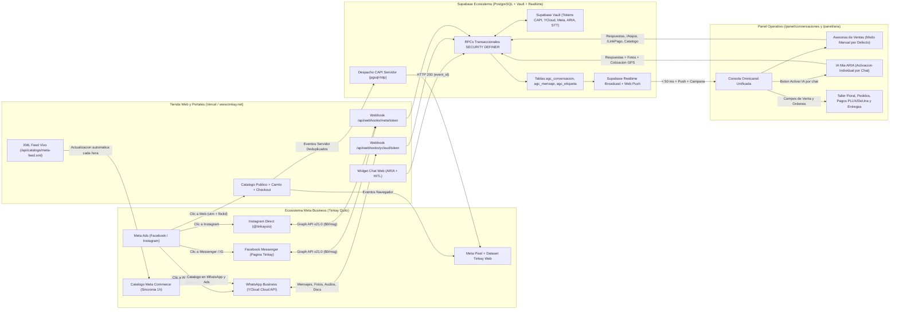
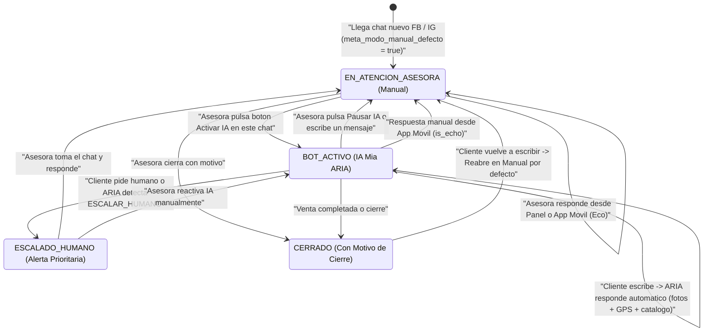
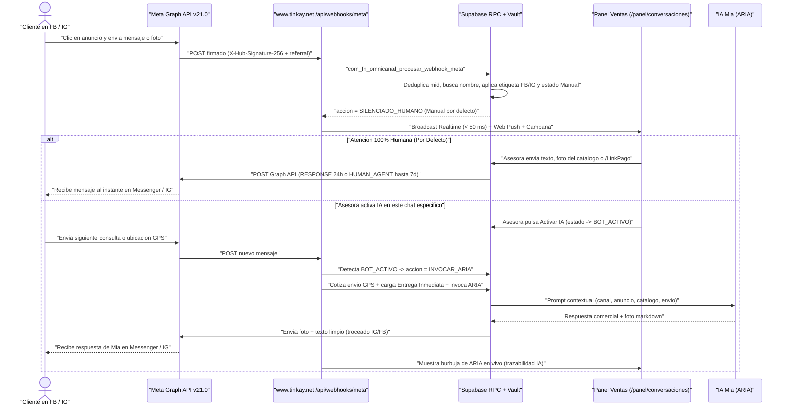
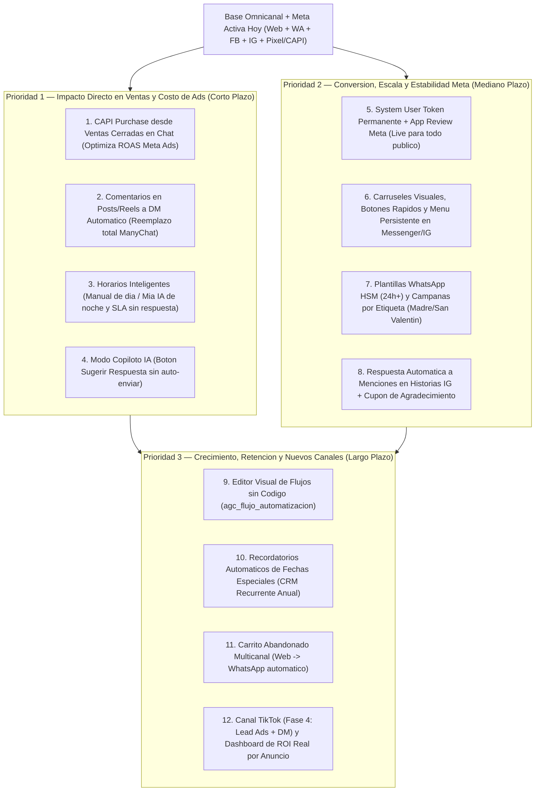

# Mapa Maestro Omnicanal & Meta Ecosystem (`PLT-010` + `PLT-025`)

Guía visual y operativa de **todo lo que está implementado hoy**, **cómo interactúan nuestros canales y Meta**, y **qué capacidades nuevas podemos construir** sobre esta misma infraestructura (con **$0 de licencias SaaS** tipo ManyChat) para los 4 negocios del ecosistema (**Tinkay**, **Margaritas**, **FastFix Home** y **Tranqi**).

---

## 1. Diagrama de Arquitectura Actual (Implementado Hoy)

---

## 2. Máquina de Estados: Modo Manual por Defecto + IA Individual por Chat

Así funciona exactamente el control humano vs. IA ARIA en **Facebook Messenger**, **Instagram Direct** (y opcionalmente en WhatsApp):

---

## 3. Flujo Completo de Conversión: Desde el Anuncio hasta el Cierre

---

## 4. Inventario Exacto: Qué Está IMPLEMENTADO Hoy

| Área | Capacidad | Estado | Dónde vive / Notas operativas |
| :--- | :--- | :---: | :--- |
| **Dominio y Tienda** | Dominio propio `https://www.tinkay.net` con SSL en Vercel y redirección desde `tinkay.net` | ✅ Activo | DNS GoDaddy + Vercel + Supabase Auth Redirects |
| **Tracking Meta (`PLT-025`)** | **Meta Pixel** en navegador + **Conversions API (CAPI)** desde PostgreSQL Vault con deduplicación `event_id` | ✅ Activo | Pixel `4679318432213846` (`Tinkay Web`) vinculado a `Tinkay G&F`, probado `HTTP 200` |
| **Catálogo Vivo (`PLT-025`)** | Feed XML RSS 2.0 `/api/catalogo/meta-feed.xml` sincronizado cada hora con **Meta Commerce Manager** | ✅ Activo | Catálogo `1506168184709464` (41 productos/variantes sin errores) + conectado a WhatsApp |
| **Atribución Publicitaria** | Captura de `utm_*`, `fbclid`, `_fbc`, `_fbp` en web y `referral` en anuncios Click-to-WhatsApp / FB / IG para adaptar tono de Mía | ✅ Implementado | Detecta automáticamente *Condolencias* (tono sobrio sin emojis), *Eventos*, *Entrega Inmediata* |
| **Chat Web HITL (`PLT-010` F1)** | Monitoreo en vivo, toma de control humano, reactivar IA, puente bidireccional Web ↔ WhatsApp (`TNK-xxx` / `wref`) | ✅ Activo | `ConsolaVentasOmnicanal.tsx` + `ChatAriaFlotante` |
| **WhatsApp YCloud (`PLT-010` F2)** | Envío/recepción de texto, fotos, documentos, notas de voz con transcripción IA automática (Nota Interna), cotización GPS automática y modo Manual opcional | ✅ Activo | `/api/webhooks/ycloud/[token]` + Vault en `/panel/aria` |
| **Facebook Messenger (`PLT-010` F3)** | Webhook `GET`/`POST` firmado HMAC-SHA256, envío directo desde panel (texto, fotos, PDFs, catálogo, `/atajos`, `/LinkPago`), eco móvil, ventana 24h + `HUMAN_AGENT` 7 días | ✅ Implementado | `/api/webhooks/meta/[token]` en las 4 apps + App `Tinkay Omnicanal` (`1942667653775790`) |
| **Instagram Direct (`PLT-010` F3)** | Webhook `GET`/`POST`, recepción de DMs/fotos/audios/menciones de historia, troceado automático 950 caracteres, envío directo desde panel | ✅ Implementado | Misma ruta `/api/webhooks/meta/[token]` + etiqueta automática `Instagram` |
| **Control IA Individual** | **Modo Manual por defecto** (`meta_modo_manual_defecto = true`) + botón individual **`Activar IA`** / **`Pausar IA`** por conversación | ✅ Implementado | Verificado en pruebas unitarias y prueba E2E en PostgreSQL |
| **Simulador de Chat ARIA** | Sandbox multi-turno en `/panel/conversaciones` (pestaña **Simulador IA**) y `/panel/aria` con selección de canal, anuncio simulado, Entrega Inmediata/GPS reales y botón **`Reiniciar Chat`** en 1 clic | ✅ Implementado | RPC `com_fn_omnicanal_simular_chat_aria` sin ensuciar chats reales ni despachar a clientes |
| **Comentarios en Posts y Reels (FB/IG)** | Auto-respuesta corta con redirección a `www.tinkay.net` (y DM privado opcional), filtros por palabras clave, solo comentarios raíz, anti-bucle, tono sobrio en condolencias, probador instantáneo y bitácora `agc_comentario_meta` | ✅ Implementado | Migración `20261126000008` + tarjeta editable en `/panel/aria#meta-comentarios` |
| **Herramientas de Venta en Chat** | Etiquetas, asignación por asesora, `/atajos`, Notas Internas, Recordatorios, **Campos de Venta a Taller**, **`/LinkPago` (PLUX/DeUna)**, **Selector de Catálogo**, **Ficha 360° de Cliente** y **Chat Grupal de Equipo** | ✅ Activo | Compartido para Tinkay, Margaritas, FastFix y Tranqi en `@eco/comercio` |
| **Alertas en Tiempo Real** | Broadcast Supabase Realtime `< 50 ms`, alertas sonoras, campana in-app y **Notificaciones Web Push** a celulares/PC del equipo de ventas | ✅ Activo | `GestorPushChatsOmnicanal.tsx` + VAPID en Vault |
| **Seguridad y Gobernanza** | 100% secretos cifrados en **Supabase Vault**, RLS obligatorio, auditoría por triggers, cero variables secretas en frontend | ✅ Activo | Cumple `AGENTS.md` Reglas 1–17 |

---

## 5. Hoja de Ruta: Qué Podemos Hacer que AÚN NO Está Implementado

### Detalle de cada mejora pendiente y qué beneficio concreto entrega

#### Prioridad 1 — Impacto inmediato en ventas y rentabilidad
1. **Envío de `Purchase` por Meta CAPI cuando se cobra un pedido en Chat (WhatsApp / FB / IG):**
   - *Hoy:* CAPI envía compras cerradas en la web (`www.tinkay.net`).
   - *Lo nuevo:* cuando una asesora marca un pedido como **Pagado** en `/panel/conversaciones` o `/panel/pedidos` y ese cliente llegó por un anuncio (`ctwa_clid` / `ad_id` / `fbclid`), el servidor dispara `Purchase` a Meta CAPI con el monto real en USD.
   - *Impacto:* el algoritmo de Meta deja de optimizar solo por "gente que pregunta precio" y aprende a buscar **clientes que sí compran**, bajando el costo por venta.
2. **Automatización de Comentarios en Posts y Reels → DM ("Comenta PRECIO / ROSAS"):**
   - *Hoy:* escuchamos mensajes directos (`messages`), no comentarios públicos.
   - *Lo nuevo:* suscribir `feed` (Facebook) y `comments` (Instagram) en `Tinkay Omnicanal`. Cuando alguien comente una palabra clave en un Reel/Post, el sistema responde el comentario públicamente y le envía un DM privado con foto + enlace directo a `www.tinkay.net`.
   - *Impacto:* captura tráfico orgánico y viral al 100% sin pagar ManyChat.
3. **Reglas de Horario y Respaldo SLA (Manual de día / Mía IA de noche):**
   - *Lo nuevo:* configurar horario laboral (ej. 08:30–19:00 en Manual para asesoras; fuera de horario o si pasan 5 minutos sin que nadie responda en un chat Manual, activar automáticamente a Mía ARIA).
   - *Impacto:* no se pierde ni una venta nocturna o de madrugada sin perder el control humano en el día.
4. **Copiloto IA en chats Manuales ("Sugerir Respuesta" en 1 clic):**
   - *Lo nuevo:* en cualquier chat que esté en Manual, añadir un botón **"Sugerir IA"** junto al compositor; Mía lee el hilo + stock de Entrega Inmediata + costo GPS y escribe el borrador en la caja de texto para que la asesora lo edite si desea y pulse **Enviar**.
   - *Impacto:* las asesoras responden 3x más rápido sin errores de precios ni direcciones, manteniendo 100% supervisión humana.

#### Prioridad 2 — Conversión enriquecida y operación sin vencimientos
5. **System User Token Permanente + App Review Meta (`Modo Activo / Live`):**
   - *Por qué importa:* mientras `Tinkay Omnicanal` esté en modo `Desarrollo`, Meta entrega mensajes de prueba de administradores/testers; al pasar a `Activo` con permisos aprobados (`pages_messaging`, `instagram_manage_messages`) y un **System User Token** de `Tinkay Quito`, cualquier cliente público de Facebook/Instagram entra al panel y el token **nunca caduca**.
6. **Carruseles de Productos, Botones Interactivos y Menú Persistente en Messenger/IG:**
   - *Lo nuevo:* usar `Generic Template` de Meta para enviar tarjetas deslizables con foto, precio y botones ("Ver en tienda", "Pedir ahora") y menú persistente en Messenger/IG ("Ver Catálogo", "Entrega Inmediata", "Hablar con Asesora").
7. **Plantillas Oficiales WhatsApp HSM (fuera de ventana 24h) y Difusión por Etiquetas:**
   - *Lo nuevo:* gestionar plantillas aprobadas de Meta/YCloud desde el panel para enviar recordatorios de entregas, seguimiento post-cotización después de 24h y campañas segmentadas a etiquetas (`VIP`, `Eventos`, `Pagado`) en fechas pico (San Valentín, Día de la Madre, Navidad).
8. **Auto-respuesta a Menciones en Historias de Instagram (`story_mention`):**
   - *Hoy:* la mención aparece registrada en la conversación.
   - *Lo nuevo:* enviar un agradecimiento cálido automático (y opcionalmente un cupón de descuento `PLT-014` para su siguiente arreglo) apenas un cliente etiquete a `@tinkayuio`.

#### Prioridad 3 — Escala multinegocio, retención y analítica ejecutiva
9. **Editor Visual de Flujos (`agc_flujo_automatizacion`):**
   - *Base ya creada:* la tabla ya existe en Supabase; falta la pantalla visual para crear automatizaciones tipo *"Si contiene X → poner etiqueta Y → asignar a asesora Z → enviar respuesta W"*.
10. **CRM de Fechas Especiales (Recompra Automática Anual):**
    - *Lo nuevo:* guardar la ocasión y fecha de entrega de cada pedido (cumpleaños, aniversario) y disparar automáticamente un recordatorio personalizado al cliente 5 días antes al año siguiente.
11. **Recuperación de Carrito Abandonado Multicanal:**
    - *Lo nuevo:* si un cliente registrado o con teléfono deja un arreglo en el carrito de `www.tinkay.net` sin pagar tras 45 minutos, ofrecer recordatorio amable por WhatsApp o correo con enlace directo para retomar el pago.
12. **Canal TikTok (Fase 4) + Tablero de ROI/ROAS Real por Campaña:**
    - *Lo nuevo:* integrar TikTok Lead Generation / Business Messaging al mismo `/panel/conversaciones` y construir un reporte ejecutivo que cruce cada anuncio/campaña de Meta contra los dólares realmente facturados en `/panel/pedidos`.

---

## 6. Pendientes Operativos Puntuales (Tinkay)

- **Migración futura de WhatsApp a `+593 99 292 2343`:** al mover el número publicitario actual desde ManyChat hacia YCloud/Tinkay, conectar el catálogo `1506168184709464` a ese número y activar el ícono de tienda en el encabezado de WhatsApp (ver recordatorio detallado en [conexion-meta-pixel-capi-y-catalogo.md](file:///c:/IA/Ecosistema/gobernanza/productos/tinkay/conexion-meta-pixel-capi-y-catalogo.md)).
- **Instagram móvil (`@tinkayuio`):** confirmar activado el switch *Configuración y actividad → Mensajes y respuestas a historias → Controles de mensajes → Permitir acceso a los mensajes (Herramientas conectadas: ON)*.
- **Réplica a los otros 3 negocios:** Margaritas, FastFix Home y Tranqi ya tienen las rutas `/api/webhooks/meta/[token]`, la migración SQL y el panel `/panel/aria` listos; cuando se desee conectar sus páginas, solo se vinculan a la misma infraestructura sin escribir código nuevo.
