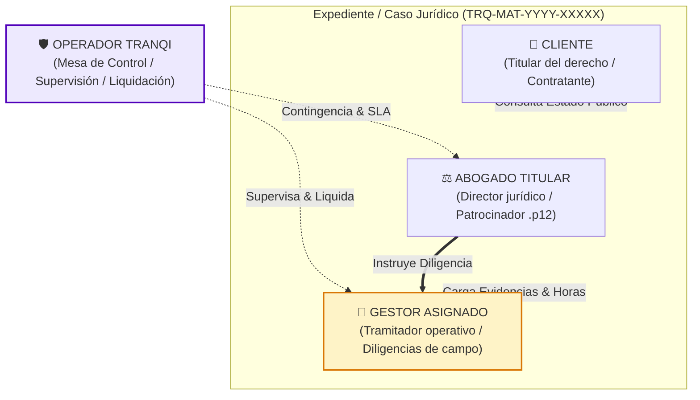

# Tranqi — Especificación Funcional y Técnica: Rol Gestor (Tramitador Legal)

**Código de Requerimiento:** `TRQ-GES-001`  
**Esquema de Base de Datos:** `tranqui_legal` · **Prefijo de tablas:** `trq_`  
**Estado:** ⏳ **Pendiente al 100% (No Implementado)**

---

## 1. Declaración de Realidad y Visión del Cliente

> [!CAUTION]
> **Aclaración Arquitectónica Mandatoria:**
> En la plataforma actual en producción ([https://www.tranqi24.com](https://www.tranqi24.com)), el concepto de **Gestor NO existe y NO tiene nada implementado (0% de avance / 100% pendiente)**. 
> 
> Históricamente, las maquetas de "Gestor" (vistas `G01` a `G08`) se habían confundido en auditorías con funciones de supervisión del **Operador**, lo cual es un error funcional: **el Operador es la mesa de control de Tranqi, mientras que el Gestor es un colaborador operativo de campo que trabaja en diligencias puntuales de un caso.**

### La Topología de Caso de 4 Actores

Bajo la visión definitiva del negocio legal de Tranqi, **cada caso o trámite jurídico** (especialmente aquellos facturables por horas o por aranceles de diligencia) se compone de 4 actores coordinados:



1. **Cliente:** Titular o beneficiario del caso. Consulta el estado público del trámite, provee información y abona las órdenes de pago.
2. **Abogado Titular (*Lead Attorney*):** Director jurídico responsable. Redacta demandas/minutas, estampa su firma electrónica `.p12` PAdES, define la estrategia jurídica y coordina al gestor.
3. **Gestor Asignado (Tramitador / Procurador / Paralegal):** Ejecutor operativo de diligencias físicas y virtuales (notarías, registros mercantiles/propiedad, juzgados, ANT, SRI, citaciones). Posee **acceso temporal y estrictamente limitado** al caso.
4. **Operador Tranqi:** Mesa de control central. Asigna casos, supervisa cumplimiento de tiempos de respuesta (SLAs), autoriza reembolsos de tasas judiciales y liquida comisiones u honorarios.

---

## 2. Tipología y Contratación del Gestor

| Modalidad | Relación Jurídica | Esquema de Compensación | Escenario Típico |
| :--- | :--- | :--- | :--- |
| **Gestor Interno** | Personal dependiente en nómina de Tranqi o del despacho legal. | Salario fijo + bono por cumplimiento de metas/SLAs. | Tramitación de alto volumen, radicación diaria en juzgados centrales de Quito/Guayaquil. |
| **Gestor Externo por Honorarios** | Profesional independiente o tramitador freelance acreditado. | Honorarios profesionales por trámite cerrado o por bolsa de horas facturables (+ IVA 15% SRI y retenciones). | Diligencias foráneas (provincias alejadas), notarizaciones urgentes, trámites vehiculares especializados. |

---

## 3. Modelo de Seguridad: Mínimo Privilegio y Acceso Temporal (Time-to-Live)

A diferencia de los roles jerárquicos tradicionales, el Gestor no goza de visibilidad horizontal. Se rige por los siguientes principios de seguridad:

1. **Sin Directorio General de Clientes:** Un gestor jamás puede listar la tabla `comun_seguridad.seg_usuario` ni consultar clientes de otros casos.
2. **Acceso Acotado a N Casos Específicos (*Case-Bounded*):** A través de la relación N:M `trq_caso_gestor`, el motor Row Level Security (RLS) de PostgreSQL solo retorna filas donde:
   $$\text{cgs\_ges\_id} = \text{auth.uid()} \quad \text{AND} \quad \text{cgs\_estado} = \text{'ACTIVO'} \quad \text{AND} \quad \text{NOW}() \le \text{cgs\_fecha\_limite}$$
3. **Ventana de Acceso Temporal (*Time-to-Live*):** Cada asignación cuenta con una fecha de caducidad (`cgs_fecha_limite`). Vencido el plazo o marcada la diligencia como `COMPLETADA`, el acceso se bloquea automáticamente sin requerir intervención manual del superadmin.
4. **Blindaje del Secreto Profesional Abogado-Cliente:**
   - En la estructura de carpetas procesales, el gestor solo accede a `01. Identificación y Poderes`, `04. Providencias` y su propia carpeta de `Diligencias y Comprobantes`.
   - Quedan estrictamente ocultas las notas de estrategia litigiosa del abogado (`es_confidencial_abogado = TRUE`).

---

## 4. Funcionalidades Clave del Rol Gestor

### 4.1. Bandeja de Diligencias Asignadas
* Listado de casos asignados activos con semáforo de vencimiento perentorio (*Urgente < 24h*, *En Curso < 72h*, *Completado*).
* Visualización de instrucciones específicas redactadas por el abogado patrocinador.
* Enlace de descarga directa de los habilitantes oficiales necesarios para la gestión (poderes, escritos con firma `.p12`, copias de cédula/RUC).

### 4.2. Registro y Carga de Evidencias de Campo
* Carga inmediata de fotografías o archivos escaneados:
  * Fe de presentación judicial (sello con fecha, hora y número de fojas en ventanilla).
  * Actas notariales y certificaciones registrales.
  * Boletas de citación o actas de notificación física.
* Extracción asistida con **ARIA OCR** para capturar número de trámite, fecha de sello y arancel pagado.

### 4.3. Liquidación de Tasas y Aranceles Públicos
* Carga del comprobante bancario o factura de aranceles públicos cancelados (SRI, Judicatura, Registro Mercantil).
* Solicitud de reembolso a la Mesa de Control de Tranqi con desglose de valores brutos.

### 4.4. Cronómetro de Horas Facturables (En Casos por Tarifa Horaria)
* Para casos facturables por horas (*Hourly Rate*): registro de tiempo invertido en traslados, filas y atención en ventanilla.
* Opción de geolocalización de inicio/fin de diligencia para certificar presencia física en sede pública.

---

## 5. Diseño del Modelo de Datos (PostgreSQL en `tranqui_legal`)

```sql
-- 1. Rol canónico en seguridad
INSERT INTO comun_seguridad.seg_rol (rol_clave, rol_nombre, rol_descripcion, rol_nivel_jerarquico)
VALUES ('GESTOR', 'Gestor Operativo / Tramitador', 'Colaborador operativo de campo asignado temporalmente a diligencias', 15)
ON CONFLICT (rol_clave) DO NOTHING;

-- 2. Entidad del Gestor
CREATE TABLE IF NOT EXISTS tranqui_legal.trq_gestor (
    ges_id UUID PRIMARY KEY DEFAULT gen_random_uuid(),
    ges_usr_id UUID NOT NULL REFERENCES comun_seguridad.seg_usuario(usr_id) ON DELETE RESTRICT,
    ges_tipo VARCHAR(25) NOT NULL CHECK (ges_tipo IN ('INTERNO_PLANTA', 'EXTERNO_HONORARIOS')),
    ges_identificacion VARCHAR(20) NOT NULL UNIQUE,
    ges_nombres VARCHAR(120) NOT NULL,
    ges_apellidos VARCHAR(120) NOT NULL,
    ges_telefono_movil VARCHAR(30) NOT NULL,
    ges_ciudad_operacion VARCHAR(80) NOT NULL,
    ges_tarifa_hora NUMERIC(10,2) DEFAULT 0.00,
    ges_tarifa_tramite_base NUMERIC(10,2) DEFAULT 0.00,
    ges_activo BOOLEAN NOT NULL DEFAULT TRUE,
    ges_datos_tributarios JSONB DEFAULT '{"emite_factura": true, "regimen": "RIMPE"}'::jsonb,
    ges_datos_bancarios JSONB DEFAULT '{}'::jsonb,
    ges_creado_en TIMESTAMPTZ NOT NULL DEFAULT NOW()
);

-- 3. Asignación Temporal N:M de Gestor a Caso
CREATE TABLE IF NOT EXISTS tranqui_legal.trq_caso_gestor (
    cgs_id UUID PRIMARY KEY DEFAULT gen_random_uuid(),
    cgs_cas_id UUID NOT NULL REFERENCES tranqui_legal.trq_caso(cas_id) ON DELETE CASCADE,
    cgs_ges_id UUID NOT NULL REFERENCES tranqui_legal.trq_gestor(ges_id) ON DELETE RESTRICT,
    cgs_asignado_por UUID NOT NULL REFERENCES comun_seguridad.seg_usuario(usr_id),
    cgs_tipo_tarea VARCHAR(50) NOT NULL, -- 'NOTARIA', 'REGISTRO_PROPIEDAD', 'CITACION_JUDICIAL', 'RETIRO_EXPEDIENTE'
    cgs_instrucciones TEXT NOT NULL,
    cgs_fecha_inicio TIMESTAMPTZ NOT NULL DEFAULT NOW(),
    cgs_fecha_limite TIMESTAMPTZ NOT NULL,
    cgs_fecha_cierre TIMESTAMPTZ,
    cgs_estado VARCHAR(20) NOT NULL DEFAULT 'ASIGNADO' CHECK (cgs_estado IN ('ASIGNADO', 'EN_DILIGENCIA', 'COMPLETADO', 'REVOCADO', 'VENCIDO')),
    cgs_honorario_acordado NUMERIC(10,2) DEFAULT 0.00,
    cgs_creado_en TIMESTAMPTZ NOT NULL DEFAULT NOW()
);

-- 4. Diligencias y Comprobantes de Tasas
CREATE TABLE IF NOT EXISTS tranqui_legal.trq_caso_gestor_actuacion (
    cga_id UUID PRIMARY KEY DEFAULT gen_random_uuid(),
    cga_cgs_id UUID NOT NULL REFERENCES tranqui_legal.trq_caso_gestor(cgs_id) ON DELETE CASCADE,
    cga_descripcion TEXT NOT NULL,
    cga_url_fe_presentacion TEXT,
    cga_url_comprobante_tasa TEXT,
    cga_monto_tasa_pagada NUMERIC(10,2) DEFAULT 0.00,
    cga_horas_invertidas NUMERIC(5,2) DEFAULT 0.00,
    cga_aprobado_operador BOOLEAN DEFAULT FALSE,
    cga_fecha_actuacion TIMESTAMPTZ NOT NULL DEFAULT NOW()
);

-- 5. Política de Seguridad RLS de Lectura Estricta para Gestores
ALTER TABLE tranqui_legal.trq_caso ENABLE ROW LEVEL SECURITY;

CREATE POLICY trq_pol_gestor_acceso_caso ON tranqui_legal.trq_caso
FOR SELECT TO authenticated
USING (
    EXISTS (
        SELECT 1 FROM tranqui_legal.trq_caso_gestor cg
        JOIN tranqui_legal.trq_gestor g ON g.ges_id = cg.cgs_ges_id
        WHERE cg.cgs_cas_id = trq_caso.cas_id
          AND g.ges_usr_id = auth.uid()
          AND cg.cgs_estado IN ('ASIGNADO', 'EN_DILIGENCIA')
          AND NOW() <= cg.cgs_fecha_limite
    )
);
```

---

## 6. Plan de Implementación Modular (Roadmap)

> [!IMPORTANT]
> **Regla de Desarrollo:** No se comenzará la codificación hasta la aprobación formal de este documento por el Product Owner y el Cliente.

1. **Fase 1: Esquema de Base de Datos y Políticas RLS (Sprint 1):**
   * Creación de migraciones Supabase con tablas `trq_gestor`, `trq_caso_gestor` y políticas RLS.
   * Registro del rol `GESTOR` en `comun_seguridad.seg_rol` (Nivel 15).
2. **Fase 2: Interfaz del Despacho del Gestor (Sprint 2):**
   * Nueva ruta en el panel: `/panel/tramites` (exclusiva para rol Gestor).
   * Bandeja de diligencias pendientes, visor de instrucciones y modal de subida de evidencias fotográficas.
3. **Fase 3: Mesa de Control y Asignación de Gestores (Sprint 2):**
   * Integración en el panel del Operador (`/panel/agenda/asignaciones`) para vincular gestores a casos con ventana de tiempo.
4. **Fase 4: Liquidación Contable y Honorarios (Sprint 3):**
   * Módulo de conciliación de horas y reembolso de tasas en `/panel/administrar`.
