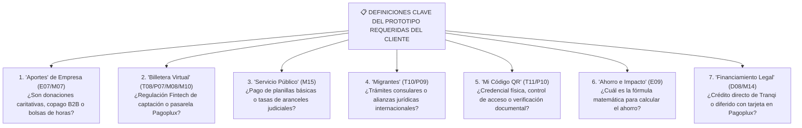
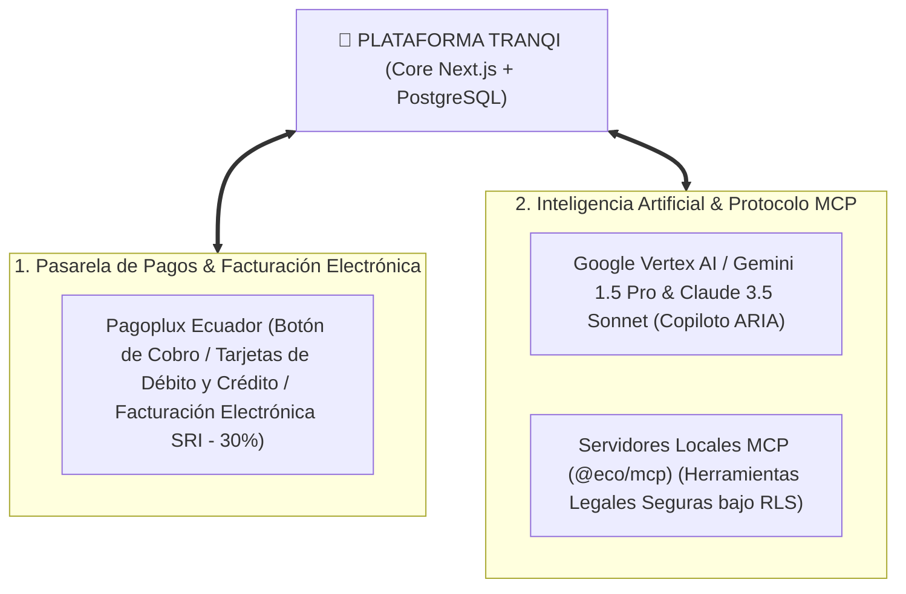

# Informe Ejecutivo de Homologación: Prototipo del Cliente vs. Plataforma en Producción (https://www.tranqi24.com)

**Fecha de emisión:** 14 de octubre de 2026  
**Plataforma en producción evaluada:** [https://www.tranqi24.com](https://www.tranqi24.com)  
**Código fuente de referencia:** Monorepo Ecosistema (`apps/tranqi-web`, `packages/*`, base de datos Supabase multi-esquema `tranqui_legal` y `comun_*`)  
**Responsables del análisis:** Kleber Toapanta / Jesus Navarrete  
**Propósito del informe:** Análisis técnico-funcional comparativo entre el prototipo conceptual entregado por el cliente (87 pantallas y modales) y el estado real de la plataforma desplegada en producción, identificando módulos operativos, desarrollos de infraestructura no previstos en el prototipo, catálogo oficial de integraciones y puntos que requieren definición.

---

## 1. Alcance de los Ítems Evaluados

El análisis abarca el 100% de los elementos entregados en el catálogo del prototipo conceptual del cliente (87 pantallas y modales), organizados de la siguiente forma:
* **61 Vistas del Prototipo Existente:** Empresa (`E01–E10`), Trabajador (`T01–T14`), Persona (`P01–P12`), Abogado (`L01–L08`), Gestor (`G01–G08`), Accionista (`S01–S09`).
* **26 Pantallas Complementarias Propuestas:** Acceso (`A01–A07`), Detalles (`D01–D08`), Pagos (`F01–F03`), Operación (`O01–O08`).
* **19 Formularios y Ventanas Modales:** `M01` a `M19`.

---

## 2. Declaraciones Fundamentales de Negocio y Reglas Reales

1. **El Rol "Gestor" está PENDIENTE AL 100% (0% implementado):**
   * El concepto de Gestor **NO existe actualmente en producción ni en base de datos**.
   * No debe confundirse con el Operador de la mesa de control. El Gestor es un rol operativo de campo (interno de nómina o externo contratado por honorarios/horas) que atiende diligencias físicas y virtuales (notarías, juzgados, registros, ANT).
   * **Cada caso legal involucra a 4 actores coordinados:**
     * 👤 **Cliente:** Titular o beneficiario del derecho.
     * ⚖️ **Abogado Titular:** Patrocinador jurídico director con firma digital `.p12`.
     * 🏃 **Gestor Asignado:** Tramitador con **acceso temporal y estrictamente limitado** al caso asignado para colaborar con diligencias operativas.
     * 🛡️ **Operador Tranqi:** Mesa de control central, supervisión de tiempos (SLAs) y liquidación de pagos.
   * Las 8 pantallas del prototipo de Gestor (`G01–G08`) quedan registradas como **100% PENDIENTES** bajo el requerimiento `TRQ-GES-001` (especificación completa en [`especificacion-rol-gestor.md`](especificacion-rol-gestor.md)).

2. **Pagos y Facturación Electrónica con Pagoplux están EN DESARROLLO (30% de avance):**
   * La integración con Pagoplux (como pasarela de pagos con tarjetas de crédito/débito y como motor de emisión/conciliación de facturación electrónica autorizada ante el SRI) **NO aplica como implementada**.
   * Todo lo relativo a cobros, checkout web, webhooks transaccionales, historial contable de pagos y liquidaciones se encuentra en **fase de desarrollo (30%)** bajo el requerimiento `TRQ-ADM-004`.

3. **Módulo de Accionistas / Inversionistas (`S01–S09`):**
   * Pertenecían a la maqueta comercial de captación de capital (*Pitch Deck*). Están planificados para un portal futuro independiente de *Investor Relations* (**100% PENDIENTES** para el MVP operativo).

---

## 3. Estado Real de Madurez Transaccional (Semáforo de Producción)

El avance del proyecto se evalúa en función de **procesos de negocio transaccionales operativos de punta a punta**, respaldados por la base de datos PostgreSQL, políticas de seguridad RLS y componentes interactivos desplegados en producción:

```
┌────────────────────────────────────────────────────────────────────────┐
│              ESTADO DE MADUREZ TRANSACCIONAL EN PRODUCCIÓN             │
├────────────────────────────┬────────────────────────────┬──────────────┤
│ SUBSISTEMA / ÁREA          │ ESTADO EN PRODUCCIÓN       │ AVANCE REAL  │
├────────────────────────────┼────────────────────────────┼──────────────┤
│ 1. Identidad, Auth & LOPDP │ ✅ Terminado y Estable     │    100%      │
│ 2. Firma Digital PAdES .p12│ ✅ Terminado y Estable     │    100%      │
│ 3. Inteligencia IA & MCP   │ ✅ Terminado y Estable     │    100%      │
│ 4. Billetera Documentos OCR│ 🟡 Operativo con detalles  │     85%      │
│ 5. Agenda y Citas          │ 🟡 Operativo Parcial       │     65%      │
│ 6. B2B / Legal HR          │ 🟡 Interfaz sin carga CSV  │     40%      │
│ 7. Pagos y Fact. (Pagoplux)│ 🟡 En Desarrollo Inicial   │     30%      │
│ 8. Expediente Judicial     │ 🟡 En Especificación/Base  │     30%      │
│ 9. Rol Gestor Operativo    │ 🔴 No Existe en Código/BDD │      0%      │
│ 10. Portal Accionistas     │ 🔴 No Priorizado (Pitch)   │      0%      │
└────────────────────────────┴────────────────────────────┴──────────────┘
```

### Estadísticas Consolidadas Reales

| Categoría | Cantidad de Pantallas/Flujos | % del Total | Diagnóstico del Estado |
| :--- | :---: | :---: | :--- |
| **✅ 100% Operativo y Transaccional** | **44** | **41.5%** | Flujos completos que un usuario puede utilizar hoy en producción de forma segura. |
| **🟡 Parcial / En Desarrollo** | **35** | **33.0%** | Interfaces activas cuyos servicios transaccionales de fondo (Pagoplux al 30%, expediente COGEP al 30%, Legal HR al 40%) están en construcción. |
| **🔄 Homologado / Reorientado** | **10** | **9.4%** | Unificados bajo el perfil `CLIENTE` o ajustados al marco regulatorio ecuatoriano. |
| **⏳ Pendiente al 100% (No Existe)** | **17** | **16.1%** | **8 pantallas de Gestor (`G01–G08`)** + **9 pantallas de Accionista (`S01–S09`)**. |
| **TOTAL** | **106** | **100%** | |

---

## 4. Funcionalidades Adicionales Desarrolladas (No Previstas en el Prototipo)

Durante el desarrollo de la plataforma real en producción ([https://www.tranqi24.com](https://www.tranqi24.com)), se implementaron **10 pilares técnicos de alto valor operativo que no estaban descritos en el prototipo**, pero que son indispensables para el funcionamiento del negocio:

| # | Pilar Adicional Desarrollado | Dónde Vive en el Proyecto | Valor Agregado Frente al Prototipo |
| :-: | :--- | :--- | :--- |
| **1** | **Copiloto de IA ARIA Multi-Perfil y Servidores MCP** | `/panel/asistente`<br/>`/panel/agentes`<br/>`packages/agentes-ia` | Chat interactivo real conectado a LLMs (Gemini 1.5 Pro / Claude 3.5 Sonnet) con persistencia de conversaciones (`trq_conversacion`), prompts diferenciados para Cliente vs. Abogado y servidores MCP bajo RLS. El prototipo solo presentaba un formulario sin procesamiento. |
| **2** | **Firma Electrónica PAdES Zero-Custody en Navegador** | `/panel/firma-documentos`<br/>`TRQ-COM-003` | Descifrado criptográfico PKCS#12 (`.p12`/`.pfx`) 100% en la memoria RAM local sin enviar clave ni certificado al servidor, con proyección matemática 1:1, soporte táctil móvil y código QR oficial conforme a la Ley de Comercio Electrónico. |
| **3** | **Billetera Cifrada con Enlaces Efímeros TTL y Código PIN** | `/panel/billetera-documentos`<br/>`/compartir/documento/[token]` | Extracción OCR inteligente con ARIA (cédulas, matrículas, RUCs), alertas preventivas de caducidad documental a 90 días y generación de links públicos con tiempo de vida (TTL: 1h–30d, *Burn-on-Read*) y clave PIN. |
| **4** | **Acreditación y Onboarding Dual de Abogados** | `/panel/solicitud-socio`<br/>`/panel/socios` | Formulario de postulación con subida de carnet del Foro, validación asistida por IA, generación dinámica de Contrato de Sociedad en PDF interactivo, contra-firma digital bilateral e impresión automática en `/panel/solicitud-socio/contrato/imprimir`. |
| **5** | **Seguridad RLS al 100%, MFA TOTP y Supabase Vault** | `/panel/cuenta`<br/>PostgreSQL RLS | Doble factor de autenticación TOTP (Google Authenticator) en `/panel/cuenta?widget=mfa_seguridad`, credenciales SMTP en Supabase Vault y bitácora de auditoría BDD con diffs JSONB de cada transacción en `/panel/auditoria`. |
| **6** | **Conmutador Dinámico 'Ver Como' (`SelectorRolActivo`)** | `/panel/cuenta`<br/>Cabecera del Panel | Permite alternar la vista en vivo entre Cliente, Abogado, Operador y Administrador sin cerrar sesión, recalculando dinámicamente los permisos y paneles. |
| **7** | **Consola SuperAdmin Modular y Buscador `Ctrl + K`** | `/panel`<br/>`BuscadorModulosGlobal.tsx` | Buscador rápido de módulos por atajo de teclado, catálogo completo de widgets y consola central de control del ecosistema. |
| **8** | **Despacho Multicanal de Notificaciones** | `/panel/emision-notificaciones`<br/>`packages/notificaciones` | Motor de emisión masiva segmentada (In-App, Push VAPID, Email y WhatsApp) con bitácora de confirmación y tiempo de pospuesto. |
| **9** | **DataGrid Enterprise Estandarizado** | `@eco/datagrid` | Componente reutilizable con agrupación de columnas, ordenamiento multivariable reactivo y exportación a Excel/CSV. |
| **10**| **Directorio y Carrusel de Abogados Verificados en Landing** | `https://www.tranqi24.com/` | Ficha pública interactiva de abogados reales matriculados, con cálculo de años de experiencia y filtro por materias legales. |

---

## 5. Matriz de Definiciones y Consultas al Cliente

A partir del contraste entre el prototipo conceptual y la arquitectura legal/técnica de la plataforma, se identifican **7 puntos clave que requieren definición formal por parte del cliente** para orientar su desarrollo:



| # | Ítem del Prototipo | Texto en el Prototipo | Análisis Técnico | Consulta Concreta para el Cliente |
| :-: | :--- | :--- | :--- | :--- |
| **1** | **E07 / M07** (`empresa/aportes.html`, `realizar-aporte.html`) | *"Contribuciones voluntarias con destino, comprobante e impacto. Selección del programa y del importe."* | **Modelo Comercial vs. Donación:** Tranqi es una empresa comercial (Legaltech), no una fundación benéfica. Catalogar ingresos como "aportes voluntarios" genera inconsistencias tributarias ante el SRI. | **¿Se trata de patrocinio Pro-Bono (responsabilidad social), o de la compra de bolsas corporativas de consultas jurídicas para empleados?** |
| **2** | **T08 / P07 / M08 / M10** (`billetera.html`, `transferir.html`, `recargar-billetera.html`) | *"Paga, cobra, transfiere a otro usuario, recarga tu billetera simulada."* | **Marco Regulatorio Fintech:** La captación de dinero de terceros, saldos virtuales y transferencias P2P requiere licencia de Entidad de Servicios Financieros Auxiliares ante el Banco Central. | **¿Tranqi tramitará licencia de billetera Fintech ante el Banco Central, o la plataforma operará exclusivamente con cobro directo de honorarios mediante Pagoplux sin custodiar saldos de clientes?** *(Recomendación técnica: Cobro directo con Pagoplux).* |
| **3** | **M15** (`formularios/servicio-publico.html`) | *"Etapas previstas para consultar una obligación pública, generar una orden y conciliarla."* | **Delimitación del Servicio:** No se detalla qué obligaciones públicas comprende. | **¿Se refiere al pago de tasas y aranceles notariales/judiciales vinculados a un trámite, o contempla la recaudación de planillas de servicios básicos y multas?** |
| **4** | **T10 / P09** (`migrantes.html`) | *"Protección y conexión jurídica para personas y familias entre países."* | **Jurisdicción y Alcance Legal:** No especifica si el servicio se circunscribe a la legislación ecuatoriana o incluye convenios internacionales. | **¿El alcance es tramitar poderes consulares, apostillas y repatriaciones desde Ecuador, o Tranqi dispondrá de alianzas con abogados colegiados en el exterior?** |
| **5** | **T11 / P10** (`qr.html`, `qrpersona.html`) | *"Credencial rápida de identificación y acceso controlado."* | **Caso de Uso:** El prototipo muestra un código QR estático sin detallar la interacción de verificación. | **¿Cuál es el flujo de lectura de este QR? ¿Validación presencial en recepciones físicas, verificación de vigencia de cobertura de seguros/asistencia, o intercambio de perfil digital?** |
| **6** | **E09** (`empresa/impacto.html`) | *"Resultados documentados y estimaciones claramente diferenciadas de ahorro."* | **Fórmula de Medición:** No existe una metodología definida para cuantificar el "ahorro legal". | **¿Cómo define la empresa este indicador? ¿Comparando contra el tarifario mínimo del Colegio de Abogados, o calculando contingencias y multas laborales evitadas?** |
| **7** | **D08 / M14** (`solicitar-financiamiento.html`, `pagar-cuota.html`) | *"Revisa la propuesta de servicio y solicita evaluación de financiamiento."* | **Riesgo Crediticio:** No está definido el mecanismo de asunción de riesgo de crédito. | **¿Tranqi concederá crédito directo asumiendo el riesgo de incobrabilidad, o el financiamiento se canalizará mediante las cuotas diferidas de las tarjetas de crédito en la pasarela Pagoplux?** |

---

## 6. Especificación de Integraciones Oficiales (Ítem O07)

El catálogo de integraciones de la plataforma comprende los componentes y servicios externos formalmente vinculados a la operación de Tranqi:



### Tabla Maestra de Integraciones Oficiales: Protocolos, Proveedores y Estado

| Pilar | Sistema / Proveedor | Protocolo / Tecnología | Objetivo Funcional en Tranqi | Estado en Producción |
| :--- | :--- | :--- | :--- | :---: |
| **1. Pagos & Facturación** | **Pagoplux Ecuador** | REST API / Webhooks / Motor SRI | Pasarela oficial para cobro de consultas y servicios con tarjeta de débito/crédito (corriente y diferido en cuotas) y emisión/conciliación automatizada de Facturación Electrónica XML autorizada ante el SRI con desglose de IVA 15%. | 🟡 En Desarrollo (30%) |
| **2. Inteligencia Artificial** | **Google Vertex AI / Gemini 1.5 Pro & Claude 3.5** | REST API Streaming | Motor LLM de razonamiento jurídico para el copiloto ARIA (redacción de minutas, triaje legal, asistencia en consultas y OCR inteligente de documentos). | ✅ Implementado (100%) |
| **3. Protocolo MCP** | **Servidores MCP Locales (`@eco/mcp`)** | JSON-RPC 2.0 sobre HTTP / Stdio | Exposición de herramientas seguras para que ARIA consulte la base de datos de casos, tarifas y marco legal ecuatoriano bajo políticas RLS estrictas. | ✅ Implementado (100%) |

---

### 6.1. Integraciones Propuestas en el Prototipo del Cliente (Estado y Validación de Especificaciones)

El prototipo conceptual presenta vistas y componentes asociados a servicios externos adicionales. El análisis técnico confirma que **ninguna de estas propuestas cuenta con especificaciones técnicas en el material provisto**, por lo que se clasifican formalmente como **⏳ Pendientes de Especificación**:

| Código Prototipo | Integración Insinuada en Prototipo | Alcance Descrito en Prototipo | Estado Real | Especificaciones Técnicas y Diagnóstico |
| :---: | :--- | :--- | :---: | :--- |
| **O07** | **Conexiones e Integraciones (`operacion/integraciones.html`)** | Monitoreo visual de disponibilidad ("Servicio activo", "Timeout") con switches ON/OFF de pasarelas y servicios. | ⏳ **Pendiente (0%)** | **Sin especificaciones técnicas.** El prototipo es una maqueta de interfaz con interruptores visuales. No define catálogo de endpoints, contratos de payload JSON, esquemas de autenticación (OAuth2 / API Key), mecanismos de health check ni acuerdos de nivel de servicio (SLA). |
| **M15** | **Servicio Público (`formularios/servicio-publico.html`)** | *"Etapas previstas para consultar una obligación pública, generar una orden y conciliarla."* | ⏳ **Pendiente (0%)** | **Sin especificaciones técnicas.** No existe documentación técnica ni convenios de API con entidades recaudadoras o empresas de servicios públicos (agua, luz, telecomunicaciones, ANT o función judicial) para consulta de planillas ni recaudación. |
| **T10 / P09** | **Asistencia a Migrantes / Cross-Border (`migrantes.html`)** | *"Protección y conexión jurídica para personas y familias entre países."* | ⏳ **Pendiente (0%)** | **Sin especificaciones técnicas.** No existen especificaciones de interoperabilidad con sistemas consulares (MREMH), sistemas de apostilla internacional ni convenios técnicos con despachos jurídicos en el exterior. |
| **T08 / M08 / M10** | **Billetera Virtual / Transferencias P2P (`persona/billetera.html`)** | Envío de dinero entre usuarios particulares y recargas de saldo virtual. | ⏳ **Pendiente (0%)** | **Sin especificaciones técnicas.** No existe integración con el Switch Interbancario (SPI) del Banco Central del Ecuador. Además, este modelo está desaconsejado técnicamente por requerir licencia bancaria Fintech. La recaudación real se canaliza por Pagoplux. |
| **E02 / A05** | **Consulta en Línea RUC / Catastro (`empresa.html`, `validar-empresa.html`)** | Autocompletado inmediato de razón social, estado tributario y datos fiscales al tipear el RUC. | ⏳ **Pendiente (0%)** | **Sin especificaciones técnicas.** El prototipo no incluye especificaciones de Webservices SOAP/REST del SRI ni accesos autorizados. En producción se utiliza ingreso manual con validación matemática algorítmica de RUC (Módulo 10/11). |

---

## 7. Matriz Homologada de Pantallas y Roles Habilitados

### 7.1. Empresa (E01 – E10)

| Código | Pantalla Prototipo | URL Real en Producción | Roles Habilitados | Estado Real | Observación Técnica |
| :---: | :--- | :--- | :--- | :---: | :--- |
| **E01** | `empresa/inicio.html` | `https://www.tranqi24.com/panel/empresas` | `CLIENTE` (Empresa), `OPERADOR`, `ADMIN`, `SUPERADMIN` | ✅ Implementado | Dashboard corporativo activo. |
| **E02** | `empresa/empresa.html` | `https://www.tranqi24.com/panel/cuenta?widget=datos_facturacion` | `TODOS LOS AUTENTICADOS` | ✅ Implementado | Formulario fiscal SRI terminado. |
| **E03** | `empresa/trabajadores.html` | `https://www.tranqi24.com/panel/empresas?widget=legal_hr_laboral` | `OPERADOR`, `ADMIN`, `SUPERADMIN` | 🟡 En Desarrollo (40%) | Alta individual activa; carga masiva CSV pendiente. |
| **E04** | `empresa/proteccion.html` | `https://www.tranqi24.com/panel/empresas?widget=vitrina_comercial_empresas` | `CLIENTE`, `OPERADOR`, `ADMIN`, `SUPERADMIN` | ✅ Implementado | Catálogo corporativo de planes activo. |
| **E05** | `empresa/cumplimiento.html` | `https://www.tranqi24.com/panel/empresas?widget=compliance_score_legal` | `OPERADOR`, `ADMIN`, `SUPERADMIN` | ✅ Implementado | Compliance Score y monitoreo ARIA terminado. |
| **E06** | `empresa/documentos.html` | `https://www.tranqi24.com/panel/billetera-documentos`<br/>`https://www.tranqi24.com/panel/firma-documentos` | `CLIENTE`, `ABOGADO`, `OPERADOR`, `ADMIN`, `SUPERADMIN` | ✅ Implementado | Bóveda documental cifrada y firma digital `.p12`. |
| **E07** | `empresa/aportes.html` | `https://www.tranqi24.com/panel/catalogo-productos` | `CLIENTE`, `OPERADOR`, `ADMIN`, `SUPERADMIN` | 🔄 Requiere Aclaración | **Consulta #1:** Definición requerida sobre modelo Pro-Bono vs. bolsas corporativas B2B. |
| **E08** | `empresa/pagos.html` | `https://www.tranqi24.com/panel/administrar?widget=historial_pagos` | `CLIENTE`, `OPERADOR`, `ADMIN`, `SUPERADMIN` | 🟡 En Desarrollo (30%) | **Pagos al 30%:** Webhooks y checkout de Pagoplux en desarrollo. |
| **E09** | `empresa/impacto.html` | `https://www.tranqi24.com/panel/empresas?widget=compliance_score_legal` | `OPERADOR`, `ADMIN`, `SUPERADMIN` | 🟡 Requiere Aclaración (50%) | **Consulta #6:** Falta fórmula acordada para estimación de ahorro financiero. |
| **E10** | `empresa/configuracion.html` | `https://www.tranqi24.com/panel/configuracion` | `ADMINISTRADOR`, `SUPERADMIN` | ✅ Implementado | Configuración de negocio y servidor SMTP Vault. |

---

### 7.2. Trabajador y Persona (T01 – T14, P01 – P12)

| Código | Pantalla Prototipo | URL Real en Producción | Roles Habilitados | Estado Real | Observación Técnica |
| :---: | :--- | :--- | :--- | :---: | :--- |
| **T01 / P01** | `inicio.html` | `https://www.tranqi24.com/panel` | `CLIENTE` | ✅ Implementado | Tablero del cliente activo con citas y ARIA. |
| **T02 / P02** | `miproteccion.html` | `https://www.tranqi24.com/panel/clientes` | `CLIENTE`, `OPERADOR`, `ADMIN`, `SUPERADMIN` | ✅ Implementado | Vitrina de planes individuales activa. |
| **T03 / P03** | `consultar.html` | `https://www.tranqi24.com/panel/agendar`<br/>`https://www.tranqi24.com/panel/asistente` | `CLIENTE`, `OPERADOR`, `ADMIN`, `SUPERADMIN` | ✅ Implementado | Agendamiento de consulta telemática o chat ARIA. |
| **T04 / P04** | `miscasos.html` | `https://www.tranqi24.com/panel/clientes` | `CLIENTE`, `OPERADOR`, `ADMIN`, `SUPERADMIN` | 🟡 En Desarrollo (35%) | Citas activas; expediente judicial COGEP en desarrollo. |
| **T05 / P05** | `seguimiento.html` | `https://www.tranqi24.com/panel/mis-citas` | `CLIENTE`, `OPERADOR`, `SUPERADMIN` | 🟡 En Desarrollo (30%) | Estado de citas activo; bitácora judicial pendiente. |
| **T06 / P06** | `misdocumentos.html` | `https://www.tranqi24.com/panel/billetera-documentos` | `CLIENTE`, `ABOGADO`, `OPERADOR`, `ADMIN`, `SUPERADMIN` | ✅ Implementado | Billetera con OCR ARIA y enlaces temporales TTL. |
| **T07 / P07** | `citas.html` | `https://www.tranqi24.com/panel/agendar`<br/>`https://www.tranqi24.com/panel/mis-citas` | `CLIENTE`, `OPERADOR`, `SUPERADMIN` | 🟡 En Desarrollo (65%) | Agendamiento activo; sala de videoconsulta al 40%. |
| **T08 / P08** | `billetera.html` | `https://www.tranqi24.com/panel/administrar?widget=historial_pagos` | `CLIENTE`, `ABOGADO`, `OPERADOR`, `ADMIN`, `SUPERADMIN` | 🟡 Requiere Aclaración (30%) | **Consulta #2:** Pagos al 30%; se descarta saldo virtual por Ley Fintech; cobros vía Pagoplux. |
| **T09 / P09** | `familia.html` | `https://www.tranqi24.com/panel/billetera-documentos` | `CLIENTE`, `OPERADOR`, `SUPERADMIN` | 🟡 Parcial (50%) | Documentos familiares activos; cuentas hijas en roadmap. |
| **T10 / P10** | `migrantes.html` | `https://www.tranqi24.com/panel/clientes` | `CLIENTE`, `OPERADOR`, `ADMIN`, `SUPERADMIN` | 🟡 Requiere Aclaración (40%) | **Consulta #4:** Requiere definir si el alcance es consular o de convenios internacionales. |
| **T11 / P11** | `qr.html` | `https://www.tranqi24.com/compartir/documento/[token]` | `PÚBLICO`, `CLIENTE`, `ABOGADO` | 🟡 Requiere Aclaración (60%) | **Consulta #5:** QR activo en documentos TTL; falta definir uso de credencial. |
| **T12 / P12** | `notificaciones.html` | `https://www.tranqi24.com/panel/notificaciones` | `TODOS LOS AUTENTICADOS` | ✅ Implementado | Centro multicanal In-App, Push y WhatsApp activo. |
| **T13 / P13** | `privacidad.html` | `https://www.tranqi24.com/panel/cuenta` | `TODOS LOS AUTENTICADOS` | ✅ Implementado | Seguridad MFA TOTP y consentimientos terminados. |
| **T14** | `mispagos.html` | `https://www.tranqi24.com/panel/administrar?widget=historial_pagos` | `CLIENTE`, `ABOGADO`, `OPERADOR`, `ADMIN`, `SUPERADMIN` | 🟡 En Desarrollo (30%) | **Pagos al 30%:** Consulta de órdenes Pagoplux en desarrollo. |

---

### 7.3. Abogado (L01 – L08)

| Código | Pantalla Prototipo | URL Real en Producción | Roles Habilitados | Estado Real | Observación Técnica |
| :---: | :--- | :--- | :--- | :---: | :--- |
| **L01** | `abogado/inicio.html` | `https://www.tranqi24.com/panel` | `ABOGADO`, `SUPERADMIN` | ✅ Implementado | Panel profesional con agenda y accesos directos. |
| **L02** | `abogado/casosasignados.html` | `https://www.tranqi24.com/panel/agenda` | `ABOGADO`, `OPERADOR`, `SUPERADMIN` | 🟡 En Desarrollo (50%) | Bandeja de consultas activa; expediente judicial en desarrollo. |
| **L03** | `abogado/agendaabogado.html` | `https://www.tranqi24.com/panel/agenda`<br/>`https://www.tranqi24.com/panel/agenda/disponibilidad` | `ABOGADO`, `SUPERADMIN` | ✅ Implementado | Disponibilidad, horas hábiles y bloqueos operativos. |
| **L04** | `abogado/clientesabogado.html` | `https://www.tranqi24.com/panel/clientes` | `ABOGADO`, `OPERADOR`, `ADMIN`, `SUPERADMIN` | ✅ Implementado | CRM Jurídico 360° con conflict check activo. |
| **L05** | `abogado/documentosabogado.html` | `https://www.tranqi24.com/panel/billetera-documentos`<br/>`https://www.tranqi24.com/panel/firma-documentos` | `ABOGADO`, `OPERADOR`, `ADMIN`, `SUPERADMIN` | ✅ Implementado | Bóveda con OCR y firma electrónica PDF `.p12`. |
| **L06** | `abogado/honorarios.html` | `https://www.tranqi24.com/panel/catalogo-productos` | `ABOGADO`, `ADMIN`, `SUPERADMIN` | 🟡 En Desarrollo (30%) | **Pagos al 30%:** Tarifario activo; liquidación de comisiones vía Pagoplux pendiente. |
| **L07** | `abogado/redabogados.html` | `https://www.tranqi24.com/panel/red-profesional` | `ABOGADO`, `OPERADOR`, `ADMIN`, `SUPERADMIN` | ✅ Implementado | Tablero de convenios y beneficios gremiales activo. |
| **L08** | `abogado/perfilprofesional.html` | `https://www.tranqi24.com/panel/perfil-abogado`<br/>`https://www.tranqi24.com/panel/cuenta` | `ABOGADO`, `SUPERADMIN` | ✅ Implementado | Ficha curricular, matrículas y territorios terminada. |

---

### 7.4. Gestor (G01 – G08) — ⏳ PENDIENTE AL 100%

> [!NOTE]
> **El concepto de Gestor no existe actualmente en producción ni en base de datos (0% implementado / 100% pendiente).**  
> Ver documento de diseño arquitectónico y funcional en [`especificacion-rol-gestor.md`](especificacion-rol-gestor.md).

| Código | Pantalla Prototipo | URL Prevista | Roles Habilitados | Estado Real | Observación Técnica |
| :---: | :--- | :--- | :--- | :---: | :--- |
| **G01 – G08** | `gestor/*.html` | `/panel/tramites` (a crear) | `GESTOR (Pendiente)` | ⏳ **0% Implementado** | **100% Pendiente:** Rol tramitador temporal por caso bajo requerimiento `TRQ-GES-001`. |

---

### 7.5. Accionista (S01 – S09) — ⏳ PENDIENTE AL 100% (Fase Futura)

| Código | Pantalla Prototipo | URL Prevista | Roles Habilitados | Estado Real | Observación Técnica |
| :---: | :--- | :--- | :--- | :---: | :--- |
| **S01 – S09** | `accionista/*.html` | Portal Investor Relations | `ACCIONISTA` | ⏳ **0% Implementado** | **100% Pendiente:** Material comercial para inversionistas fuera del MVP operativo. |

---

### 7.6. Complementarias y Operación (A01–A07, D01–D08, F01–F03, O01–O08)

| Código | Pantalla Prototipo | URL Real en Producción | Roles Habilitados | Estado Real | Observación Técnica |
| :---: | :--- | :--- | :--- | :---: | :--- |
| **A01–A04**| Login, Registro, Recuperar, Verificar | `https://www.tranqi24.com/ingresar` | `PÚBLICO` | ✅ Implementado | Módulo de autenticación Supabase Auth terminado. |
| **A05** | Validar empresa | `https://www.tranqi24.com/panel/empresas` | `CLIENTE` (Empresa), `ADMIN`, `SUPERADMIN` | 🟡 Parcial (75%) | RUC y razón social activos; validación algorítmica activa. |
| **A06** | Activar cobertura | `https://www.tranqi24.com/panel/catalogo-productos` | `CLIENTE`, `OPERADOR`, `ADMIN`, `SUPERADMIN` | 🟡 En Desarrollo (30%) | **Pagos al 30%:** Checkout Pagoplux en construcción. |
| **A07** | Consentimientos LOPDP | `https://www.tranqi24.com/bienvenida` | `TODOS LOS ROLES` | ✅ Implementado | Términos obligatorios inmutables en BDD terminados. |
| **D01–D04**| Expedientes y Actuaciones | `https://www.tranqi24.com/panel/agenda` | `CLIENTE`, `ABOGADO`, `OPERADOR`, `SUPERADMIN` | 🟡 En Desarrollo (35%) | Citas activas; expediente judicial COGEP en desarrollo. |
| **D05** | Permisos de archivo | `https://www.tranqi24.com/panel/billetera-documentos` | `TODOS LOS AUTENTICADOS` | ✅ Implementado | Enlaces efímeros TTL con PIN terminados. |
| **D06** | Usuarios de empresa | `https://www.tranqi24.com/panel/usuarios` | `ADMINISTRADOR`, `SUPERADMIN` | ✅ Implementado | Matriz de perfiles y membresías terminada. |
| **D07** | Vincular familiar | `https://www.tranqi24.com/panel/billetera-documentos` | `CLIENTE`, `OPERADOR`, `SUPERADMIN` | 🟡 Parcial (50%) | Documentos familiares activos; cuentas hijas en roadmap. |
| **D08** | Financiamiento de honorarios | `https://www.tranqi24.com/panel/catalogo-productos` | `CLIENTE`, `ABOGADO`, `OPERADOR`, `ADMIN`, `SUPERADMIN` | 🟡 Requiere Aclaración (30%) | **Consulta #7:** Pagos al 30%; se requiere definir si es diferido Pagoplux o crédito propio. |
| **F01–F03**| Revisar orden, Comprobante, Conciliación | `https://www.tranqi24.com/panel/administrar?widget=historial_pagos` | `CLIENTE`, `ABOGADO`, `OPERADOR`, `ADMIN`, `SUPERADMIN` | 🟡 En Desarrollo (30%) | **Pagos al 30%:** Flujo transaccional Pagoplux (pagos y facturación) en construcción. |
| **O01–O06**| Mesa Operativa, Acreditación, Asignaciones | `https://www.tranqi24.com/panel/administrar` | `OPERADOR`, `ADMINISTRADOR`, `SUPERADMIN` | ✅ Implementado | Consola de control operativo y auditoría BDD terminada. |
| **O07** | Integraciones | `https://www.tranqi24.com/panel/configuracion` | `ADMINISTRADOR`, `SUPERADMIN` | 🟡 En Desarrollo (30%) | Delimitado a Pagoplux (pagos/facturación), IA y MCP; propuestas del prototipo pendientes de especificación. |
| **O08** | Soporte | `https://www.tranqi24.com/panel/asistente` | `TODOS LOS ROLES` | ✅ Implementado | Copiloto ARIA multi-perfil terminado. |

---

### 7.7. Formularios y Modales (M01 – M19)

| Código | Formulario Prototipo | Contexto | Estado Real | Observación Técnica |
| :---: | :--- | :--- | :---: | :--- |
| **M01** | Agregar trabajador | `#empresa/trabajadores` | ✅ Implementado | Modal en Legal HR activo. |
| **M02** | Nueva consulta | `#trabajador/consultar` | ✅ Implementado | Formulario en `/panel/agendar` activo. |
| **M03** | Subir documento | `#empresa/documentos` | ✅ Implementado | Modal con OCR inteligente ARIA activo. |
| **M04** | Importar nómina | `#empresa/trabajadores` | 🟡 En Desarrollo (30%) | Carga por lotes CSV pendiente en `TRQ-B2B-002`. |
| **M05** | Agendar cita | `#trabajador/citas` | ✅ Implementado | Formulario en `/panel/agendar` activo. |
| **M06** | Realizar pago | `#empresa/pagos` | 🟡 En Desarrollo (30%) | **Pagos al 30%:** Modal de checkout Pagoplux en desarrollo. |
| **M07** | Realizar aporte | `#empresa/aportes` | 🔄 Requiere Aclaración | **Consulta #1:** Aporte benéfico vs. copago corporativo. |
| **M08** | Transferir | `#persona/billetera` | 🟡 Requiere Aclaración (30%) | **Consulta #2:** Pagos al 30%; riesgo por regulación Fintech. |
| **M09** | Cobrar con TRANQI | `#persona/billetera` | 🟡 En Desarrollo (30%) | **Pagos al 30%:** Botón de cobro Pagoplux en desarrollo. |
| **M10** | Recargar billetera | `#persona/billetera` | 🟡 Requiere Aclaración (30%) | **Consulta #2:** Pagos al 30%; compra de créditos vs saldo bancario. |
| **M11** | Escanear código QR | `#persona/billetera` | ✅ Implementado | Visor de firmas PAdES y visor TTL activo. |
| **M12** | Pagar servicio legal | `#persona/billetera` | 🟡 En Desarrollo (30%) | **Pagos al 30%:** Botón de pago Pagoplux en desarrollo. |
| **M13** | Pagar trámite | `#persona/billetera` | 🟡 En Desarrollo (30%) | **Pagos al 30%:** Botón de pago Pagoplux en desarrollo. |
| **M14** | Pagar cuota | `#persona/billetera` | 🟡 Requiere Aclaración (30%) | **Consulta #7:** Pagos al 30%; diferido Pagoplux en desarrollo. |
| **M15** | Servicio público | `#persona/billetera` | ⏳ Pendiente (0%) | **Consulta #3 / Integración Prototipo:** No existen especificaciones técnicas de APIs de entidades públicas. |
| **M16** | Filtrar movimientos | `#persona/billetera` | 🟡 En Desarrollo (30%) | **Pagos al 30%:** DataGrid activo, conciliación Pagoplux en desarrollo. |
| **M17** | Solicitar beneficio | `#accionista/beneficios` | ✅ Implementado | Formulario de beneficios gremiales activo. |
| **M18** | Preguntar a Tranqi | `#trabajador/inicio` | ✅ Implementado | Barra ARIA interactiva activa. |
| **M19** | Notificaciones | `#trabajador/notificaciones` | ✅ Implementado | Modal Push con confirmación activo. |

---

## 8. Próximos Pasos Prioritarios

1. **Sesión de Alineación con el Cliente:** Resolver formalmente las 7 consultas de la Sección 5 (especialmente Billetera/Fintech, Aportes, Financiamiento y Servicios Públicos).
2. **Aprobación de la Especificación del Rol Gestor (`TRQ-GES-001`):** Validar [`especificacion-rol-gestor.md`](especificacion-rol-gestor.md) para programar el desarrollo de las tablas `trq_gestor`, `trq_caso_gestor` y la ruta `/panel/tramites`.
3. **Cierre de la Integración con Pagoplux (`TRQ-ADM-004`):** Llevar Pagoplux del 30% al 100% completando los webhooks transaccionales, el checkout de pagos y la emisión automatizada de facturación electrónica con el SRI.


